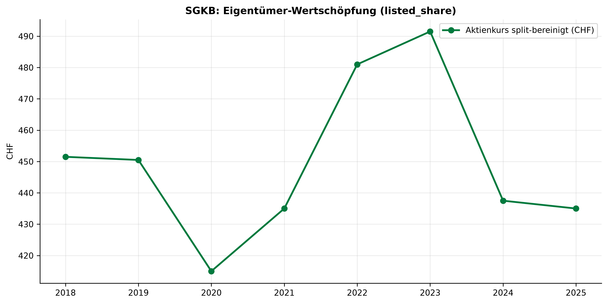

# 05 · Aktie, Dividenden & Investoren-Wertschöpfung (2018–2025): St.Galler Kantonalbank AG

> **Eigentümer-Modus:** `listed_share` | **Staatsgarantie:** Ja | **Ticker:** `SGKN`

## 1. Management Summary
- Im Geschäftsjahr 2025 erwirtschaftete SGKB einen Gewinn von **227,0 Mio. CHF** bei einem Eigenkapital von **3'118,0 Mio. CHF**.
- **Aktuelle Ausschüttung (2025):** Kurs **435.00 CHF**, Dividende **20.00 CHF** (Rendite **4,60 %**).

## 2. Quantitative Entwicklung
| Jahr | Reingewinn (Mio.) | Eigenkapital (Mio.) | Aktienkurs (split-ber.) | Dividende/Aktie | Div.-Rendite | Öff. Ablieferung (Mio.) |
| --- | --- | --- | --- | --- | --- | --- |
| 2018 | 158,6 | 2'304,4 | 451.50 | 16.00 | 3,54 % | – |
| 2019 | 163,9 | 2'551,6 | 450.50 | 16.00 | 3,55 % | – |
| 2020 | 167,2 | 2'590,8 | 415.00 | 16.00 | 3,86 % | – |
| 2021 | 181,2 | 2'684,0 | 435.00 | 17.00 | 3,91 % | – |
| 2022 | 183,8 | 2'770,9 | 481.00 | 17.00 | 3,53 % | – |
| 2023 | 207,2 | 2'902,7 | 491.50 | 19.00 | 3,87 % | – |
| 2024 | 215,1 | 3'005,9 | 437.50 | 19.00 | 4,34 % | – |
| 2025 | 227,0 | 3'118,0 | 435.00 | 20.00 | 4,60 % | – |

## 3. Treiberanalyse & Wendepunkte (Investoren-Perspektive)
- Bei kotierten Instituten mit Aktiensplits (z. B. BCV 1:10 im Jahr 2020) sind sämtliche historischen Kurs- und Dividendenreihen deterministisch split-bereinigt.
- Im Branchenvergleich (siehe `comparison/reports/06_investoren_branchenvergleich.md`) werden P/B, P/E, Dividendenrendite und Eigentümer-Ablieferungen über alle 19 Institute eingeordnet.

## 4. Fazit, Führungsleistung & Ausblick
- Stabile Ertragskraft sichert langfristig Dividendenkontinuität bzw. verlässliche Ablieferungen an Kanton, Post oder Genossenschafter.
- Die detaillierte Leistungsbilanz von CEO und Verwaltungsratspräsidium aus Investoren- und Eigentümersicht findet sich im [CEO & Chairman of the Board Achievement Report](./08_ceo_und_vrp_leistungsbericht.md).
