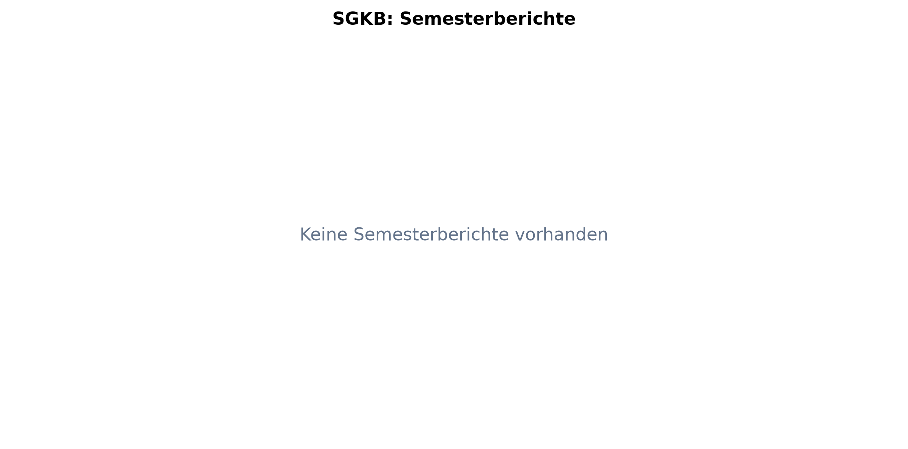

# 06 · Unterjährige Dynamik (Semesterberichte): St.Galler Kantonalbank AG

## 1. Management Summary
- Vorliegen von **3 Halbjahresabschlüssen**; jüngster Stichtag ist **H1-2026** mit einem Geschäftsertrag von **313,9 Mio. CHF** und einem Halbjahresgewinn von **– Mio. CHF**.

## 2. Quantitative Entwicklung
| Periode | Bilanzsumme | Zinserfolg H1 | Geschäftsertrag H1 | Geschäftserfolg H1 | Reingewinn H1 |
| --- | --- | --- | --- | --- | --- |
| H1-2022 | 40'411,5 | 153,5 | 253,2 | – | – |
| H1-2025 | 47'170,1 | 167,7 | 274,7 | 125,1 | – |
| H1-2026 | 49'776,5 | 190,2 | 313,9 | 147,6 | – |

## 3. Treiberanalyse & Wendepunkte
- Der Vergleich von H1-Werten gegen die jeweiligen Gesamtjahresergebnisse (FY) zeigt die saisonale Ertragsverteilung und Reservebildung im zweiten Halbjahr.

## 4. Fazit & Ausblick
- Die Halbjahresberichte ermöglichen ein zeitnahes Monitoring der Zinsmargen- und Kreditvolumen-Dynamik bis H1-2026.
