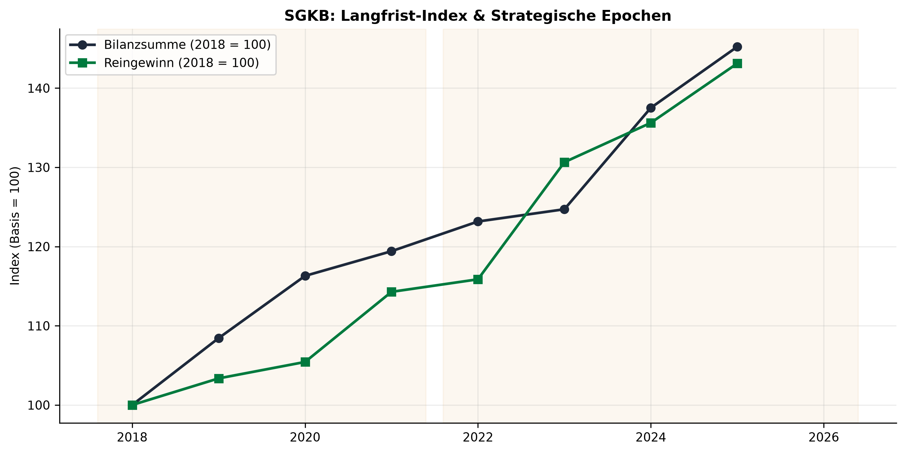
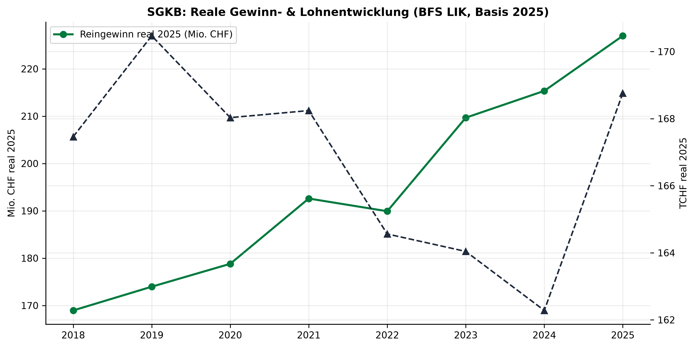

# 07 · Strategische Epochen, Governance, reale Vergütung & Vorsorge (2018–2025): St.Galler Kantonalbank AG

> **Preisbasis:** Sämtliche Realgrössen sind mit dem offiziellen **BFS Landesindex der Konsumentenpreise (LIK, Dez. 1982 = 100)** deterministisch auf **reale CHF 2025** deflationiert.

## 1. Management Summary & Strategische Epochen
- **Epoche 1 (2018–2021):** SNB-Negativzinsen & Ostschweizer Wachstum
- **Epoche 2 (2022–2026):** Zinswende, Wealth Management & Basel III final

## 2. Reale Gewinn-, Lohn- & Vergütungsentwicklung (real 2025 CHF)
| Jahr | Gewinn nom. | Gewinn real 2025 | Lohn/FTE real (TCHF) | VR real (TCHF) | CEO real (TCHF) | GL real (TCHF) |
| --- | --- | --- | --- | --- | --- | --- |
| 2018 | 158,6 | 168,9 | 167,5 | – | – | – |
| 2019 | 163,9 | 174,0 | 170,5 | – | – | – |
| 2020 | 167,2 | 178,8 | 168,0 | – | – | – |
| 2021 | 181,2 | 192,6 | 168,2 | – | – | – |
| 2022 | 183,8 | 189,9 | 164,6 | – | – | – |
| 2023 | 207,2 | 209,7 | 164,0 | – | – | – |
| 2024 | 215,1 | 215,3 | 162,3 | – | – | – |
| 2025 | 227,0 | 227,0 | 168,8 | – | – | – |

## 3. Arbeitgeber-Attraktivität & Vorsorgeeinrichtung (Pensionskasse)
- **Vorsorgeeinrichtung:** Personalvorsorgeeinrichtung der St. Galler Kantonalbank (*Beitragsprimat (Alter) / Leistungsprimat (Risiko)*, Basis: `Swiss GAAP FER 26 / ARB`)
- **Versichertenstruktur:** Aktive **–**, Rentner **–** (Verhältnis Aktive/Rentner: **–**)
- **Deckungsgrad (BVG) / Reserven:** Deckungsgrad **120,8 %**, Arbeitgeberbeitragsreserve **0,0 Mio. CHF**, Sondereinlagen **0,0 Mio. CHF**
- **CEO-zu-Mitarbeitenden-Pay-Ratio (2025):** **–×** (CEO real 2025: – TCHF vs. Ø Personalaufwand/FTE: 168,8 TCHF)
- **Quelle:** `sgkb/.md/sgkb-geschaeftsbericht-2025.md (Anhang Konzernrechnung & Stammhaus Anm. 9)` — Rechtlich selbstständige Personalvorsorgeeinrichtung; Überdeckung per 31.12.2025 CHF 154,913 Mio. (Deckungsgrad 120,8 %, Soll-Wertschwankungsreserve 117,0 %); Beiträge 2025 CHF 17,380 Mio.

## 4. Treiberanalyse, Strukturbrüche & Ausblick
- **2022:** SNB-Zinswende & Rückkehr positiver Leitzinsen
- **2025:** Inkrafttreten Basel III final per 01.01.2025
- Die gemeinsame Inflationsbereinigung auf `real 2025 CHF` ermöglicht den unverzerrten Vergleich von Produktivität, Reallöhnen, Pay Ratio und Pensionskassen-Resilienz im Branchenvergleich (`comparison/reports/07_mitarbeiter_und_vorsorge_branchenvergleich.md`).
