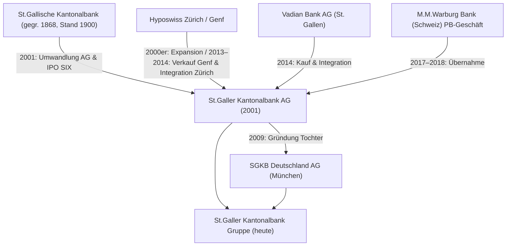

# 10 · Fusionsbaum & Institutsgeschichte seit 1900: St.Galler Kantonalbank AG

> **Gründung / Ursprung:** 1868 (St.Gallische Kantonalbank) → 2001 (Umwandlung in Aktiengesellschaft & Börsengang SIX) | **Aktuelle Rechtsform:** `listed_ag` | **FINMA-Kategorie:** 3

## 1. Überblick der Institutslinie (1900–2026)
Die 1868 gegründete St.Galler Kantonalbank wurde 2001 in eine spezialgesetzliche/privatrechtliche Aktiengesellschaft umgewandelt und an der SIX Swiss Exchange kotiert (Kanton St. Gallen hält 51,0 %). In den 2000er-Jahren expandierte sie über Hyposwiss (Zürich/Genf) und gründete 2009 die SGKB Deutschland AG. 2013–2014 fokussierte sie sich wieder auf das Kerngebiet (Verkauf Hyposwiss Genf und Übernahme/Integration der Vadian Bank AG St. Gallen) sowie 2017–2018 Übernahme von Teilen der M.M.Warburg Bank (Schweiz).

## 2. Fusionsbaum (Mermaid-Diagramm seit 1900)

## 3. Chronologische Meilensteine (Fusionen, Übernahmen & Rechtsformwechsel)
| Jahr / Zeitraum | Institut / Ereignis | Typ | Bedeutung & Auswirkung |
| --- | --- | --- | --- |
| 1868 / 1900 | St.Gallische Kantonalbank | Gründung & Ausgangslage | Staatsbank des Kantons St. Gallen seit 1868 |
| 2001 | Umwandlung in AG & Börsengang (SIX: SGKN) | Rechtsformwechsel | Teilprivatisierung unter Beibehaltung der kantonalen Mehrheit (51,0 %) und Staatsgarantie |
| 2009 | Gründung St.Galler Kantonalbank Deutschland AG | Auslandstochter | Aufbau des Private-Banking-Standorts München |
| 2013–2014 | Kauf Vadian Bank AG & Verkauf Hyposwiss Genf | Fokussierung | Stärkung im Heimmarkt St. Gallen und Rückzug aus nicht-strategischen Auslandsmärkten |
| 2017–2018 | Übernahme M.M.Warburg Bank (Schweiz) PB-Geschäft | Akquisition | Ausbau des Schweizer Private Bankings zum 150-Jahr-Jubiläum |

- **Quellenbasis:** `SGKB Geschäftsberichte (2018–2025); SGKB Chronik`
