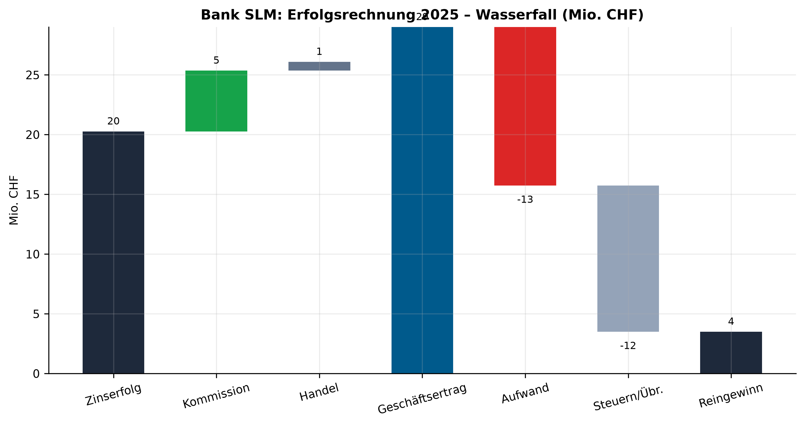
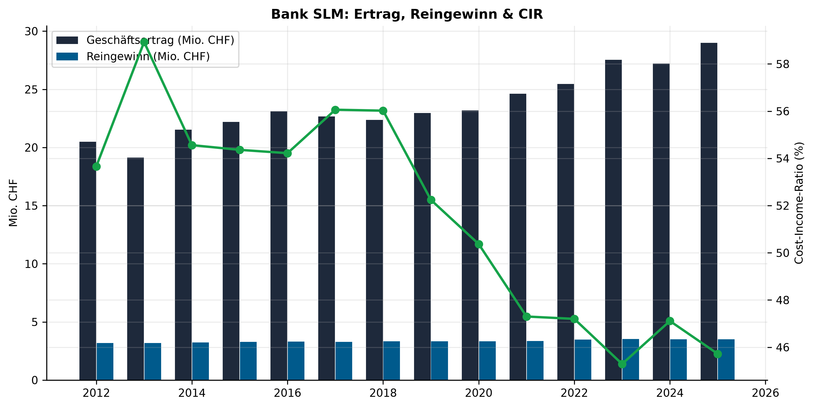

# 01 · Zinszyklen & Ertragsarchitektur (2012–2025): Bank SLM AG (Spar- und Leihkasse Münsingen)

> **Scope:** `standalone` | **Standard:** `ARB_RVB` | **Währung:** Mio. CHF (harmonisierte Zeitreihe)

## 1. Management Summary
- Im Zeitraum **2012–2025** entwickelte sich der Geschäftsertrag von **20,5 Mio. CHF** auf **29,0 Mio. CHF** (CAGR **2,71 % p. a.**).
- Der Reingewinn erreichte im jüngsten Geschäftsjahr 2025 **3,5 Mio. CHF** (nach 3,2 Mio. CHF im Jahr 2012).
- Der Netto-Zinserfolg trägt aktuell **69,9 %** zum Gesamtertrag bei, das Kommissionsgeschäft **17,6 %** und das Handelsgeschäft **2,5 %**.

## 2. Quantitative Entwicklung
| Jahr | Zinserfolg (Mio.) | Kommission (Mio.) | Handel (Mio.) | Geschäftsertrag | Geschäftserfolg | Reingewinn | Zinsanteil |
| --- | --- | --- | --- | --- | --- | --- | --- |
| 2012 | 16,3 | 2,1 | – | 20,5 | 9,5 | 3,2 | 79,5 % |
| 2013 | 16,2 | 2,9 | – | 19,1 | 9,5 | 3,2 | 84,7 % |
| 2014 | 16,5 | 2,9 | 0,7 | 21,5 | 9,8 | 3,2 | 76,5 % |
| 2015 | 17,3 | 2,8 | 0,7 | 22,2 | 9,7 | 3,3 | 77,9 % |
| 2016 | 18,1 | 2,9 | 0,7 | 23,1 | 10,1 | 3,3 | 78,3 % |
| 2017 | 17,7 | 3,0 | 0,7 | 22,7 | 9,6 | 3,3 | 78,2 % |
| 2018 | 17,7 | 3,0 | 0,7 | 22,4 | 9,8 | 3,3 | 79,2 % |
| 2019 | 17,3 | 3,2 | 0,8 | 23,0 | 7,3 | 3,3 | 75,5 % |
| 2020 | 18,0 | 3,6 | 0,6 | 23,2 | 7,8 | 3,3 | 77,8 % |
| 2021 | 18,4 | 4,2 | 0,7 | 24,6 | 10,2 | 3,4 | 74,6 % |
| 2022 | 19,3 | 4,3 | 0,7 | 25,5 | 10,7 | 3,5 | 75,7 % |
| 2023 | 21,8 | 4,2 | 0,8 | 27,5 | 12,1 | 3,5 | 79,2 % |
| 2024 | 20,5 | 4,6 | 0,8 | 27,2 | 11,7 | 3,5 | 75,5 % |
| 2025 | 20,3 | 5,1 | 0,7 | 29,0 | 12,6 | 3,5 | 69,9 % |

## 3. Treiberanalyse & Wendepunkte
- **2025:** Inkrafttreten Basel III final per 01.01.2025

## 4. Fazit & Ausblick
- Die Ertragsarchitektur von Bank SLM spiegelt die Zinszyklen (Negativzinsphase 2015–2022, Zinswende 2022–2024, Zinssenkungen ab 2025) unmittelbar wider.
