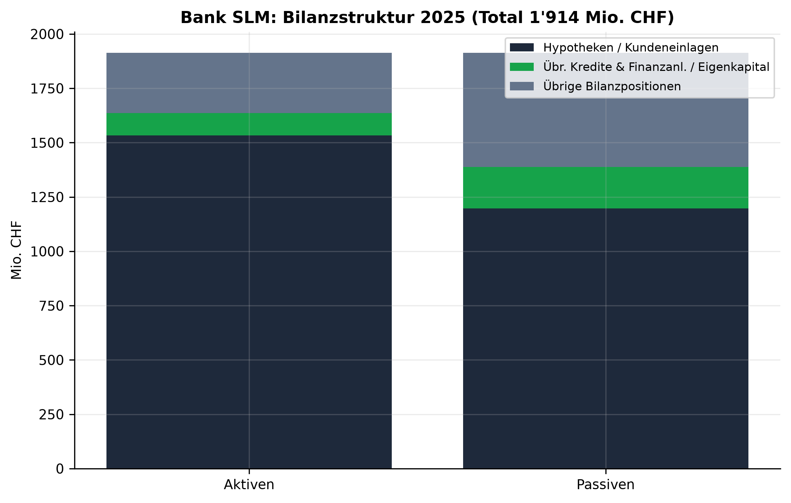
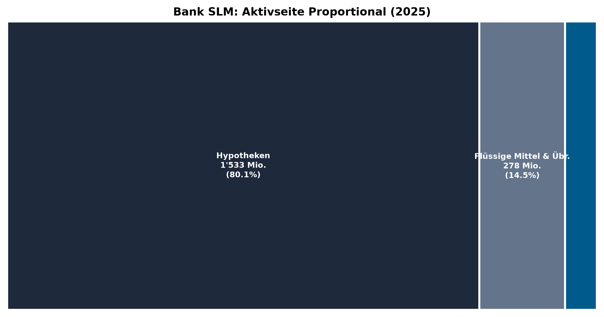
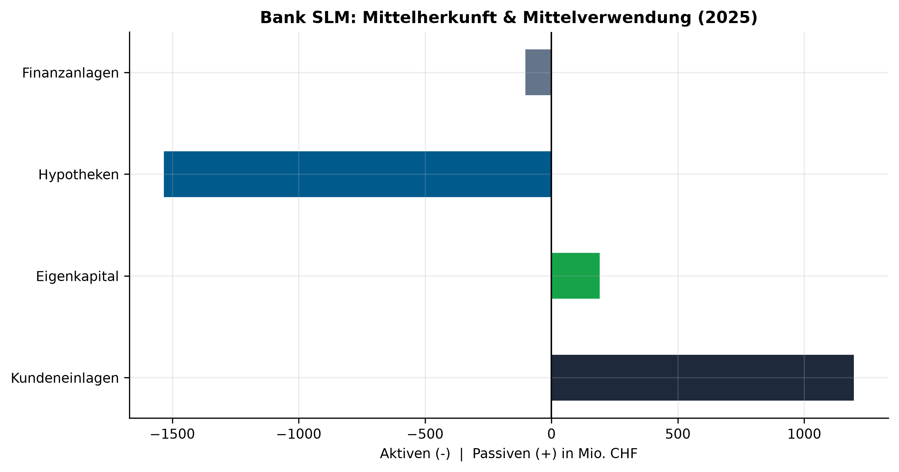
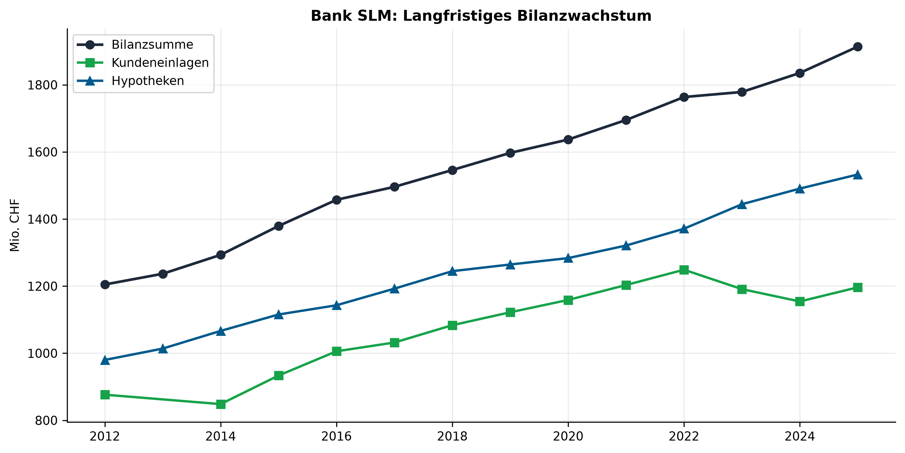

# 02 · Bilanzwachstum, Hypotheken & Refinanzierung (2012–2025): Bank SLM AG (Spar- und Leihkasse Münsingen)

## 1. Management Summary
- Die Bilanzsumme wuchs von **1'204,8 Mio. CHF** (2012) auf **1'913,9 Mio. CHF** (2025, CAGR **3,62 %**).
- Die Hypothekarforderungen machen im Jahr 2025 **80,1 %** der Bilanzsumme aus.
- Die Kundeneinlagen belaufen sich 2025 auf **1'196,4 Mio. CHF**, das Eigenkapital auf **191,3 Mio. CHF** (Eigenkapitalquote **10,00 %**).

## 2. Quantitative Entwicklung
| Jahr | Bilanzsumme | Hypotheken | Finanzanlagen | Kundeneinlagen | Eigenkapital | Deckungsgrad |
| --- | --- | --- | --- | --- | --- | --- |
| 2012 | 1'204,8 | 979,9 | – | 876,4 | 121,9 | 89,4 % |
| 2013 | 1'236,8 | 1'013,8 | – | – | – | – % |
| 2014 | 1'293,1 | 1'066,5 | 86,1 | 848,3 | – | 79,5 % |
| 2015 | 1'379,2 | 1'115,4 | 86,4 | 933,5 | – | 83,7 % |
| 2016 | 1'457,3 | 1'142,9 | 79,8 | 1'005,8 | – | 88,0 % |
| 2017 | 1'496,0 | 1'192,4 | 80,2 | 1'031,9 | – | 86,5 % |
| 2018 | 1'546,0 | 1'244,6 | 77,6 | 1'083,6 | – | 87,1 % |
| 2019 | 1'597,1 | 1'264,5 | 81,1 | 1'122,0 | 146,4 | 88,7 % |
| 2020 | 1'636,8 | 1'283,5 | 110,2 | 1'158,8 | 151,1 | 90,3 % |
| 2021 | 1'695,2 | 1'321,0 | 113,3 | 1'203,3 | 157,7 | 91,1 % |
| 2022 | 1'763,6 | 1'371,1 | 127,3 | 1'248,8 | 164,6 | 91,1 % |
| 2023 | 1'778,7 | 1'444,1 | 140,5 | 1'191,0 | 172,8 | 82,5 % |
| 2024 | 1'835,3 | 1'490,7 | 109,7 | 1'154,3 | 181,9 | 77,4 % |
| 2025 | 1'913,9 | 1'532,7 | 102,9 | 1'196,4 | 191,3 | 78,0 % |

## 3. Treiberanalyse & Wendepunkte
- **2025:** Inkrafttreten Basel III final per 01.01.2025

## 4. Fazit & Ausblick
- Refinanzierungsbasis und Bilanzstruktur bleiben eng an Kundeneinlagen und die jeweilige Geschäftsmodell-Spezialisierung gekoppelt.
