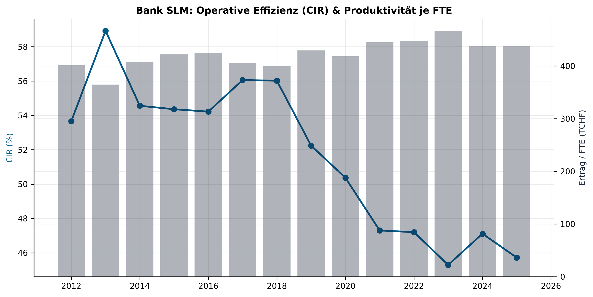

# 04 · Operative Effizienz & Transformation (2012–2025): Bank SLM AG (Spar- und Leihkasse Münsingen)

## 1. Management Summary
- Die Cost-Income-Ratio (CIR) liegt im Jahr 2025 bei **45,72 %** (vs. 53,66 % im Jahr 2012), die Eigenkapitalrendite (ROE) bei **1,83 %**.
- Der Personalbestand umfasst 2025 **66,1 FTE** bei einem Ertrag pro Vollzeitstelle von **438,8 TCHF** und einem **Lohnkosten-/Produktivitätsverhältnis von 28,1 %** (bzw. **3,56×** Ertrag je CHF Personalaufwand).
- **Personalfluktuation:** Im Geschäftsbericht wird keine quantitative Personalfluktuationsquote ausgewiesen.

## 2. Quantitative Entwicklung
| Jahr | CIR % | ROE % | FTE | Fluktuation % | Ertrag/FTE (TCHF) | Lohn/FTE (TCHF) | Lohn/Ertrag % | Ertrag/Lohn | Bilanz/FTE (Mio.) |
| --- | --- | --- | --- | --- | --- | --- | --- | --- | --- |
| 2012 | 53,66 % | 2,62 % | 51,1 | – | 401,2 | 113,5 | 28,3 % | 3,53× | 23,58 |
| 2013 | 58,93 % | – % | 52,5 | – | 364,6 | – | – % | –× | 23,56 |
| 2014 | 54,56 % | – % | 52,8 | – | 408,0 | 123,3 | 30,2 % | 3,31× | 24,49 |
| 2015 | 54,36 % | – % | 52,6 | – | 422,1 | – | – % | –× | 26,22 |
| 2016 | 54,22 % | – % | 54,4 | – | 424,9 | – | – % | –× | 26,79 |
| 2017 | 56,06 % | – % | 55,9 | – | 405,5 | 125,3 | 30,9 % | 3,24× | 26,76 |
| 2018 | 56,02 % | – % | 56,0 | – | 399,4 | 129,0 | 32,3 % | 3,10× | 27,61 |
| 2019 | 52,24 % | 2,28 % | 53,5 | – | 429,4 | 136,4 | 31,8 % | 3,15× | 29,85 |
| 2020 | 50,37 % | 2,21 % | 55,4 | – | 418,6 | 128,3 | 30,6 % | 3,26× | 29,55 |
| 2021 | 47,30 % | 2,13 % | 55,3 | – | 445,0 | 129,1 | 29,0 % | 3,45× | 30,65 |
| 2022 | 47,20 % | 2,12 % | 56,8 | – | 448,2 | 129,3 | 28,9 % | 3,47× | 31,05 |
| 2023 | 45,29 % | 2,04 % | 59,1 | – | 465,9 | 127,1 | 27,3 % | 3,66× | 30,10 |
| 2024 | 47,11 % | 1,92 % | 62,0 | – | 438,8 | 124,4 | 28,3 % | 3,53× | 29,60 |
| 2025 | 45,72 % | 1,83 % | 66,1 | – | 438,8 | 123,3 | 28,1 % | 3,56× | 28,95 |

## 3. Treiberanalyse & Wendepunkte
- **2025:** Inkrafttreten Basel III final per 01.01.2025

## 4. Fazit & Ausblick
- Digitalisierung und Skalierung steigern Bilanzsumme und Geschäftsvolumen pro Vollzeitstelle langfristig.
