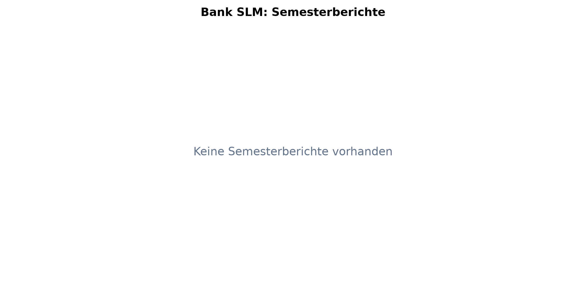

# 06 · Unterjährige Dynamik (Semesterberichte): Bank SLM AG (Spar- und Leihkasse Münsingen)

## 1. Management Summary
- Vorliegen von **4 Halbjahresabschlüssen**; jüngster Stichtag ist **H1-2025** mit einem Geschäftsertrag von **14,3 Mio. CHF** und einem Halbjahresgewinn von **– Mio. CHF**.

## 2. Quantitative Entwicklung
| Periode | Bilanzsumme | Zinserfolg H1 | Geschäftsertrag H1 | Geschäftserfolg H1 | Reingewinn H1 |
| --- | --- | --- | --- | --- | --- |
| H1-2021 | 1'674,0 | 9,2 | 12,4 | 5,5 | – |
| H1-2022 | 1'702,4 | 9,3 | 12,3 | 5,1 | – |
| H1-2024 | 1'818,5 | 10,1 | 13,6 | 5,8 | – |
| H1-2025 | 1'884,3 | 10,2 | 14,3 | 6,2 | – |

## 3. Treiberanalyse & Wendepunkte
- Der Vergleich von H1-Werten gegen die jeweiligen Gesamtjahresergebnisse (FY) zeigt die saisonale Ertragsverteilung und Reservebildung im zweiten Halbjahr.

## 4. Fazit & Ausblick
- Die Halbjahresberichte ermöglichen ein zeitnahes Monitoring der Zinsmargen- und Kreditvolumen-Dynamik bis H1-2026.
