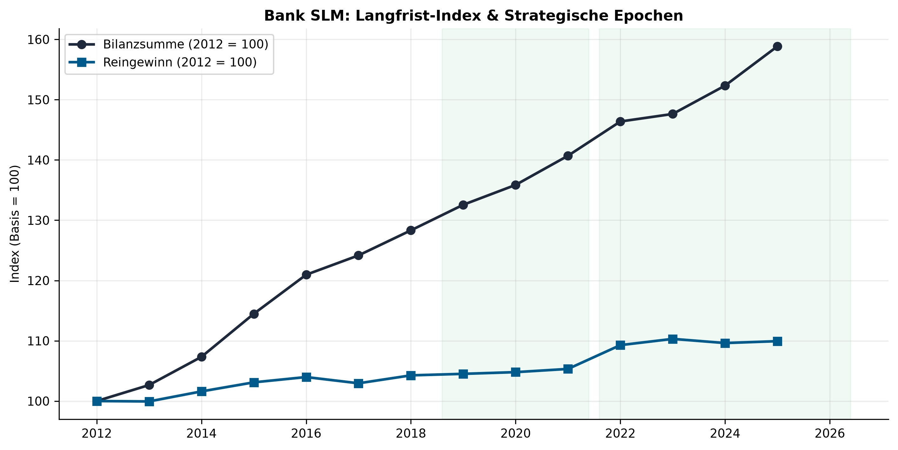
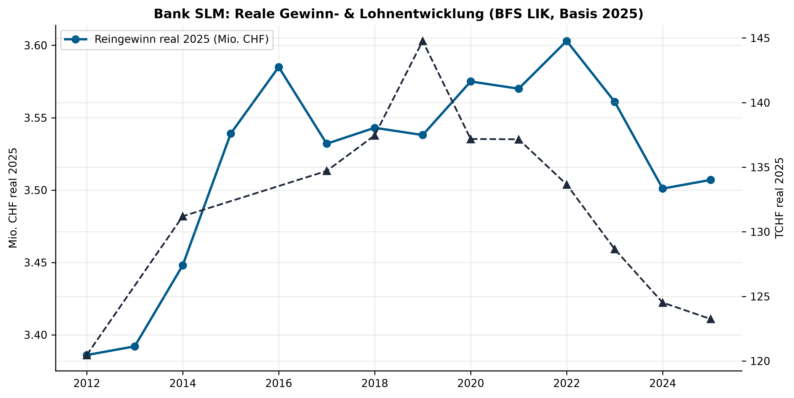

# 07 · Strategische Epochen, Governance, reale Vergütung & Vorsorge (2012–2025): Bank SLM AG (Spar- und Leihkasse Münsingen)

> **Preisbasis:** Sämtliche Realgrössen sind mit dem offiziellen **BFS Landesindex der Konsumentenpreise (LIK, Dez. 1982 = 100)** deterministisch auf **reale CHF 2025** deflationiert.

## 1. Management Summary & Strategische Epochen
- **Epoche 1 (2019–2021):** SNB-Negativzinsen & Aaretaler Regionalgeschäft
- **Epoche 2 (2022–2026):** Zinswende & Basel III final

## 2. Reale Gewinn-, Lohn- & Vergütungsentwicklung (real 2025 CHF)
| Jahr | Gewinn nom. | Gewinn real 2025 | Lohn/FTE real (TCHF) | VR real (TCHF) | CEO real (TCHF) | GL real (TCHF) |
| --- | --- | --- | --- | --- | --- | --- |
| 2012 | 3,2 | 3,4 | 120,5 | – | – | – |
| 2013 | 3,2 | 3,4 | – | – | – | – |
| 2014 | 3,2 | 3,4 | 131,2 | – | – | – |
| 2015 | 3,3 | 3,5 | – | – | – | – |
| 2016 | 3,3 | 3,6 | – | – | – | – |
| 2017 | 3,3 | 3,5 | 134,7 | – | – | – |
| 2018 | 3,3 | 3,5 | 137,5 | – | – | – |
| 2019 | 3,3 | 3,5 | 144,8 | – | – | – |
| 2020 | 3,3 | 3,6 | 137,2 | – | – | – |
| 2021 | 3,4 | 3,6 | 137,2 | – | – | – |
| 2022 | 3,5 | 3,6 | 133,7 | – | – | – |
| 2023 | 3,5 | 3,6 | 128,7 | – | – | – |
| 2024 | 3,5 | 3,5 | 124,5 | – | – | – |
| 2025 | 3,5 | 3,5 | 123,2 | – | – | – |

## 3. Arbeitgeber-Attraktivität & Vorsorgeeinrichtung (Pensionskasse)
- **Vorsorgeeinrichtung:** Stiftung «Vorsorge FinTec» (*Beitragsprimat (beitragsorientiert)*, Basis: `Swiss GAAP FER 26 / ARB`)
- **Versichertenstruktur:** Aktive **–**, Rentner **–** (Verhältnis Aktive/Rentner: **–**)
- **Deckungsgrad (BVG) / Reserven:** Deckungsgrad **122,3 %**, Arbeitgeberbeitragsreserve **0,2 Mio. CHF**, Sondereinlagen **0,0 Mio. CHF**
- **CEO-zu-Mitarbeitenden-Pay-Ratio (2025):** **–×** (CEO real 2025: – TCHF vs. Ø Personalaufwand/FTE: 123,2 TCHF)
- **Quelle:** `slm/.md/slm-geschaeftsbericht-2025.md (Anhang Vorsorgeeinrichtungen)` — Deckungsgrad Ende 2024 122,30 % (provisorisch Sept. 2025: ~124,30 %); AGBR CHF 171'726 (nicht aktiviert); Vorsorgeaufwand im Personalaufwand 2025 CHF 0,643 Mio. (2024: 0,627 Mio.).

## 4. Treiberanalyse, Strukturbrüche & Ausblick
- **2025:** Inkrafttreten Basel III final per 01.01.2025
- Die gemeinsame Inflationsbereinigung auf `real 2025 CHF` ermöglicht den unverzerrten Vergleich von Produktivität, Reallöhnen, Pay Ratio und Pensionskassen-Resilienz im Branchenvergleich (`comparison/reports/07_mitarbeiter_und_vorsorge_branchenvergleich.md`).
