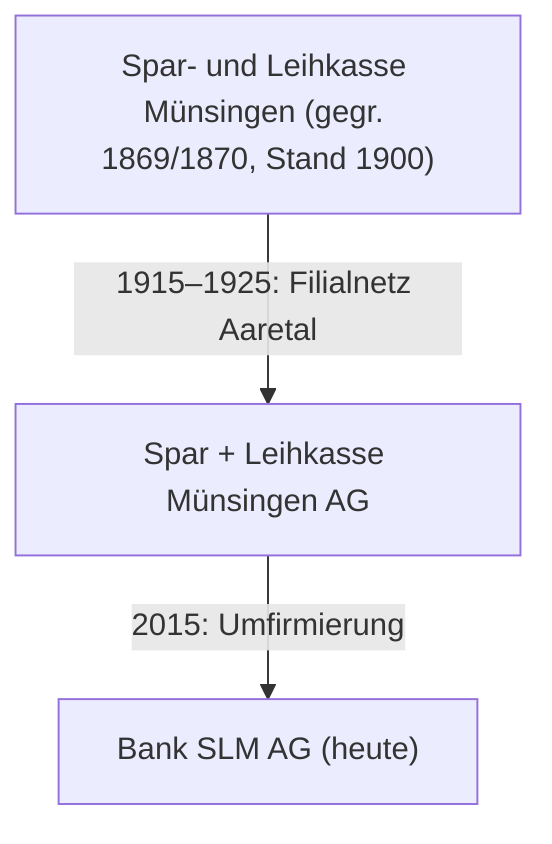

# 10 · Fusionsbaum & Institutsgeschichte seit 1900: Bank SLM AG (Spar- und Leihkasse Münsingen)

> **Gründung / Ursprung:** 1869/1870 (Spar- und Leihkasse Münsingen → 2015 Bank SLM AG) | **Aktuelle Rechtsform:** `ag_unlisted` | **FINMA-Kategorie:** 5

## 1. Überblick der Institutslinie (1900–2026)
Die Bank SLM AG wurde im November 1869 gegründet und eröffnete am 1. April 1870 als Spar- und Leihkasse Münsingen ihren ersten Schalter. Seit 1900 entwickelte sich das Institut eigenständig ohne Grossfusionen im Aaretal (Einnehmereien ab 1915 in Kiesen, Wichtrach, Rubigen und Worb) und firmierte Anfang 2015 von Spar + Leihkasse Münsingen AG in Bank SLM AG um.

## 2. Fusionsbaum (Mermaid-Diagramm seit 1900)

## 3. Chronologische Meilensteine (Fusionen, Übernahmen & Rechtsformwechsel)
| Jahr / Zeitraum | Institut / Ereignis | Typ | Bedeutung & Auswirkung |
| --- | --- | --- | --- |
| 1869–1870 / 1900 | Spar- und Leihkasse Münsingen | Ausgangslage 1900 | Gegründet von 17 Handwerkern, Gewerbetreibenden und Bauern im Aaretal |
| 1915–1925 | Eröffnung der Geschäftsstellen im Aaretal | Expansion | Einnehmereien in Kiesen, Wichtrach, Kirchdorf, Rubigen und Worb (1925) |
| 2015 | Umfirmierung in Bank SLM AG | Rebranding | Moderner Markenauftritt unter Beibehaltung der regionalen Eigenständigkeit |

- **Quellenbasis:** `Bank SLM 150-Jahre-Chronik (bankslm.ch); Geschäftsberichte (2012–2025)`
