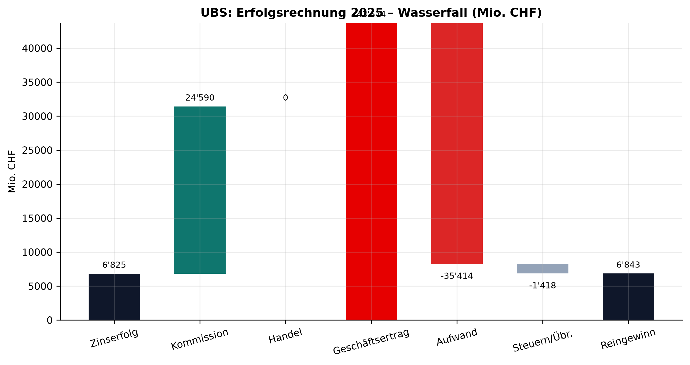
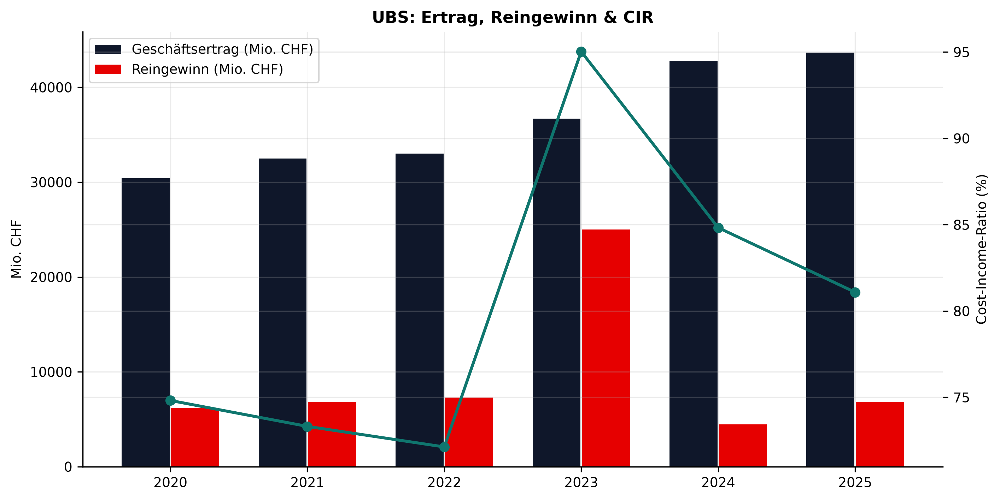

# 01 · Zinszyklen & Ertragsarchitektur (2020–2025): UBS Group AG

> **Scope:** `consolidated` | **Standard:** `IFRS` | **Währung:** Mio. CHF (harmonisierte Zeitreihe)

## 1. Management Summary
- Im Zeitraum **2020–2025** entwickelte sich der Geschäftsertrag von **30'411,0 Mio. CHF** auf **43'673,8 Mio. CHF** (CAGR **7,51 % p. a.**).
- Der Reingewinn erreichte im jüngsten Geschäftsjahr 2025 **6'842,7 Mio. CHF** (nach 6'156,4 Mio. CHF im Jahr 2020).
- Der Netto-Zinserfolg trägt aktuell **15,6 %** zum Gesamtertrag bei, das Kommissionsgeschäft **56,3 %** und das Handelsgeschäft **– %**.

## 2. Quantitative Entwicklung
| Jahr | Zinserfolg (Mio.) | Kommission (Mio.) | Handel (Mio.) | Geschäftsertrag | Geschäftserfolg | Reingewinn | Zinsanteil |
| --- | --- | --- | --- | --- | --- | --- | --- |
| 2020 | – | – | – | 30'411,0 | – | 6'156,4 | – % |
| 2021 | – | – | – | 32'496,1 | – | 6'817,9 | – % |
| 2022 | – | – | – | 32'997,3 | – | 7'284,4 | – % |
| 2023 | – | – | – | 36'693,4 | – | 25'025,1 | – % |
| 2024 | 6'258,6 | 23'014,5 | – | 42'802,0 | – | 4'477,3 | 14,6 % |
| 2025 | 6'825,1 | 24'590,5 | – | 43'673,8 | – | 6'842,7 | 15,6 % |

## 3. Treiberanalyse & Wendepunkte
- **2023:** Akquisition Credit Suisse (Negative Goodwill USD 27,7 Mrd. als Einmaleffekt)
- **2025:** Basel III final & G-SIB-Kapitalanforderungen

## 4. Fazit & Ausblick
- Die Ertragsarchitektur von UBS spiegelt die Zinszyklen (Negativzinsphase 2015–2022, Zinswende 2022–2024, Zinssenkungen ab 2025) unmittelbar wider.
