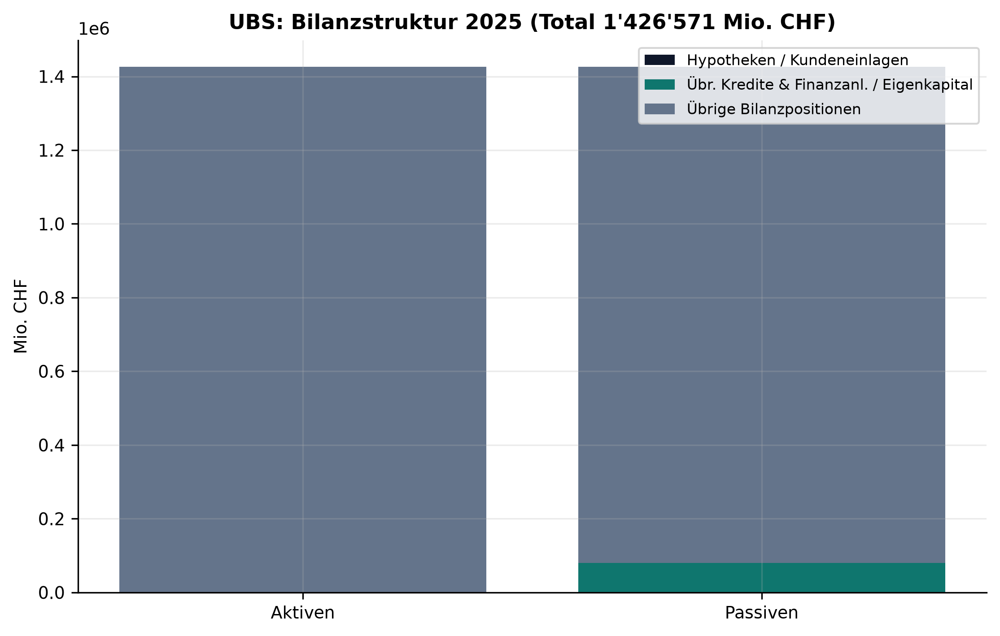
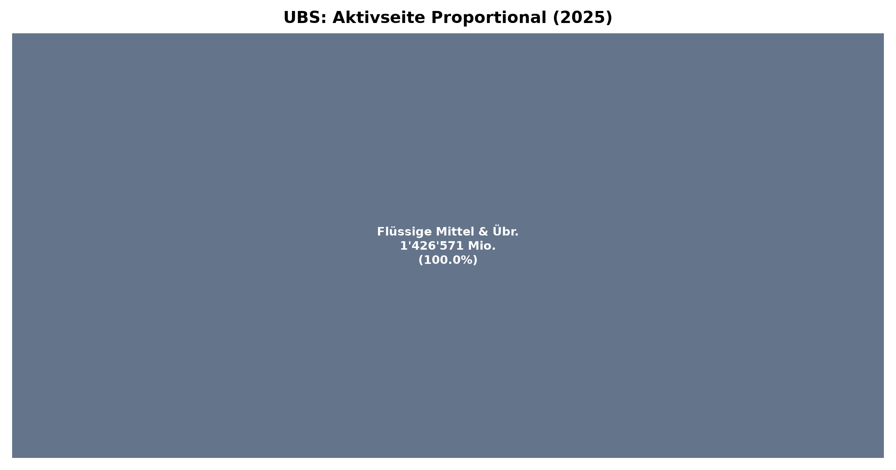
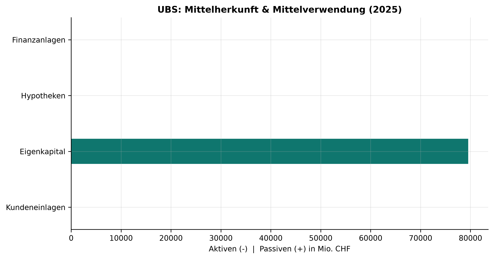
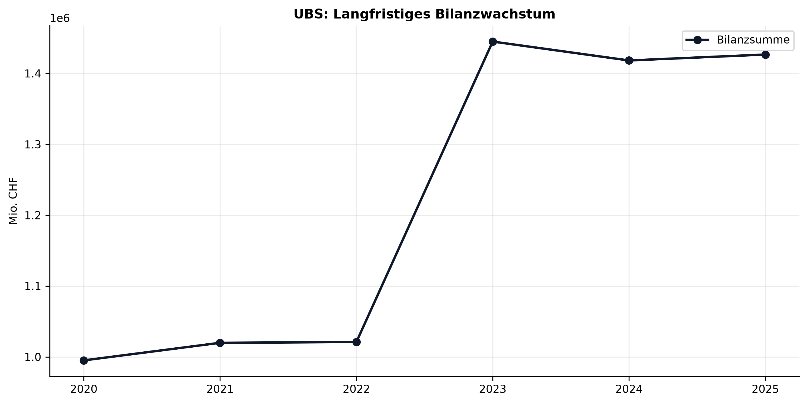

# 02 · Bilanzwachstum, Hypotheken & Refinanzierung (2020–2025): UBS Group AG

## 1. Management Summary
- Die Bilanzsumme wuchs von **995'063,7 Mio. CHF** (2020) auf **1'426'570,6 Mio. CHF** (2025, CAGR **7,47 %**).
- Die Hypothekarforderungen machen im Jahr 2025 **– %** der Bilanzsumme aus.
- Die Kundeneinlagen belaufen sich 2025 auf **– Mio. CHF**, das Eigenkapital auf **79'567,9 Mio. CHF** (Eigenkapitalquote **5,58 %**).

## 2. Quantitative Entwicklung
| Jahr | Bilanzsumme | Hypotheken | Finanzanlagen | Kundeneinlagen | Eigenkapital | Deckungsgrad |
| --- | --- | --- | --- | --- | --- | --- |
| 2020 | 995'063,7 | – | – | – | 52'543,4 | – % |
| 2021 | 1'019'875,4 | – | – | – | 55'378,3 | – % |
| 2022 | 1'020'984,5 | – | – | – | 52'581,9 | – % |
| 2023 | 1'444'890,8 | – | – | – | 72'451,3 | – % |
| 2024 | 1'418'228,4 | – | – | – | 77'098,6 | – % |
| 2025 | 1'426'570,6 | – | – | – | 79'567,9 | – % |

## 3. Treiberanalyse & Wendepunkte
- **2023:** Akquisition Credit Suisse (Negative Goodwill USD 27,7 Mrd. als Einmaleffekt)
- **2025:** Basel III final & G-SIB-Kapitalanforderungen

## 4. Fazit & Ausblick
- Refinanzierungsbasis und Bilanzstruktur bleiben eng an Kundeneinlagen und die jeweilige Geschäftsmodell-Spezialisierung gekoppelt.
