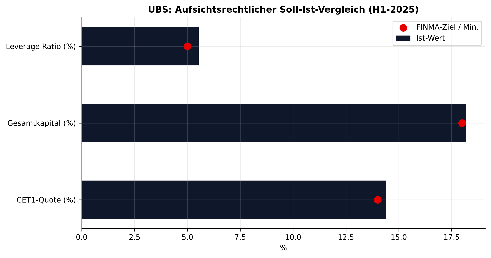
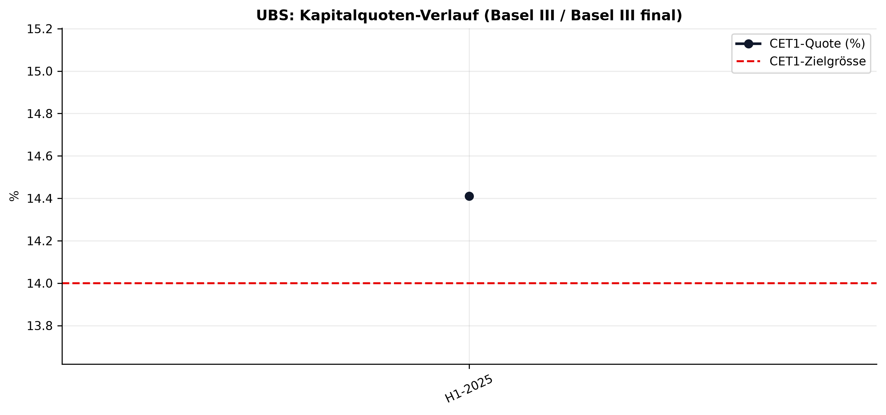

# 03 · Aufsichtsrechtliche Resilienz & Basel III: UBS Group AG

> **FINMA-Kategorie:** Kategorie 1 | **CET1-Zielgrösse:** 14,00 % | **Gesamtkapital-Ziel:** 18,00 %

## 1. Management Summary
- Am jüngsten Offenlegungsstichtag (**H1-2025**, Regime: *Basel III final*) beträgt die **CET1-Quote 14,41 %** (Puffer über Ziel: **0,41 Prozentpunkte**).
- Die Gesamtkapitalquote liegt bei **18,18 %**, die Leverage Ratio bei **5,53 %**.
- Liquiditätsquoten: LCR **182,3 %**, NSFR **122,4 %** (Mindestanforderung je 100 %).

## 2. Quantitative Entwicklung (4 Stichtage)
| Periode | Regime | RWA (Mio.) | CET1 (Mio.) | CET1 % | Gesamtkap. % | Leverage % | LCR % | NSFR % |
| --- | --- | --- | --- | --- | --- | --- | --- | --- |
| H1-2023 | Basel III | 468'325,8 | 67'529,1 | – % | 16,76 % | 5,56 % | 175,2 % | 117,6 % |
| FY2023 | Basel III | 459'829,3 | 66'037,3 | – % | 16,90 % | 5,45 % | – % | – % |
| FY2024 | Basel III | 451'775,1 | 64'672,8 | – % | 17,60 % | 5,77 % | – % | – % |
| H1-2025 | Basel III final | 444'969,0 | 64'129,3 | 14,41 % | 18,18 % | 5,53 % | 182,3 % | 122,4 % |

## 3. Treiberanalyse & Wendepunkte
- Mit Inkrafttreten von **Basel III final** ab 01.01.2025 verändern sich risikogewichtete Aktiven (RWA) und RWA-Dichte durch angepasste Standard- bzw. Output-Floor-Vorgaben.

## 4. Fazit & Ausblick
- Die Eigenmittel- und Liquiditätspuffer übertreffen die regulatorischen Mindestanforderungen für FINMA-Kategorie 1 deutlich.
