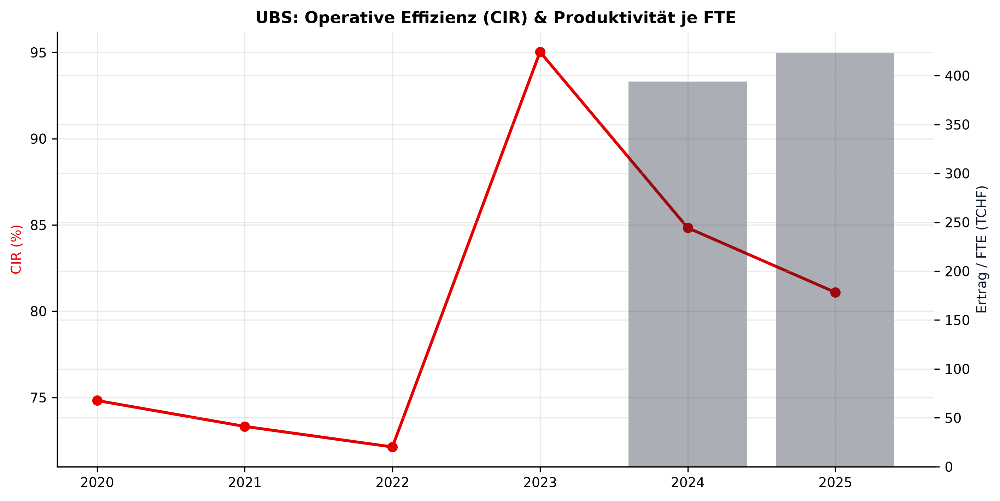

# 04 · Operative Effizienz & Transformation (2020–2025): UBS Group AG

## 1. Management Summary
- Die Cost-Income-Ratio (CIR) liegt im Jahr 2025 bei **81,09 %** (vs. 74,82 % im Jahr 2020), die Eigenkapitalrendite (ROE) bei **8,60 %**.
- Der Personalbestand umfasst 2025 **103'177,0 FTE** bei einem Ertrag pro Vollzeitstelle von **423,3 TCHF** und einem **Lohnkosten-/Produktivitätsverhältnis von 56,2 %** (bzw. **1,78×** Ertrag je CHF Personalaufwand).
- **Personalfluktuation:** Jüngster offengelegter Wert liegt im Jahr **2025** bei **7,1 %** (*Voluntary employee turnover rate in % (UBS Group; Gesamtfluktuation inkl. unfreiwilliger & neutraler Austritte in `gross`)*).

## 2. Quantitative Entwicklung
| Jahr | CIR % | ROE % | FTE | Fluktuation % | Ertrag/FTE (TCHF) | Lohn/FTE (TCHF) | Lohn/Ertrag % | Ertrag/Lohn | Bilanz/FTE (Mio.) |
| --- | --- | --- | --- | --- | --- | --- | --- | --- | --- |
| 2020 | 74,82 % | 11,72 % | – | – | – | – | – % | –× | – |
| 2021 | 73,32 % | 12,31 % | – | – | – | – | – % | –× | – |
| 2022 | 72,13 % | 13,85 % | – | 12,6 % | – | – | – % | –× | – |
| 2023 | 95,03 % | 34,54 % | – | 12,4 % | – | – | – % | –× | – |
| 2024 | 84,83 % | 5,81 % | 108'648,0 | 7,9 % | 394,0 | – | – % | –× | 13,05 |
| 2025 | 81,09 % | 8,60 % | 103'177,0 | 7,1 % | 423,3 | 237,9 | 56,2 % | 1,78× | 13,83 |

## 3. Treiberanalyse & Wendepunkte
- **2023:** Akquisition Credit Suisse (Negative Goodwill USD 27,7 Mrd. als Einmaleffekt)
- **2025:** Basel III final & G-SIB-Kapitalanforderungen

## 4. Fazit & Ausblick
- Digitalisierung und Skalierung steigern Bilanzsumme und Geschäftsvolumen pro Vollzeitstelle langfristig.
