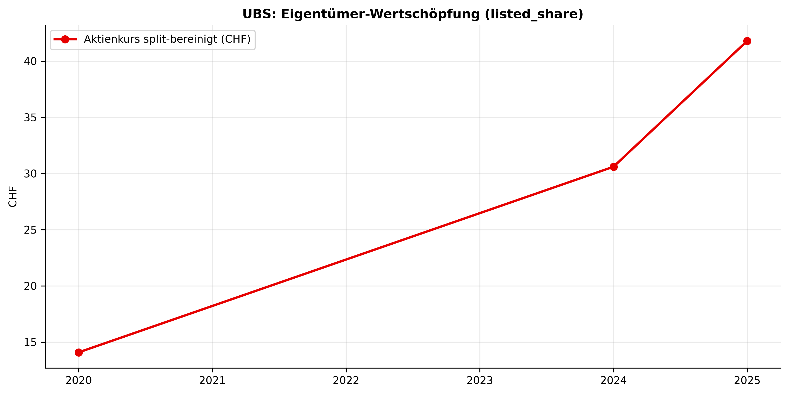

# 05 · Aktie, Dividenden & Investoren-Wertschöpfung (2020–2025): UBS Group AG

> **Eigentümer-Modus:** `listed_share` | **Staatsgarantie:** Keine | **Ticker:** `UBSG`

## 1. Management Summary
- Im Geschäftsjahr 2025 erwirtschaftete UBS einen Gewinn von **6'842,7 Mio. CHF** bei einem Eigenkapital von **79'567,9 Mio. CHF**.
- **Aktuelle Ausschüttung (2025):** Kurs **41.80 CHF**, Dividende **0.90 CHF** (Rendite **2,15 %**).

## 2. Quantitative Entwicklung
| Jahr | Reingewinn (Mio.) | Eigenkapital (Mio.) | Aktienkurs (split-ber.) | Dividende/Aktie | Div.-Rendite | Öff. Ablieferung (Mio.) |
| --- | --- | --- | --- | --- | --- | --- |
| 2020 | 6'156,4 | 52'543,4 | 14.08 | – | – % | – |
| 2021 | 6'817,9 | 55'378,3 | – | – | – % | – |
| 2022 | 7'284,4 | 52'581,9 | – | – | – % | – |
| 2023 | 25'025,1 | 72'451,3 | – | – | – % | – |
| 2024 | 4'477,3 | 77'098,6 | 30.60 | 0.90 | 2,94 % | – |
| 2025 | 6'842,7 | 79'567,9 | 41.80 | 0.90 | 2,15 % | – |

## 3. Treiberanalyse & Wendepunkte (Investoren-Perspektive)
- Bei kotierten Instituten mit Aktiensplits (z. B. BCV 1:10 im Jahr 2020) sind sämtliche historischen Kurs- und Dividendenreihen deterministisch split-bereinigt.
- Im Branchenvergleich (siehe `comparison/reports/06_investoren_branchenvergleich.md`) werden P/B, P/E, Dividendenrendite und Eigentümer-Ablieferungen über alle 19 Institute eingeordnet.

## 4. Fazit, Führungsleistung & Ausblick
- Stabile Ertragskraft sichert langfristig Dividendenkontinuität bzw. verlässliche Ablieferungen an Kanton, Post oder Genossenschafter.
- Die detaillierte Leistungsbilanz von CEO und Verwaltungsratspräsidium aus Investoren- und Eigentümersicht findet sich im [CEO & Chairman of the Board Achievement Report](./08_ceo_und_vrp_leistungsbericht.md).
