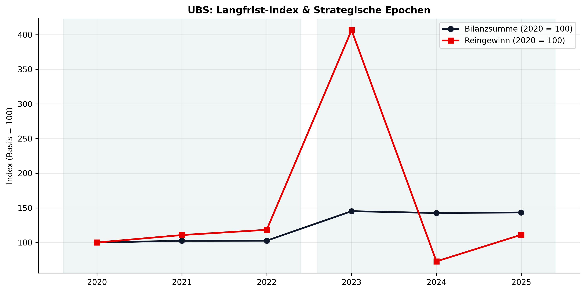
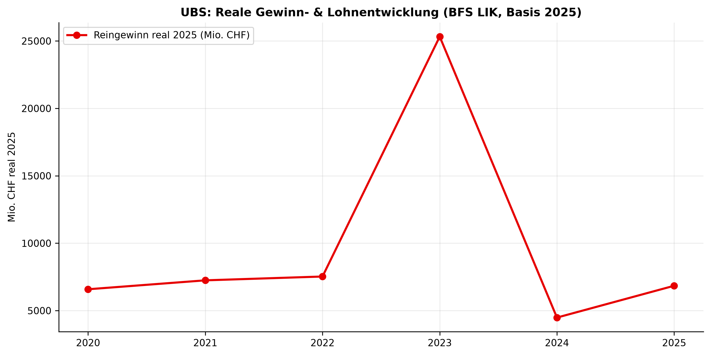

# 07 · Strategische Epochen, Governance, reale Vergütung & Vorsorge (2020–2025): UBS Group AG

> **Preisbasis:** Sämtliche Realgrössen sind mit dem offiziellen **BFS Landesindex der Konsumentenpreise (LIK, Dez. 1982 = 100)** deterministisch auf **reale CHF 2025** deflationiert.

## 1. Management Summary & Strategische Epochen
- **Epoche 1 (2020–2022):** Globale Wealth-Management-Konsolidierung
- **Epoche 2 (2023–2025):** Credit-Suisse-Übernahme, Integration & Basel III final

## 2. Reale Gewinn-, Lohn- & Vergütungsentwicklung (real 2025 CHF)
| Jahr | Gewinn nom. | Gewinn real 2025 | Lohn/FTE real (TCHF) | Fluktuation % | VR real (TCHF) | CEO real (TCHF) | GL real (TCHF) |
| --- | --- | --- | --- | --- | --- | --- | --- |
| 2020 | 6'156,4 | 6'583,1 | – | – | – | – | – |
| 2021 | 6'817,9 | 7'244,9 | – | – | – | – | – |
| 2022 | 7'284,4 | 7'528,4 | – | 12,6 % | – | – | – |
| 2023 | 25'025,1 | 25'323,6 | – | 12,4 % | – | – | – |
| 2024 | 4'477,3 | 4'482,6 | – | 7,9 % | – | – | – |
| 2025 | 6'842,7 | 6'842,7 | 237,9 | 7,1 % | 14'800,0 | 14'900,0 | 143'500,0 |

## 3. Arbeitgeber-Attraktivität, Personalfluktuation & Vorsorgeeinrichtung (Pensionskasse)
- **Vorsorgeeinrichtung:** Pensionskasse der UBS (+ Credit Suisse Swiss Plan) (*Beitragsprimat (IAS 19: Defined Benefit)*, Basis: `IFRS / IAS 19 (vs. BVV 2 lokal)`)
- **Versichertenstruktur:** Aktive **–**, Rentner **–** (Verhältnis Aktive/Rentner: **–**)
- **Deckungsgrad (BVG) / Reserven:** Deckungsgrad **– %**, Arbeitgeberbeitragsreserve **– Mio. CHF**, Sondereinlagen **0,0 Mio. CHF**
- **CEO-zu-Mitarbeitenden-Pay-Ratio (2025):** **62,6×** (CEO real 2025: 14'900,0 TCHF vs. Ø Personalaufwand/FTE: 237,9 TCHF)
- **Quelle Vorsorge:** `ubs/.md/ubs-geschaeftsbericht-2025.md (Note 25 Post-employment benefit plans, S. 339)` — Konzernrechnung weist Schweizer Pläne (UBS Swiss Plan & CS Swiss Plan, Zusammenführung per 01.01.2027) nach IAS 19 aus (Note 25); BVG-Deckungsgrad gemäss Art. 44 BVV 2 im IFRS-Abschluss nicht separat ausgewiesen.
- **Personalfluktuation (4 Berichtsjahre, 2022–2025):** **2022:** 12,6 % (Netto 12,6 % / Brutto 15,9 %), **2023:** 12,4 % (Netto 12,4 % / Brutto 18,6 %), **2024:** 7,9 % (Netto 7,9 % / Brutto 12,8 %), **2025:** 7,1 % (Netto 7,1 % / Brutto 12,6 %)
- **Methodik & Quelle Fluktuation:** Voluntary employee turnover rate in % (UBS Group; Gesamtfluktuation inkl. unfreiwilliger & neutraler Austritte in `gross`) (`UBS Group Sustainability Report Supplement 2024 (p. 32) & 2025 (GRI 401-1: Voluntary and involuntary employee turnover)`)

## 4. Treiberanalyse, Strukturbrüche & Ausblick
- **2023:** Akquisition Credit Suisse (Negative Goodwill USD 27,7 Mrd. als Einmaleffekt)
- **2025:** Basel III final & G-SIB-Kapitalanforderungen
- Die gemeinsame Inflationsbereinigung auf `real 2025 CHF` ermöglicht den unverzerrten Vergleich von Produktivität, Reallöhnen, Personalfluktuation, Pay Ratio und Pensionskassen-Resilienz im Branchenvergleich (`comparison/reports/07_mitarbeiter_und_vorsorge_branchenvergleich.md`).
