# 10 · Fusionsbaum & Institutsgeschichte seit 1900: UBS Group AG

> **Gründung / Ursprung:** 1856 (SKA) / 1862 (Bank in Winterthur) / 1872 (Basler Bankverein) → 1998 (UBS) → 2023 (+ CS) | **Aktuelle Rechtsform:** `listed_ag` | **FINMA-Kategorie:** 1

## 1. Überblick der Institutslinie (1900–2026)
Die heutige UBS Group AG vereint die gesamte moderne Schweizer Grossbankengeschichte in drei historischen Hauptsträngen: (1) Die SBG-Linie, entstanden 1912 aus der Fusion der Bank in Winterthur (1862) und der Toggenburger Bank (1863), erweitert u. a. um die Eidgenössische Bank (1945), Interhandel (1967) und die kriselnde Appenzell-Ausserrhodische Kantonalbank (1996). (2) Die SBV-Linie (Schweizerischer Bankverein), gegründet 1872/1897 aus Basler und Zürcher Vorgängern, gewachsen durch die Basler Handelsbank (1945) sowie internationale Investmentbanken wie O'Connor (1992), Brinson (1994), S.G. Warburg (1995) und Dillon Read (1997). (3) Die Credit Suisse-Linie (1856 als Schweizerische Kreditanstalt SKA gegründet), die 1990 Bank Leu (gegr. 1755), 1993 die kriselnde Schweizerische Volksbank (SVB), 1994 die Neue Aargauer Bank (NAB, Wurzeln bis 1812), 1988/90 First Boston und 2000 DLJ integrierte. 1998 fusionierten SBG und SBV zur UBS AG (unter WEKO-Auflage des Verkaufs der Solothurner Bank SoBa im Jahr 2000). 2008 wurde die Bad Bank 'SNB StabFund' (USD 38.7 Mrd.) ausgegliedert. Am 19. März 2023 übernahm UBS in einer staatlich orchestrierten Rettung die Credit Suisse Group AG, gliederte deren toxische Investmentbank-Aktiven in die Bad-Bank-Einheit 'Non-Core and Legacy' (NCL) aus und fusionierte 2024 die operativen Stammhäuser und Schweizer Banktöchter.

## 2. Fusionsbaum (Mermaid-Diagramm seit 1900)

```mermaid
flowchart TD
    subgraph SBG_Linie["1. SBG-Linie (Schweizerische Bankgesellschaft)"]
        BIW["Bank in Winterthur (gegr. 1862)"] -->|"1912: Fusion"| SBG["SBG (1912)"]
        TOG["Toggenburger Bank (gegr. 1863)"] -->|"1912: Fusion"| SBG
        EID["Eidgenössische Bank (1863)"] -->|"1945: Übernahme"| SBG
        INH["Interhandel (1967)"] -->|"1967: Fusion"| SBG
        ARKB["Appenzell-Ausserrh. KB"] -->|"1996: Notübernahme"| SBG
        SMH["Schroeder Münchmeyer Hengst"] -->|"1997: Kauf"| SBG
    end

    subgraph SBV_Linie["2. SBV-Linie (Schweizerischer Bankverein)"]
        BBV["Basler Bankverein (gegr. 1854/1872)"] -->|"1897: Konsolidierung"| SBV["SBV (1897)"]
        ZBV["Zürcher Bankverein + Basler Depositenbank"] -->|"1897"| SBV
        BHB["Basler Handelsbank (1862)"] -->|"1945: Übernahme"| SBV
        OCO["O'Connor & Associates (Chicago)"] -->|"1992: Derivate"| SBV
        BRI["Brinson Partners (Chicago)"] -->|"1994: Asset Mgmt"| SBV
        WAR["S.G. Warburg & Co. (London)"] -->|"1995: Investment Banking"| SBV
        DIL["Dillon, Read & Co. (Wall Street)"] -->|"1997: M&A"| SBV
    end

    subgraph CS_Linie["3. Credit Suisse-Linie (SKA / SVB / Leu / NAB — Rekursiver Baum)"]
        %% SKA Stammhaus & historische Übernahmen
        SKA1856["Schweizerische Kreditanstalt (SKA, gegr. 1856)<br>+ Allg. Deutsche Creditanstalt Leipzig (50 % Startkapital)"]
        BIZ1836["Bank in Zürich ('Meisenbank', gegr. 1836, älteste Aktienbank CH)<br>+ Oberrheinische Bank Basel + St. Galler Handelsbank + Bank in St. Gallen"] -->|"1905–1907: Fusion / Übernahmen"| SKA_EXP1["SKA Nationale Expansion (1905–1937)"]
        SKA1856 --> SKA_EXP1
        REG1911["1911: SLK Aussersihl-Wiedikon | 1912: Bank in Luzern, Bank in Glarus, Bank in Horgen<br>1916: Bank in Baden | 1920: Thurg. Handelsbank | 1921: Soc. Suisse Lausanne<br>1925: Centralschweiz. Hypothekenbank | 1930: Rhätische Bank Davos | 1937: Bank in Zug"] -->|"1911–1937: Übernahmen"| SKA_EXP1
        SBKA1896["Schweiz. Bodenkredit-Anstalt (SBKA, ex Hypothekarbank Zürich, 1896)<br>+ 1961: Banque Pop. Martigny + 1968: Obwaldner Gewerbebank + 1978: Bank Wädenswil"] -->|"1961–1978: Übernahmen"| SKA_KERN["SKA Stammhaus (Retail & Corporate)"]
        EKO["1986: Discont-Credit Zürich | 1992: EKO Hypothekar- & Handelsbank Olten<br>1993: Krefina-Bank St. Gallen & Swiss-Kuwaiti Bank Genf"] -->|"1986–1993: Übernahmen"| SKA_KERN
        SKA_EXP1 --> SKA_KERN
        SKA_KERN -->|"1982/1989: Holdingstruktur"| CSH1982["CS Holding (1982)"]

        %% Schweizerische Volksbank (SVB) & ihre eigenen Fusionen
        VB1869["Volksbank in Bern (gegr. 1869)"] -->|"1880/81: Statuten & Fusion lokale Volksbanken"| SVB1881["Schweizerische Volksbank (SVB / BPS)"]
        SVB_ACQ1["1889: Banque pop. de Tramelan | 1912: Caisse d'épargne de Moutier<br>1918: St. Moritzer Bank (ex R. Bavier) | 1924: Leihkasse Meilen-Herrliberg<br>+ Bank Gebr. Oechslin Schaffhausen + BICC Genf"] -->|"1889–1930: Übernahmen"| SVB1881
        SVB1881 -->|"1933/37: Bundessanierung (CHF 100 Mio.) / 1993: Notübernahme (CHF 1.1 Mrd.)"| CSH1982

        %% Clariden Leu & Privatbanken-Zweig
        LEU1755["Bank Leu AG (gegr. 1755, älteste Bank CH)"] -->|"1990: Übernahme durch CS Holding"| LEU_CS["Bank Leu"]
        LEU_SUB["1993: Bank Jenni & Cie. + Bank Heusser & Cie. (Basel)<br>1994/95: Bank Neumünster Zürich | 1997: Affida Bank Zürich"] -->|"1993–1997: Fusionen in Leu"| LEU_CS
        HOF1897["Bank Hofmann AG (1897, Kauf 1973) + Clariden Bank (ex White Weld 1962)<br>+ Finter Bank (1994) + BGP Lugano (1998) + CS Fides (ex KPMG Fides 1928)"] -->|"01.01.2007: 5er-Fusion"| CL2007["Clariden Leu AG (2007)"]
        LEU_CS -->|"2007: Fusion"| CL2007

        %% Neue Aargauer Bank (NAB) & Vorgänger
        AAEK1812["Allg. Aargauische Ersparniskasse (AAEK, 1812)<br>+ Ersparniskasse Laufenburg + SLK Zurzach"] -->|"1989: Fusion"| NAB1989["Neue Aargauer Bank (NAB, 1989)"]
        AHB1849["Aarg. Hypotheken- & Handelsbank (AHB, 1849)<br>+ Gewerbebank Baden"] -->|"1989: Fusion"| NAB1989
        FREI1883["1996: Aargauer SVB- & SKA-Filialen<br>1997: Freiämter Bank Wohlen (gegr. 1883)"] -->|"1996–1997: Integration"| NAB_CS["NAB (CS-Tochter ab 1994)"]
        NAB1989 -->|"1994/95: Mehrheitskauf CS"| NAB_CS

        %% Wall Street: First Boston, BZW, Garantia & DLJ
        FB1932["First Boston Corp. (1932/34) + White, Weld & Co. Eurobonds (1978)"] -->|"1978: JV / 1988–90: Übernahme"| CSFB["CS First Boston (CSFB)"]
        BZW["1997: BZW Equities/M&A | 1998: Banco Garantia (Brasilien)<br>2000: Donaldson, Lufkin & Jenrette (DLJ, USD 11.5 Mrd.)"] -->|"1997–2000: Zukäufe"| CSFB

        %% Zusammenführung in Credit Suisse Group
        CSH1982 -->|"1997: Rebranding"| CSG["Credit Suisse Group AG"]
        WIN1875["Winterthur Versicherungen (gegr. 1875)"] -->|"1997: Allfinanz-Kauf (CHF 14 Mrd.)"| CSG
        CSG -.->|"2006: Spin-off & Verkauf (CHF 12.3 Mrd.)"| WIN_AXA["Winterthur an AXA"]
        CSFB -->|"2006: 'One Bank' Integration"| CSG
        CL2007 -->|"2012: Vollintegration"| CSG
        NAB_CS -->|"2020: Vollabsorption in CS (Schweiz) AG"| CSG
    end

    SBG -->|"1998: Megafusion"| UBS98["UBS AG (1998)"]
    SBV -->|"1998: Megafusion"| UBS98
    UBS98 -.->|"2000: WEKO-Auflage Abspaltung"| SOBA["Solothurner Bank SoBa (an Baloise)"]
    PW["PaineWebber (USA)"] -->|"2000: Übernahme USD 10.8 Mrd."| UBS98
    UBS98 -.->|"2008: Bad Bank Carve-out"| STAB["SNB StabFund (USD 38.7 Mrd.; 2013 rückgekauft)"]
    UBS98 -->|"2014: TBTF-Holdingstruktur"| UBS14["UBS Group AG (2014)"]
    UBS14 -->|"19.03.2023: Notübernahme"| UBS23["UBS Group AG (vereinte Grossbank)"]
    CSG -->|"12.06.2023: Vollzug Übernahme"| UBS23
    UBS23 -.->|"2023–2026: Bad-Bank-Abbau"| NCL["Non-Core and Legacy (NCL) & SPG-Verkauf an Apollo"]
    UBS23 -->|"2024: Rechtliche Fusion Stammhäuser & Schweiz-Töchter"| UBS_HEUTE["UBS Group AG (globaler Wealth Manager >$5.5 Bio. AuM)"]
```

## 3. Chronologische Meilensteine (Fusionen, Übernahmen & Rechtsformwechsel)
| Jahr / Zeitraum | Institut / Ereignis | Typ | Bedeutung & Auswirkung |
| --- | --- | --- | --- |
| 1854–1872 | Gründungsära Basler Bankverein (1872), Bank in Winterthur (1862), Toggenburger Bank (1863), SKA (1856) | Ausgangslage | Pioniere der schweizerischen Industrie- und Eisenbahnfinanzierung |
| 1869 | Gründung Schweizerische Volksbank (SVB) in Bern | Gründung | Genossenschaftlicher Ursprung als 'Volksbank in Bern' |
| 1912 | Gründung Schweizerische Bankgesellschaft (SBG) | Grossfusion | Zusammenschluss der Bank in Winterthur und der Toggenburger Bank |
| 1945 | Kriegs-Bereinigung: Eidgenössische Bank (an SBG) & Basler Handelsbank (an SBV) | Übernahmen | Rettung zweier kriselnder Grossbanken durch SBG und SBV |
| 1988–1990 | CS Holding expandiert: First Boston & Bank Leu | Akquisitionen | Einstieg an der Wall Street und Übernahme der ältesten Bank der Schweiz (Leu, gegr. 1755) |
| 1993–1994 | Inland-Konsolidierung CS: Übernahme SVB & Neue Aargauer Bank (NAB) | Notübernahme / Zukauf | Rettung der viertgrössten Schweizer Bank (SVB) vor dem Kollaps; Kauf der führenden Regionalbank im Aargau |
| 1995–1997 | SBV formiert Investmentbank: O'Connor, Brinson, S.G. Warburg, Dillon Read | Expansion | Aufbau von SBC Warburg Dillon Read als global führendes Investmenthaus |
| 1996 | Notübernahme Appenzell-Ausserrhodische Kantonalbank (ARKB) durch SBG | Notübernahme | Rettung der nach Immobiliencrash illiquiden ARKB; Kanton übernimmt CHF 60 Mio. Verluste |
| 1997 / 2006 | CS kauft Winterthur Group & spaltet sie 2006 an AXA ab | Allfinanz & Spin-off | CHF 14 Mrd. Kauf zur Allfinanz; 2006 für CHF 12.3 Mrd. an AXA veräussert |
| 1998 | Megafusion SBG + SBV → UBS AG | Grossfusion | Zusammenschluss zur damals zweitgrössten Bank der Welt; WEKO verlangt Verkauf der Solothurner Bank SoBa (2000 an Baloise) |
| 2000 | Übernahmen PaineWebber (UBS) & Donaldson, Lufkin & Jenrette (DLJ, CS) | Wall Street M&A | UBS kauft PaineWebber für USD 10.8 Mrd.; CS kauft DLJ für USD 11.5 Mrd. |
| 2007–2012 | Clariden Leu: Bündelung & Vollintegration in CS | Konsolidierung | Fusion von 5 Privatbanken (Leu, Hofmann, Clariden, BGP, Finter) 2007 zu Clariden Leu; 2012 Vollintegration |
| 2008 | Ausgliederung Bad Bank 'SNB StabFund' (UBS) | Bad Bank Carve-Out | Übertragung von USD 38.7 Mrd. toxischen Aktiven an Zweckgesellschaft der SNB; 2013 liquidiert/rückgekauft mit USD 3.8 Mrd. SNB-Gewinn |
| 2014 | Umstrukturierung in UBS Group AG (Holding) & Stammhaus-Ring-Fencing | TBTF-Restrukturierung | Schaffung von UBS Switzerland AG und separaten Ländergesellschaften unter einer Konzernholding |
| 2020 | Vollständige Integration der Neuen Aargauer Bank (NAB) in CS | Markenbereinigung | Aufgabe der Marke NAB und Schliessung redundanter Filialen im Aargau |
| 2023 | Historische Notübernahme der Credit Suisse Group AG durch UBS | Megafusion & Notrettung | 19.03.2023 staatlich gestützte Vereinbarung; 12.06.2023 Vollzug; Ausgliederung NCL-Bad-Bank |
| 2024–2026 | Rechtliche Fusionen & Vollintegration | Vollzug | 31.05.2024 Fusion UBS AG/CS AG; 01.07.2024 Fusion UBS Schweiz AG/CS Schweiz AG; IT-Migration bis 2026 |

- **Quellenbasis:** `UBS Annual Reports; Credit Suisse Historisches Archiv; SNB Berichte; FINMA Verfügungen`
