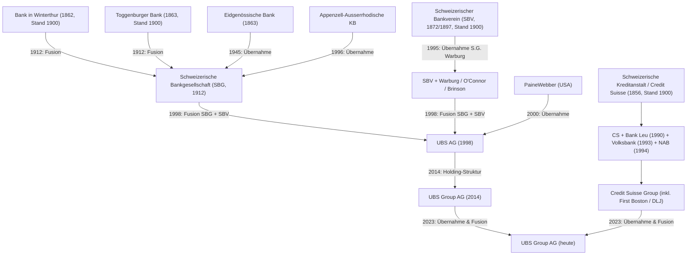

# 10 · Fusionsbaum & Institutsgeschichte seit 1900: UBS Group AG

> **Gründung / Ursprung:** 1862/1872 → 1998 (SBG + SBV = UBS AG) → 2023 (+ Credit Suisse) | **Aktuelle Rechtsform:** `listed_ag` | **FINMA-Kategorie:** 1

## 1. Überblick der Institutslinie (1900–2026)
Die heutige UBS Group AG vereint die gesamte moderne Schweizer Grossbankengeschichte seit 1900: 1912 entstand die Schweizerische Bankgesellschaft (SBG) aus der Bank in Winterthur (1862) und der Toggenburger Bank (1863); 1897 hatte sich der Schweizerische Bankverein (SBV, aus Basler Bankverein 1872) formiert. 1998 fusionierten SBG und SBV zur modernen UBS AG. 2023 folgte die historische Übernahme der Credit Suisse Group AG (1856 als Schweizerische Kreditanstalt gegründet, inklusive Bank Leu 1990, Schweizerische Volksbank 1993 und Neue Aargauer Bank 1994).

## 2. Fusionsbaum (Mermaid-Diagramm seit 1900)

## 3. Chronologische Meilensteine (Fusionen, Übernahmen & Rechtsformwechsel)
| Jahr / Zeitraum | Institut / Ereignis | Typ | Bedeutung & Auswirkung |
| --- | --- | --- | --- |
| 1900 | Basler/Schweizerischer Bankverein (1897), Bank in Winterthur (1862), Toggenburger Bank (1863), SKA (1856) | Ausgangslage 1900 | Vorgängerinstitute der drei späteren Schweizer Grossbanken |
| 1912 / 1945 | Gründung Schweizerische Bankgesellschaft (SBG) & Übernahme Eidg. Bank | Fusion & Übernahme | Bank in Winterthur + Toggenburger Bank fusionieren 1912 zur SBG |
| 1990–1996 | Konsolidierung (Bank Leu 1990, Volksbank 1993, Warburg 1995, ARKB 1996) | Akquisitionen | Inland- und Investmentbank-Konsolidierung bei CS, SBV und SBG |
| 1998 | Fusion SBG + SBV → UBS AG | Megafusion | Entstehung der modernen UBS (Verkauf Solothurner Bank SoBa 2000 als WEKO-Auflage) |
| 2000 / 2014 | Übernahme PaineWebber (2000) & Gründung UBS Group AG (2014) | Expansion & Holding | Ausbau US Wealth Management; TBTF-Holdingstruktur |
| 2023–2026 | Übernahme & Fusion der Credit Suisse Group AG | Historische Fusion | Abschluss Übernahme 12.06.2023; rechtliche und IT-Integration bis Ende 2026 |

- **Quellenbasis:** `UBS Annual Reports; UBS & Credit Suisse Historische Archive`
