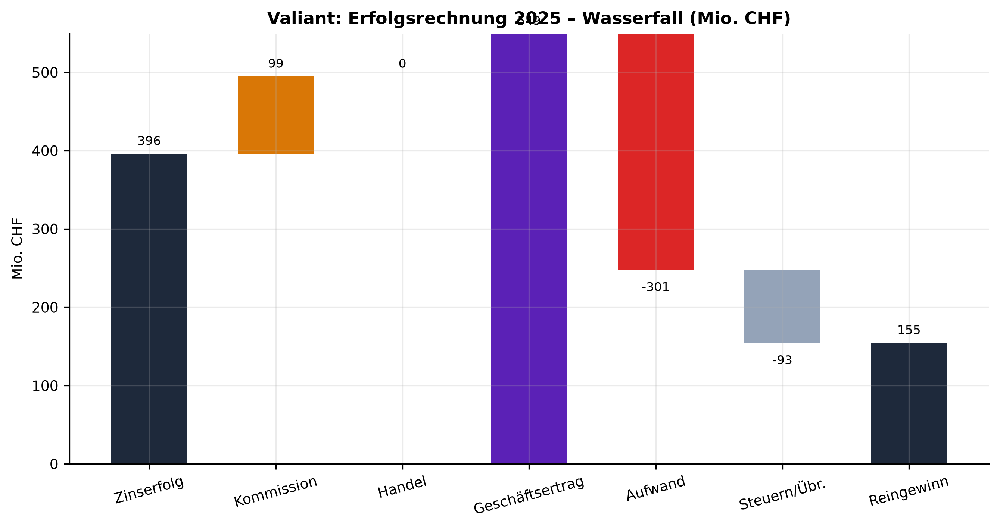
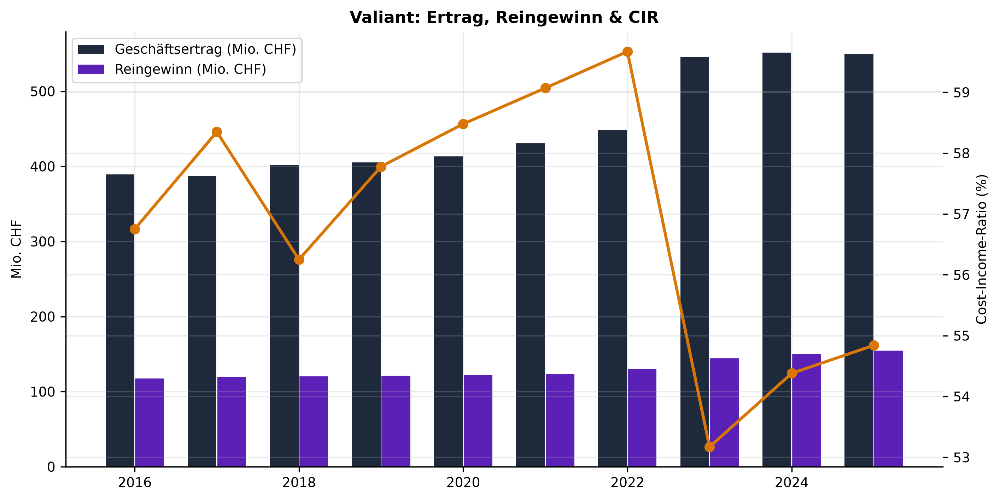

# 01 · Zinszyklen & Ertragsarchitektur (2016–2025): Valiant Holding AG

> **Scope:** `consolidated` | **Standard:** `ARB_RVB` | **Währung:** Mio. CHF (harmonisierte Zeitreihe)

## 1. Management Summary
- Im Zeitraum **2016–2025** entwickelte sich der Geschäftsertrag von **389,3 Mio. CHF** auf **549,5 Mio. CHF** (CAGR **3,90 % p. a.**).
- Der Reingewinn erreichte im jüngsten Geschäftsjahr 2025 **154,7 Mio. CHF** (nach 117,5 Mio. CHF im Jahr 2016).
- Der Netto-Zinserfolg trägt aktuell **72,1 %** zum Gesamtertrag bei, das Kommissionsgeschäft **17,9 %** und das Handelsgeschäft **– %**.

## 2. Quantitative Entwicklung
| Jahr | Zinserfolg (Mio.) | Kommission (Mio.) | Handel (Mio.) | Geschäftsertrag | Geschäftserfolg | Reingewinn | Zinsanteil |
| --- | --- | --- | --- | --- | --- | --- | --- |
| 2016 | 301,0 | 59,5 | 11,4 | 389,3 | 139,0 | 117,5 | 77,3 % |
| 2017 | 295,4 | 62,3 | 11,7 | 387,4 | 136,2 | 119,2 | 76,2 % |
| 2018 | 305,0 | 62,2 | 11,2 | 401,8 | 151,9 | 120,3 | 75,9 % |
| 2019 | 309,0 | 63,3 | 11,8 | 405,3 | 142,9 | 121,1 | 76,2 % |
| 2020 | 316,1 | – | – | 413,1 | 147,0 | 121,9 | 76,5 % |
| 2021 | 327,4 | 68,7 | – | 430,6 | 144,0 | 123,1 | 76,0 % |
| 2022 | 335,5 | 76,2 | 22,6 | 448,4 | 159,4 | 129,5 | 74,8 % |
| 2023 | 407,5 | 83,9 | 40,3 | 545,8 | 232,3 | 144,3 | 74,7 % |
| 2024 | 395,9 | 93,0 | 50,5 | 551,7 | 233,4 | 150,4 | 71,8 % |
| 2025 | 396,3 | 98,6 | – | 549,5 | 225,5 | 154,7 | 72,1 % |

## 3. Treiberanalyse & Wendepunkte
- **2020:** Beschleunigte Expansion auf 15 Kantone & Start Strategie 2020–2024
- **2025:** Inkrafttreten Basel III final & Start Strategie Valiant 2029

## 4. Fazit & Ausblick
- Die Ertragsarchitektur von Valiant spiegelt die Zinszyklen (Negativzinsphase 2015–2022, Zinswende 2022–2024, Zinssenkungen ab 2025) unmittelbar wider.
