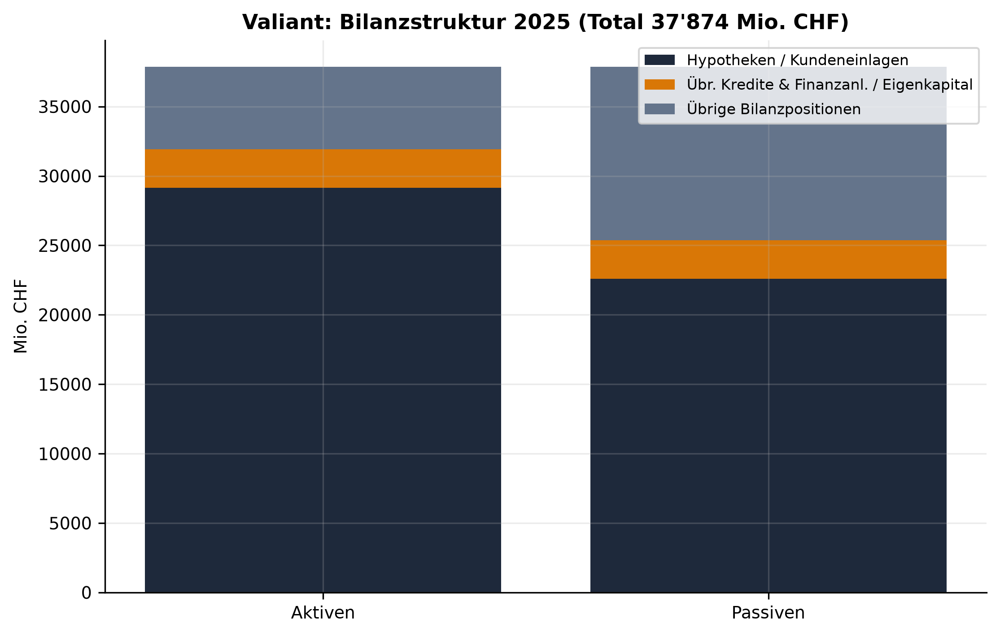
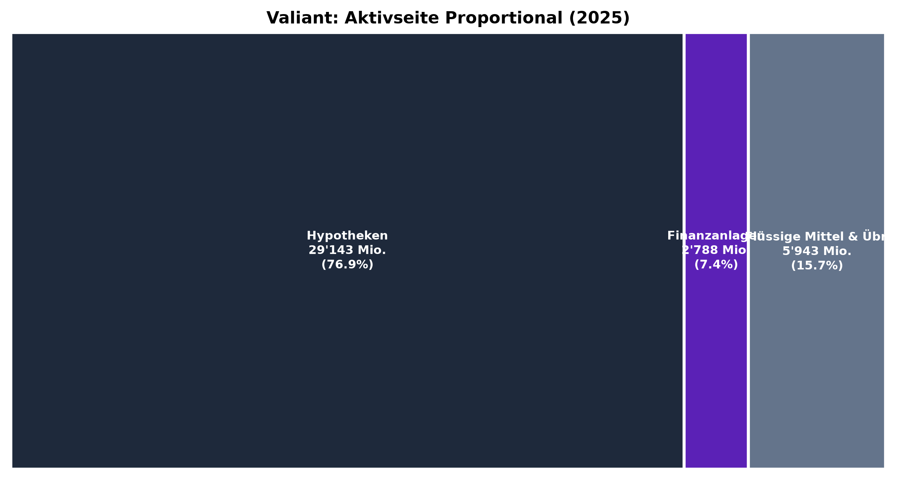
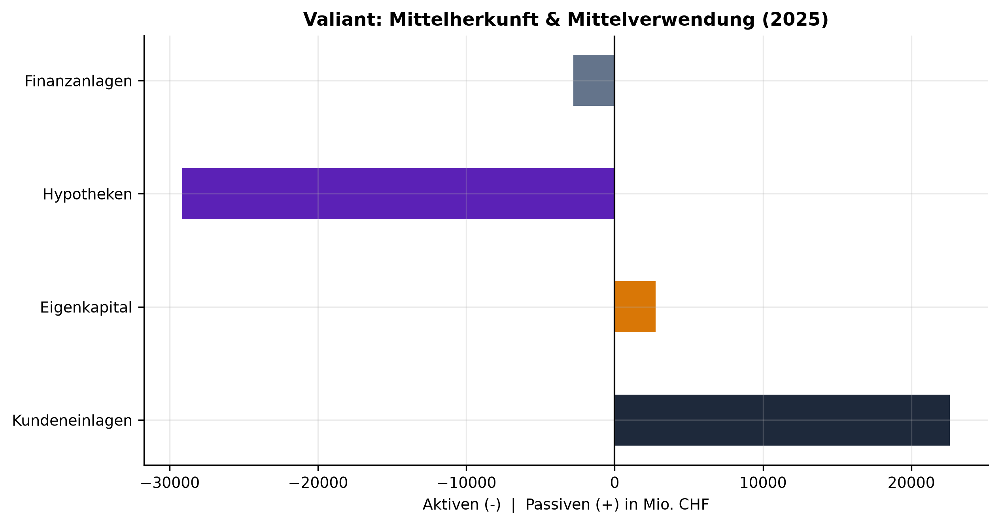
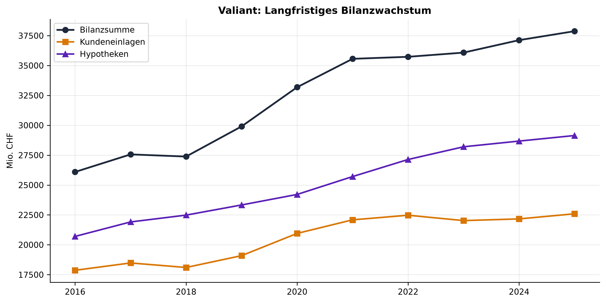

# 02 · Bilanzwachstum, Hypotheken & Refinanzierung (2016–2025): Valiant Holding AG

## 1. Management Summary
- Die Bilanzsumme wuchs von **26'094,5 Mio. CHF** (2016) auf **37'874,1 Mio. CHF** (2025, CAGR **4,23 %**).
- Die Hypothekarforderungen machen im Jahr 2025 **77,0 %** der Bilanzsumme aus.
- Die Kundeneinlagen belaufen sich 2025 auf **22'593,7 Mio. CHF**, das Eigenkapital auf **2'763,9 Mio. CHF** (Eigenkapitalquote **7,30 %**).

## 2. Quantitative Entwicklung
| Jahr | Bilanzsumme | Hypotheken | Finanzanlagen | Kundeneinlagen | Eigenkapital | Deckungsgrad |
| --- | --- | --- | --- | --- | --- | --- |
| 2016 | 26'094,5 | 20'700,8 | 1'119,2 | 17'865,7 | – | 80,3 % |
| 2017 | 27'563,6 | 21'911,7 | 941,4 | 18'479,9 | – | 78,6 % |
| 2018 | 27'382,7 | 22'482,7 | 830,9 | 18'100,9 | 2'266,7 | 75,3 % |
| 2019 | 29'906,0 | 23'332,1 | 765,1 | 19'090,3 | 2'318,3 | 81,8 % |
| 2020 | 33'184,2 | 24'212,1 | 1'610,8 | 20'950,9 | 2'361,1 | 86,5 % |
| 2021 | 35'560,3 | 25'708,3 | 1'529,5 | 22'087,9 | 2'398,8 | 85,9 % |
| 2022 | 35'729,8 | 27'137,3 | 1'287,2 | 22'473,9 | 2'467,4 | 82,8 % |
| 2023 | 36'080,4 | 28'200,4 | 1'089,3 | 22'024,3 | 2'575,5 | 78,1 % |
| 2024 | 37'123,7 | 28'677,5 | 2'270,5 | 22'165,8 | 2'677,4 | 77,3 % |
| 2025 | 37'874,1 | 29'142,7 | 2'788,2 | 22'593,7 | 2'763,9 | 77,5 % |

## 3. Treiberanalyse & Wendepunkte
- **2020:** Beschleunigte Expansion auf 15 Kantone & Start Strategie 2020–2024
- **2025:** Inkrafttreten Basel III final & Start Strategie Valiant 2029

## 4. Fazit & Ausblick
- Refinanzierungsbasis und Bilanzstruktur bleiben eng an Kundeneinlagen und die jeweilige Geschäftsmodell-Spezialisierung gekoppelt.
