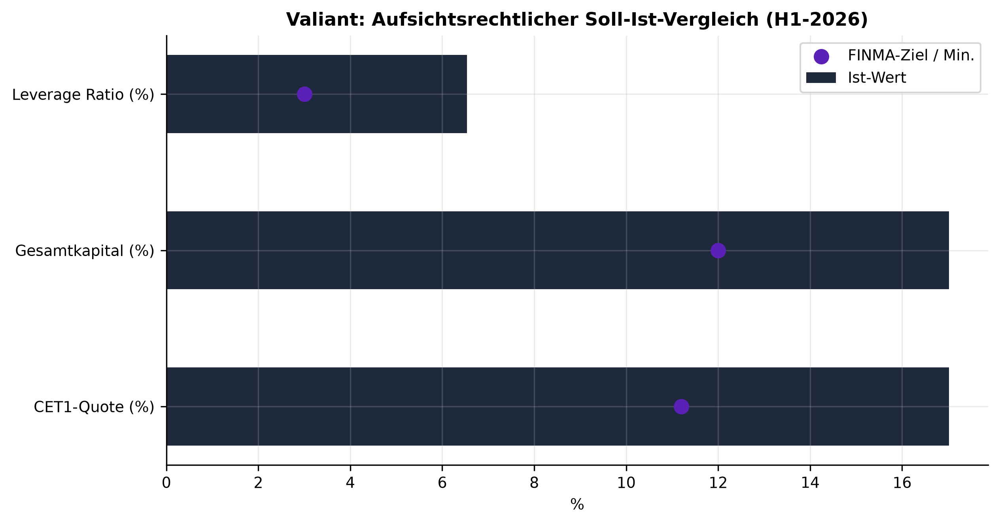
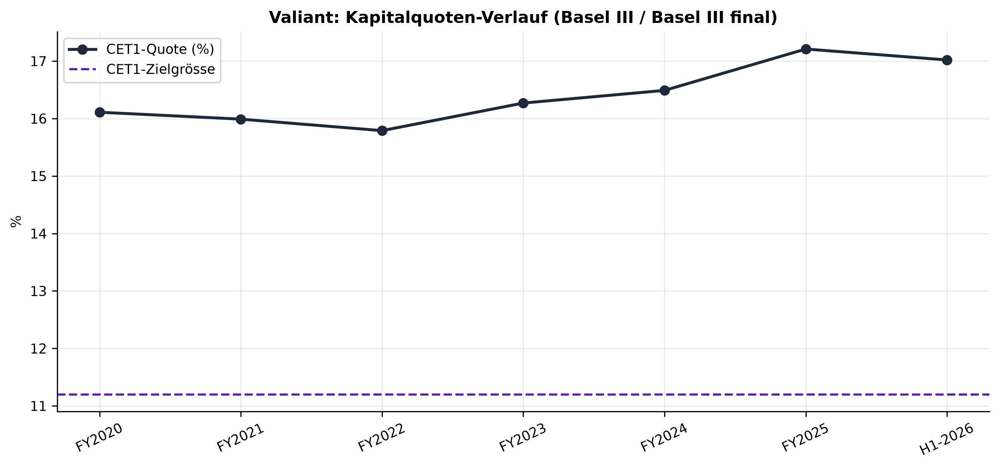

# 03 · Aufsichtsrechtliche Resilienz & Basel III: Valiant Holding AG

> **FINMA-Kategorie:** Kategorie 3 | **CET1-Zielgrösse:** 11,20 % | **Gesamtkapital-Ziel:** 12,00 %

## 1. Management Summary
- Am jüngsten Offenlegungsstichtag (**H1-2026**, Regime: *Basel III final*) beträgt die **CET1-Quote 17,02 %** (Puffer über Ziel: **5,82 Prozentpunkte**).
- Die Gesamtkapitalquote liegt bei **17,02 %**, die Leverage Ratio bei **6,54 %**.
- Liquiditätsquoten: LCR **– %**, NSFR **120,0 %** (Mindestanforderung je 100 %).

## 2. Quantitative Entwicklung (7 Stichtage)
| Periode | Regime | RWA (Mio.) | CET1 (Mio.) | CET1 % | Gesamtkap. % | Leverage % | LCR % | NSFR % |
| --- | --- | --- | --- | --- | --- | --- | --- | --- |
| FY2020 | Basel III | 14'037,3 | 2'261,5 | 16,11 % | 16,11 % | – % | – % | – % |
| FY2021 | Basel III | 14'408,3 | 2'303,2 | 15,99 % | 16,02 % | – % | – % | 119,0 % |
| FY2022 | Basel III | 15'045,4 | 2'375,7 | 15,79 % | 15,80 % | – % | – % | 115,0 % |
| FY2023 | Basel III | 15'268,4 | 2'483,8 | 16,27 % | 16,27 % | – % | – % | 112,0 % |
| FY2024 | Basel III | 15'653,4 | 2'581,0 | 16,49 % | 16,50 % | – % | – % | 115,0 % |
| FY2025 | Basel III final | 15'480,5 | 2'664,2 | 17,21 % | 17,23 % | 6,66 % | – % | 119,0 % |
| H1-2026 | Basel III final | 15'765,1 | 2'682,5 | 17,02 % | 17,02 % | 6,54 % | – % | 120,0 % |

## 3. Treiberanalyse & Wendepunkte
- Mit Inkrafttreten von **Basel III final** ab 01.01.2025 verändern sich risikogewichtete Aktiven (RWA) und RWA-Dichte durch angepasste Standard- bzw. Output-Floor-Vorgaben.

## 4. Fazit & Ausblick
- Die Eigenmittel- und Liquiditätspuffer übertreffen die regulatorischen Mindestanforderungen für FINMA-Kategorie 3 deutlich.
