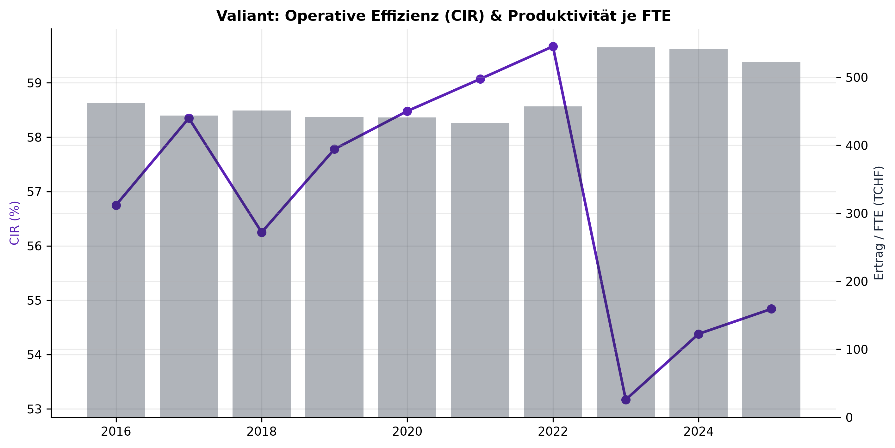

# 04 · Operative Effizienz & Transformation (2016–2025): Valiant Holding AG

## 1. Management Summary
- Die Cost-Income-Ratio (CIR) liegt im Jahr 2025 bei **54,84 %** (vs. 56,75 % im Jahr 2016), die Eigenkapitalrendite (ROE) bei **5,60 %**.
- Der Personalbestand umfasst 2025 **1'052,0 FTE** bei einem Ertrag pro Vollzeitstelle von **522,3 TCHF** und einem **Lohnkosten-/Produktivitätsverhältnis von 29,7 %** (bzw. **3,37×** Ertrag je CHF Personalaufwand).

## 2. Quantitative Entwicklung
| Jahr | CIR % | ROE % | FTE | Ertrag/FTE (TCHF) | Lohn/FTE (TCHF) | Lohn/Ertrag % | Ertrag/Lohn | Bilanz/FTE (Mio.) |
| --- | --- | --- | --- | --- | --- | --- | --- | --- |
| 2016 | 56,75 % | – % | 842,0 | 462,3 | 140,9 | 30,5 % | 3,28× | 30,99 |
| 2017 | 58,35 % | – % | 873,0 | 443,7 | 140,9 | 31,7 % | 3,15× | 31,57 |
| 2018 | 56,25 % | 5,31 % | 890,0 | 451,4 | 141,5 | 31,3 % | 3,19× | 30,77 |
| 2019 | 57,78 % | 5,22 % | 918,0 | 441,5 | 141,8 | 32,1 % | 3,11× | 32,58 |
| 2020 | 58,48 % | 5,16 % | 937,0 | 440,9 | 143,7 | 32,6 % | 3,07× | 35,42 |
| 2021 | 59,07 % | 5,13 % | 995,0 | 432,8 | – | – % | –× | 35,74 |
| 2022 | 59,67 % | 5,25 % | 981,0 | 457,1 | 146,1 | 32,0 % | 3,13× | 36,42 |
| 2023 | 53,17 % | 5,60 % | 1'003,0 | 544,2 | 162,4 | 29,8 % | 3,35× | 35,97 |
| 2024 | 54,38 % | 5,62 % | 1'018,0 | 541,9 | 158,7 | 29,3 % | 3,41× | 36,47 |
| 2025 | 54,84 % | 5,60 % | 1'052,0 | 522,3 | 155,1 | 29,7 % | 3,37× | 36,00 |

## 3. Treiberanalyse & Wendepunkte
- **2020:** Beschleunigte Expansion auf 15 Kantone & Start Strategie 2020–2024
- **2025:** Inkrafttreten Basel III final & Start Strategie Valiant 2029

## 4. Fazit & Ausblick
- Digitalisierung und Skalierung steigern Bilanzsumme und Geschäftsvolumen pro Vollzeitstelle langfristig.
