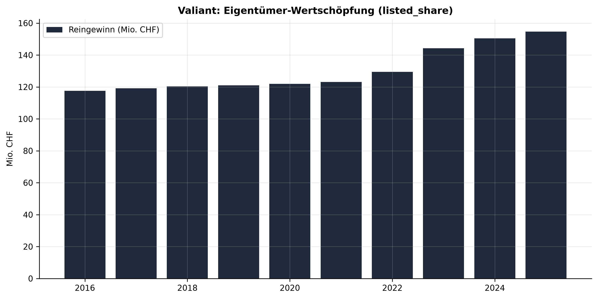

# 05 · Aktie, Dividenden & Investoren-Wertschöpfung (2016–2025): Valiant Holding AG

> **Eigentümer-Modus:** `listed_share` | **Staatsgarantie:** Keine | **Ticker:** `VATN`

## 1. Management Summary
- Im Geschäftsjahr 2025 erwirtschaftete Valiant einen Gewinn von **154,7 Mio. CHF** bei einem Eigenkapital von **2'763,9 Mio. CHF**.
- **Eigenkapitalrendite (2025):** ROE **5,60 %** bei einem Eigenkapital von **2'763,9 Mio. CHF**.

## 2. Quantitative Entwicklung
| Jahr | Reingewinn (Mio.) | Eigenkapital (Mio.) | Aktienkurs (split-ber.) | Dividende/Aktie | Div.-Rendite | Öff. Ablieferung (Mio.) |
| --- | --- | --- | --- | --- | --- | --- |
| 2016 | 117,5 | – | – | – | – % | – |
| 2017 | 119,2 | – | – | – | – % | – |
| 2018 | 120,3 | 2'266,7 | – | – | – % | – |
| 2019 | 121,1 | 2'318,3 | – | – | – % | – |
| 2020 | 121,9 | 2'361,1 | – | – | – % | – |
| 2021 | 123,1 | 2'398,8 | – | – | – % | – |
| 2022 | 129,5 | 2'467,4 | – | – | – % | – |
| 2023 | 144,3 | 2'575,5 | – | – | – % | – |
| 2024 | 150,4 | 2'677,4 | – | – | – % | – |
| 2025 | 154,7 | 2'763,9 | – | – | – % | – |

## 3. Treiberanalyse & Wendepunkte (Investoren-Perspektive)
- Bei kotierten Instituten mit Aktiensplits (z. B. BCV 1:10 im Jahr 2020) sind sämtliche historischen Kurs- und Dividendenreihen deterministisch split-bereinigt.
- Im Branchenvergleich (siehe `comparison/reports/06_investoren_branchenvergleich.md`) werden P/B, P/E, Dividendenrendite und Eigentümer-Ablieferungen über alle 8 Institute eingeordnet.

## 4. Fazit, Führungsleistung & Ausblick
- Stabile Ertragskraft sichert langfristig Dividendenkontinuität bzw. verlässliche Ablieferungen an Kanton, Post oder Genossenschafter.
- Die detaillierte Leistungsbilanz von CEO und Verwaltungsratspräsidium aus Investoren- und Eigentümersicht findet sich im [CEO & Chairman of the Board Achievement Report](./08_ceo_und_vrp_leistungsbericht.md).
