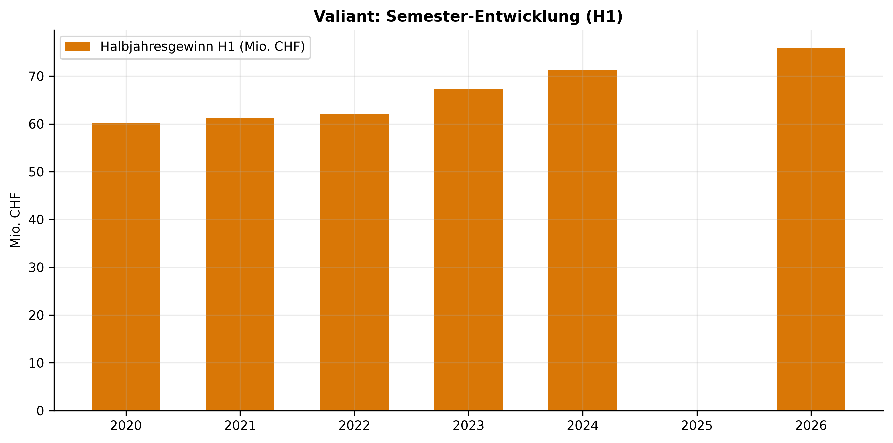

# 06 · Unterjährige Dynamik (Semesterberichte): Valiant Holding AG

## 1. Management Summary
- Vorliegen von **6 Halbjahresabschlüssen**; jüngster Stichtag ist **H1-2026** mit einem Geschäftsertrag von **277,3 Mio. CHF** und einem Halbjahresgewinn von **75,9 Mio. CHF**.

## 2. Quantitative Entwicklung
| Periode | Bilanzsumme | Zinserfolg H1 | Geschäftsertrag H1 | Geschäftserfolg H1 | Reingewinn H1 |
| --- | --- | --- | --- | --- | --- |
| H1-2020 | 31'936,0 | 154,5 | – | 73,9 | 60,1 |
| H1-2021 | 35'211,3 | 162,7 | 211,3 | 74,1 | 61,2 |
| H1-2022 | 36'495,0 | 167,3 | 222,0 | 75,8 | 62,0 |
| H1-2023 | 35'981,4 | 195,4 | 266,1 | 104,8 | 67,2 |
| H1-2024 | 36'346,6 | 196,0 | 276,5 | 116,8 | 71,3 |
| H1-2026 | 39'027,0 | 192,9 | 277,3 | 113,9 | 75,9 |

## 3. Treiberanalyse & Wendepunkte
- Der Vergleich von H1-Werten gegen die jeweiligen Gesamtjahresergebnisse (FY) zeigt die saisonale Ertragsverteilung und Reservebildung im zweiten Halbjahr.

## 4. Fazit & Ausblick
- Die Halbjahresberichte ermöglichen ein zeitnahes Monitoring der Zinsmargen- und Kreditvolumen-Dynamik bis H1-2026.
