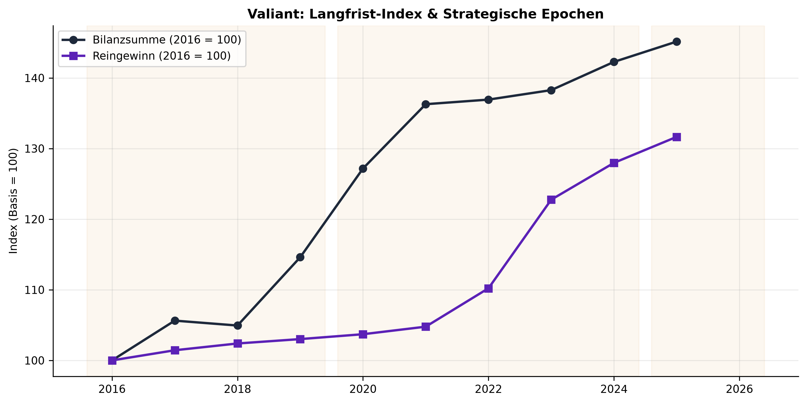
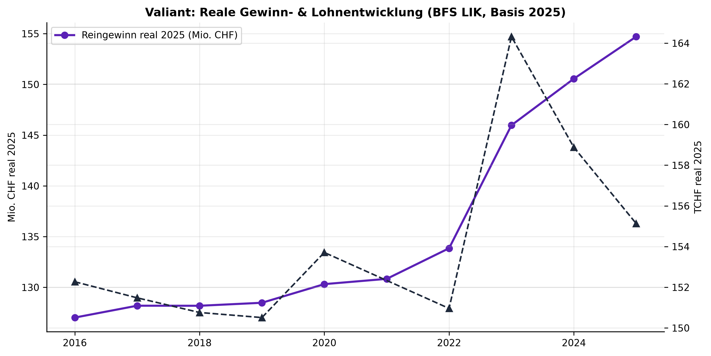

# 07 · Strategische Epochen, Governance, reale Vergütung & Vorsorge (2016–2025): Valiant Holding AG

> **Preisbasis:** Sämtliche Realgrössen sind mit dem offiziellen **BFS Landesindex der Konsumentenpreise (LIK, Dez. 1982 = 100)** deterministisch auf **reale CHF 2025** deflationiert.

## 1. Management Summary & Strategische Epochen
- **Epoche 1 (2016–2019):** Überregionale Expansion & Digitalisierung
- **Epoche 2 (2020–2024):** Strategie 2020–2024: Genfersee bis Bodensee
- **Epoche 3 (2025–2026):** Strategie Valiant 2029 & Basel III final

## 2. Reale Gewinn-, Lohn- & Vergütungsentwicklung (real 2025 CHF)
| Jahr | Gewinn nom. | Gewinn real 2025 | Lohn/FTE real (TCHF) | Fluktuation % | VR real (TCHF) | CEO real (TCHF) | GL real (TCHF) |
| --- | --- | --- | --- | --- | --- | --- | --- |
| 2016 | 117,5 | 127,0 | 152,3 | 11,9 % | – | – | – |
| 2017 | 119,2 | 128,2 | 151,5 | 11,7 % | – | – | – |
| 2018 | 120,3 | 128,2 | 150,8 | 13,2 % | – | – | – |
| 2019 | 121,1 | 128,5 | 150,5 | 12,5 % | – | – | – |
| 2020 | 121,9 | 130,3 | 153,7 | 11,0 % | – | – | – |
| 2021 | 123,1 | 130,8 | – | 10,5 % | – | – | – |
| 2022 | 129,5 | 133,9 | 151,0 | 11,9 % | – | – | – |
| 2023 | 144,3 | 146,0 | 164,3 | 12,0 % | – | – | – |
| 2024 | 150,4 | 150,6 | 158,9 | 13,1 % | – | – | – |
| 2025 | 154,7 | 154,7 | 155,1 | 9,4 % | – | – | – |

## 3. Arbeitgeber-Attraktivität, Personalfluktuation & Vorsorgeeinrichtung (Pensionskasse)
- **Vorsorgeeinrichtung:** Pensionskasse Valiant (+ avenirplus.ch Ergänzungskasse) (*Beitragsprimat*, Basis: `Swiss GAAP FER 26 / ARB`)
- **Versichertenstruktur:** Aktive **1'052**, Rentner **–** (Verhältnis Aktive/Rentner: **–**)
- **Deckungsgrad (BVG) / Reserven:** Deckungsgrad **112,8 %**, Arbeitgeberbeitragsreserve **0,0 Mio. CHF**, Sondereinlagen **0,0 Mio. CHF**
- **CEO-zu-Mitarbeitenden-Pay-Ratio (2025):** **–×** (CEO real 2025: – TCHF vs. Ø Personalaufwand/FTE: 155,1 TCHF)
- **Quelle Vorsorge:** `valiant/.md/valiant-geschaeftsbericht-2025.md (Anhang 13 Vorsorgeeinrichtungen)` — Provisorischer Deckungsgrad Ende 2025: 112,8 % bei 1,50 % techn. Zins (Überdeckung CHF 55,898 Mio., Wertschwankungsreserve CHF 61,6 Mio.); bezahlte Beiträge 2025: CHF 12,011 Mio. (CHF 10,737 Mio. PK + CHF 1,274 Mio. avenirplus).
- **Personalfluktuation (12 Berichtsjahre, 2014–2025):** **2014:** 13,2 %, **2015:** 14,1 %, **2016:** 11,9 %, **2017:** 11,7 %, **2018:** 13,2 %, **2019:** 12,5 %, **2020:** 11,0 %, **2021:** 10,5 %, **2022:** 11,9 %, **2023:** 12,0 %, **2024:** 13,1 %, **2025:** 9,4 %
- **Methodik & Quelle Fluktuation:** Nettofluktuationsrate in % (alle durch Arbeitnehmende oder Arbeitgeber initiierten Austritte inkl. vorzeitiger Pensionierung auf eigenen Wunsch, GRI 401-1) (`valiant/.md/valiant-geschaeftsbericht-2016..2023.md & Valiant Nachhaltigkeitsberichte 2023 (S. 66), 2024 (S. 76) & 2025 (S. 83)`)

## 4. Treiberanalyse, Strukturbrüche & Ausblick
- **2020:** Beschleunigte Expansion auf 15 Kantone & Start Strategie 2020–2024
- **2025:** Inkrafttreten Basel III final & Start Strategie Valiant 2029
- Die gemeinsame Inflationsbereinigung auf `real 2025 CHF` ermöglicht den unverzerrten Vergleich von Produktivität, Reallöhnen, Personalfluktuation, Pay Ratio und Pensionskassen-Resilienz im Branchenvergleich (`comparison/reports/07_mitarbeiter_und_vorsorge_branchenvergleich.md`).
