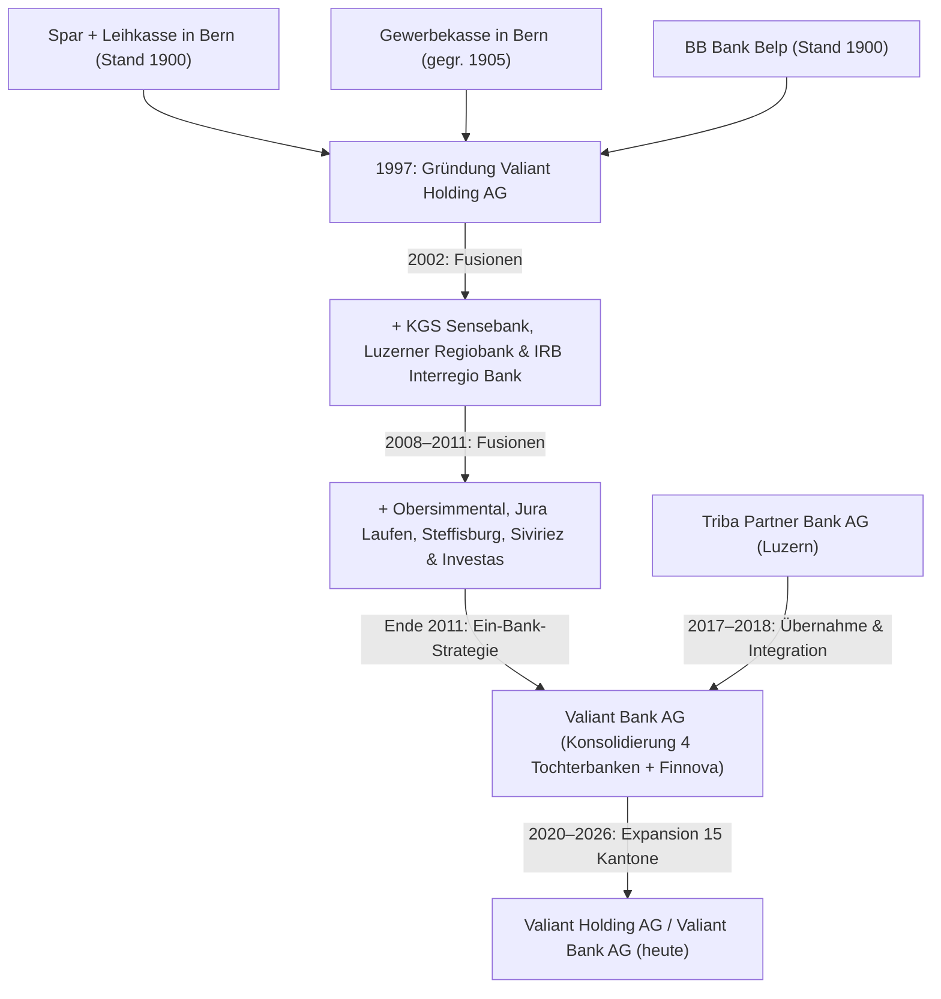

# 10 · Fusionsbaum & Institutsgeschichte seit 1900: Valiant Holding AG

> **Gründung / Ursprung:** 1997 (Fusion Spar + Leihkasse in Bern, Gewerbekasse in Bern & BB Bank Belp; >40 Vorgängerbanken) | **Aktuelle Rechtsform:** `listed_ag` | **FINMA-Kategorie:** 3

## 1. Überblick der Institutslinie (1900–2026)
Valiant entstand Mitte 1997 durch den Zusammenschluss der drei bernischen Regionalbanken Spar + Leihkasse in Bern, Gewerbekasse in Bern und BB Bank Belp unter dem Dach der Valiant Holding AG. Insgesamt gingen über 40 Regionalbanken (mit Wurzeln bis ins frühe 19. Jh.) in Valiant auf – u. a. Sensebank, Luzerner Regiobank und IRB Interregio Bank (2002), Obersimmentalische Volksbank, Bank Jura Laufen, Spar + Leihkasse Steffisburg und Caisse d'épargne de Siviriez (2008–2011) sowie die Triba Partner Bank AG (2017–2018).

## 2. Fusionsbaum (Mermaid-Diagramm seit 1900)

## 3. Chronologische Meilensteine (Fusionen, Übernahmen & Rechtsformwechsel)
| Jahr / Zeitraum | Institut / Ereignis | Typ | Bedeutung & Auswirkung |
| --- | --- | --- | --- |
| 1900–1996 | Über 40 selbstständige Regional- & Ersparniskassen | Ausgangslage | Wurzeln in Bern, Luzern, Freiburg, Jura und der Westschweiz bis ins 19. Jh. |
| 1997 | Gründung Valiant Holding AG | Dreierfusion | Zusammenschluss von Spar + Leihkasse in Bern, Gewerbekasse in Bern und BB Bank Belp |
| 2002 | Übernahme/Fusion KGS Sensebank, Luzerner Regiobank & IRB Interregio Bank | Expansion | Vorstoss in die Zentralschweiz und das Mittelland |
| 2008–2011 | Fusionen Obersimmentalische Volksbank, Bank Jura Laufen, SL Steffisburg, Siviriez | Konsolidierung | Ende 2011 Zusammenführung von 4 Tochterbanken unter dem Dach der Valiant Bank AG |
| 2017–2018 | Übernahme & Integration der Triba Partner Bank AG (Luzern) | Akquisition | Aufstockung auf 97,4 % (2017) und vollständige Fusion in die Valiant Bank AG (2018) |

- **Quellenbasis:** `Valiant Geschäftsberichte (2016–2025); Valiant Chronik`
