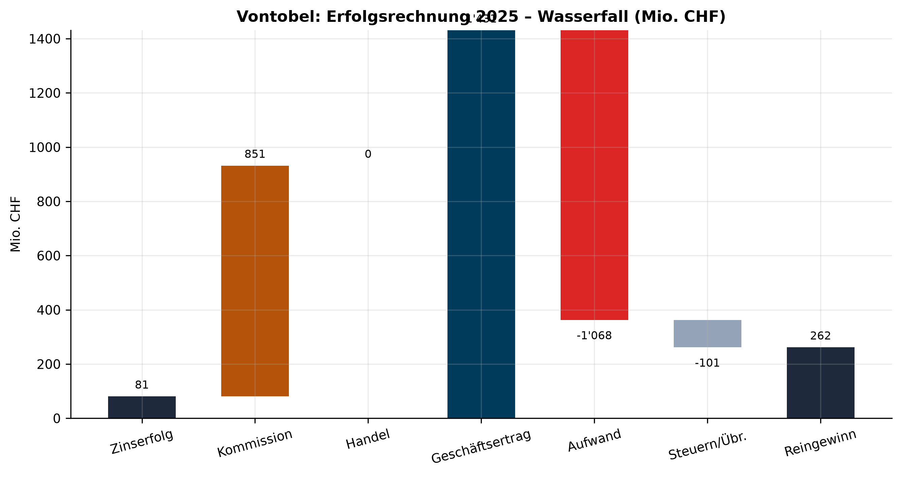
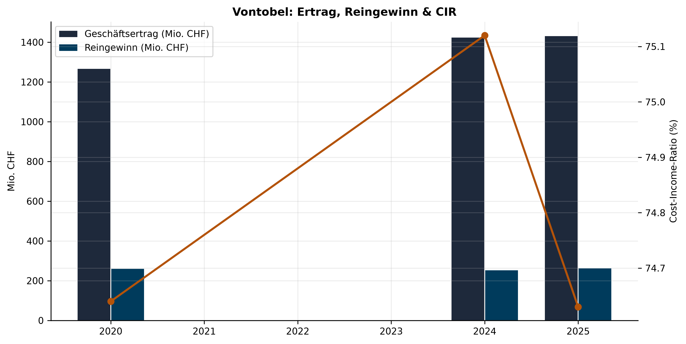

# 01 · Zinszyklen & Ertragsarchitektur (2020–2025): Vontobel Holding AG

> **Scope:** `consolidated` | **Standard:** `IFRS` | **Währung:** Mio. CHF (harmonisierte Zeitreihe)

## 1. Management Summary
- Im Zeitraum **2020–2025** entwickelte sich der Geschäftsertrag von **1'266,0 Mio. CHF** auf **1'431,0 Mio. CHF** (CAGR **2,48 % p. a.**).
- Der Reingewinn erreichte im jüngsten Geschäftsjahr 2025 **262,0 Mio. CHF** (nach 259,4 Mio. CHF im Jahr 2020).
- Der Netto-Zinserfolg trägt aktuell **5,7 %** zum Gesamtertrag bei, das Kommissionsgeschäft **59,5 %** und das Handelsgeschäft **– %**.

## 2. Quantitative Entwicklung
| Jahr | Zinserfolg (Mio.) | Kommission (Mio.) | Handel (Mio.) | Geschäftsertrag | Geschäftserfolg | Reingewinn | Zinsanteil |
| --- | --- | --- | --- | --- | --- | --- | --- |
| 2020 | 0,1 | 0,8 | – | 1'266,0 | – | 259,4 | 0,0 % |
| 2024 | 115,0 | 836,0 | – | 1'423,0 | – | 252,0 | 8,1 % |
| 2025 | 81,0 | 851,0 | – | 1'431,0 | – | 262,0 | 5,7 % |

## 3. Treiberanalyse & Wendepunkte
- **2025:** Inkrafttreten Basel III final per 01.01.2025

## 4. Fazit & Ausblick
- Die Ertragsarchitektur von Vontobel spiegelt die Zinszyklen (Negativzinsphase 2015–2022, Zinswende 2022–2024, Zinssenkungen ab 2025) unmittelbar wider.
