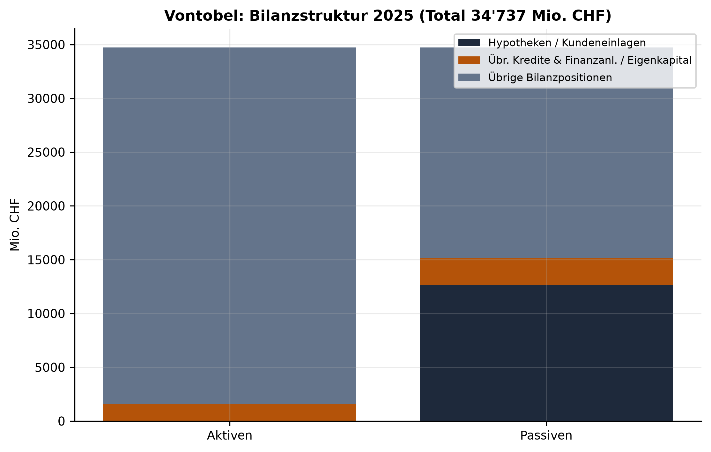
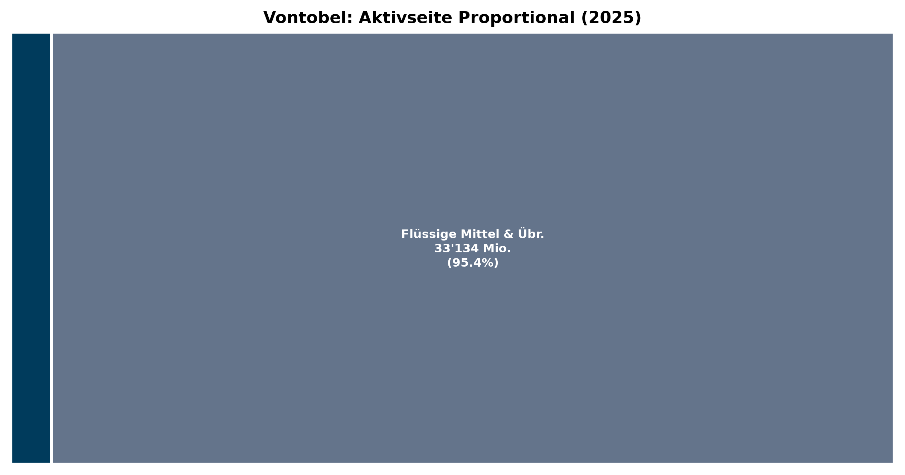
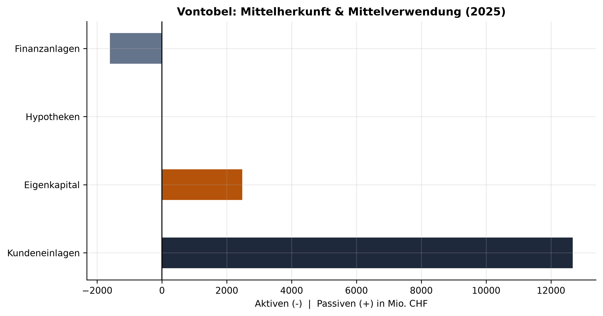
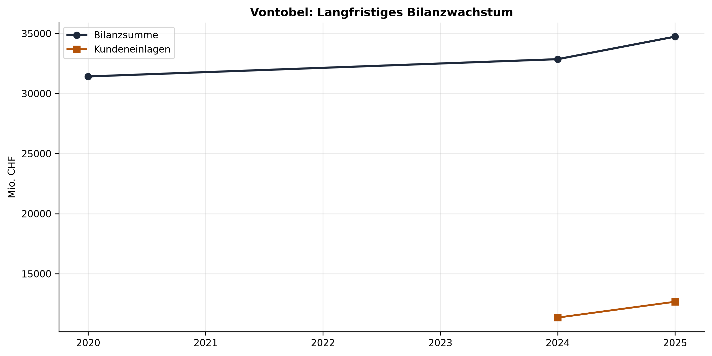

# 02 · Bilanzwachstum, Hypotheken & Refinanzierung (2020–2025): Vontobel Holding AG

## 1. Management Summary
- Die Bilanzsumme wuchs von **31'422,0 Mio. CHF** (2020) auf **34'737,0 Mio. CHF** (2025, CAGR **2,03 %**).
- Die Hypothekarforderungen machen im Jahr 2025 **– %** der Bilanzsumme aus.
- Die Kundeneinlagen belaufen sich 2025 auf **12'672,0 Mio. CHF**, das Eigenkapital auf **2'479,0 Mio. CHF** (Eigenkapitalquote **7,14 %**).

## 2. Quantitative Entwicklung
| Jahr | Bilanzsumme | Hypotheken | Finanzanlagen | Kundeneinlagen | Eigenkapital | Deckungsgrad |
| --- | --- | --- | --- | --- | --- | --- |
| 2020 | 31'422,0 | – | 2'253,0 | – | 1'892,0 | – % |
| 2024 | 32'861,0 | – | 867,0 | 11'353,0 | 2'231,0 | – % |
| 2025 | 34'737,0 | – | 1'603,0 | 12'672,0 | 2'479,0 | – % |

## 3. Treiberanalyse & Wendepunkte
- **2025:** Inkrafttreten Basel III final per 01.01.2025

## 4. Fazit & Ausblick
- Refinanzierungsbasis und Bilanzstruktur bleiben eng an Kundeneinlagen und die jeweilige Geschäftsmodell-Spezialisierung gekoppelt.
