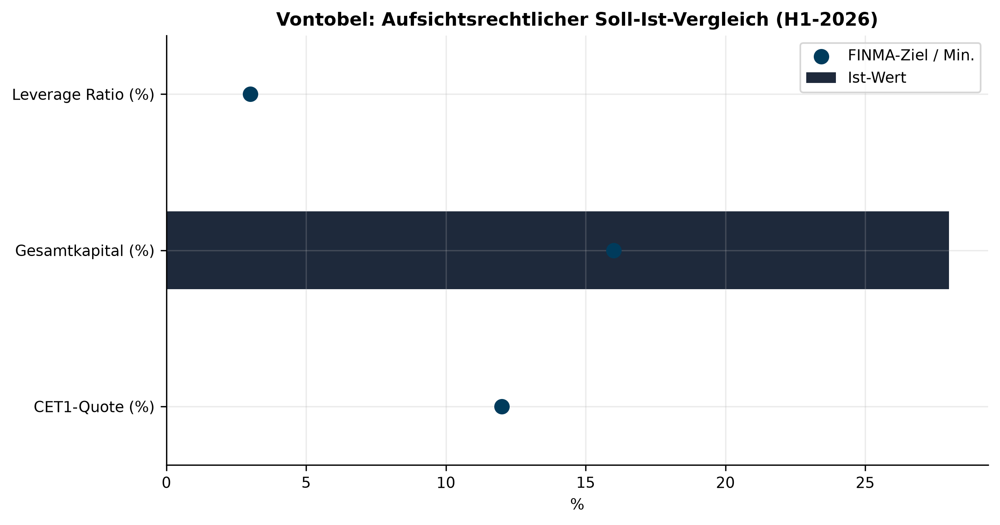
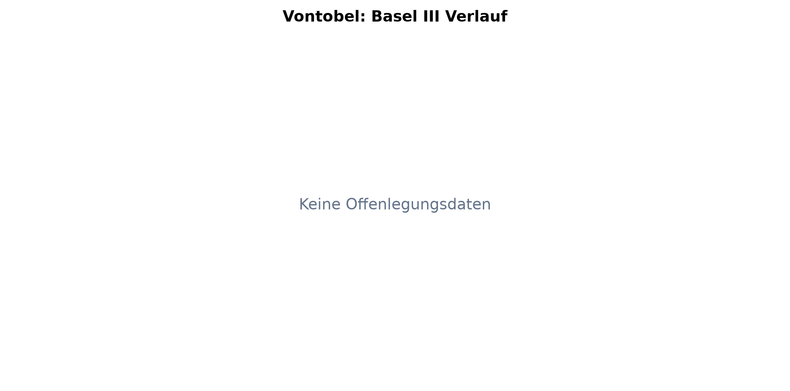

# 03 · Aufsichtsrechtliche Resilienz & Basel III: Vontobel Holding AG

> **FINMA-Kategorie:** Kategorie 3 | **CET1-Zielgrösse:** 12,00 % | **Gesamtkapital-Ziel:** 16,00 %

## 1. Management Summary
- Am jüngsten Offenlegungsstichtag (**H1-2026**, Regime: *Basel III final*) beträgt die **CET1-Quote – %** (Puffer über Ziel: **– Prozentpunkte**).
- Die Gesamtkapitalquote liegt bei **28,00 %**, die Leverage Ratio bei **– %**.
- Liquiditätsquoten: LCR **– %**, NSFR **121,7 %** (Mindestanforderung je 100 %).

## 2. Quantitative Entwicklung (5 Stichtage)
| Periode | Regime | RWA (Mio.) | CET1 (Mio.) | CET1 % | Gesamtkap. % | Leverage % | LCR % | NSFR % |
| --- | --- | --- | --- | --- | --- | --- | --- | --- |
| FY2023 | Basel III | 6'523,9 | 1'220,1 | – % | 23,80 % | 5,40 % | – % | – % |
| FY2024 | Basel III | 7'518,6 | 1'210,3 | – % | 21,00 % | 4,80 % | – % | – % |
| H1-2025 | Basel III final | 7'491,5 | 1'253,8 | – % | 21,00 % | 4,40 % | – % | 122,8 % |
| FY2025 | Basel III final | 6'764,5 | – | – % | 24,40 % | – % | – % | – % |
| H1-2026 | Basel III final | 6'514,2 | 1'498,3 | – % | 28,00 % | – % | – % | 121,7 % |

## 3. Treiberanalyse & Wendepunkte
- Mit Inkrafttreten von **Basel III final** ab 01.01.2025 verändern sich risikogewichtete Aktiven (RWA) und RWA-Dichte durch angepasste Standard- bzw. Output-Floor-Vorgaben.

## 4. Fazit & Ausblick
- Die Eigenmittel- und Liquiditätspuffer übertreffen die regulatorischen Mindestanforderungen für FINMA-Kategorie 3 deutlich.
