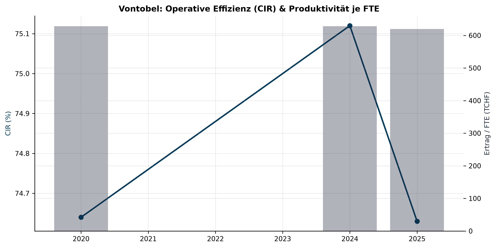

# 04 · Operative Effizienz & Transformation (2020–2025): Vontobel Holding AG

## 1. Management Summary
- Die Cost-Income-Ratio (CIR) liegt im Jahr 2025 bei **74,63 %** (vs. 74,64 % im Jahr 2020), die Eigenkapitalrendite (ROE) bei **10,57 %**.
- Der Personalbestand umfasst 2025 **2'310,0 FTE** bei einem Ertrag pro Vollzeitstelle von **619,5 TCHF** und einem **Lohnkosten-/Produktivitätsverhältnis von 49,3 %** (bzw. **2,03×** Ertrag je CHF Personalaufwand).

## 2. Quantitative Entwicklung
| Jahr | CIR % | ROE % | FTE | Ertrag/FTE (TCHF) | Lohn/FTE (TCHF) | Lohn/Ertrag % | Ertrag/Lohn | Bilanz/FTE (Mio.) |
| --- | --- | --- | --- | --- | --- | --- | --- | --- |
| 2020 | 74,64 % | 13,71 % | 2'015,1 | 628,3 | 0,3 | 0,1 % | 1'978,12× | 15,59 |
| 2024 | 75,12 % | 11,30 % | 2'264,4 | 628,4 | 307,4 | 48,9 % | 2,04× | 14,51 |
| 2025 | 74,63 % | 10,57 % | 2'310,0 | 619,5 | 305,6 | 49,3 % | 2,03× | 15,04 |

## 3. Treiberanalyse & Wendepunkte
- **2025:** Inkrafttreten Basel III final per 01.01.2025

## 4. Fazit & Ausblick
- Digitalisierung und Skalierung steigern Bilanzsumme und Geschäftsvolumen pro Vollzeitstelle langfristig.
