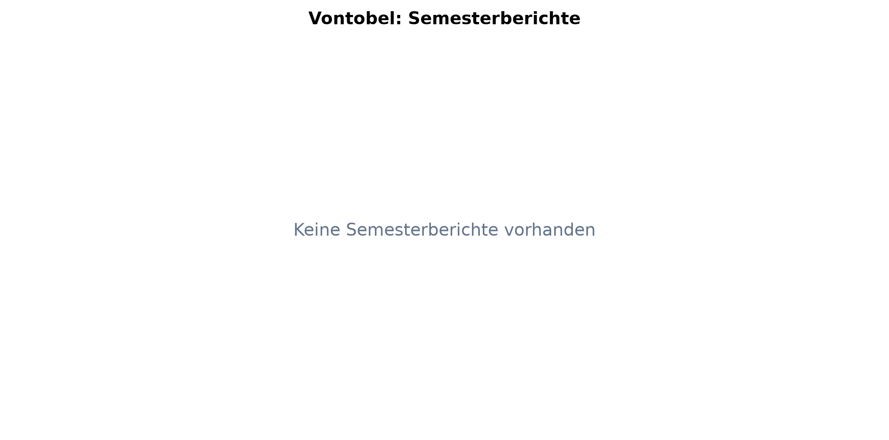

# 06 · Unterjährige Dynamik (Semesterberichte): Vontobel Holding AG

## 1. Management Summary
- Vorliegen von **4 Halbjahresabschlüssen**; jüngster Stichtag ist **H1-2026** mit einem Geschäftsertrag von **0,9 Mio. CHF** und einem Halbjahresgewinn von **– Mio. CHF**.

## 2. Quantitative Entwicklung
| Periode | Bilanzsumme | Zinserfolg H1 | Geschäftsertrag H1 | Geschäftserfolg H1 | Reingewinn H1 |
| --- | --- | --- | --- | --- | --- |
| H1-2023 | 32,1 | 0,1 | 0,7 | – | – |
| H1-2024 | 33,1 | 0,1 | 0,7 | – | – |
| H1-2025 | 35,5 | 0,0 | 0,7 | – | – |
| H1-2026 | 38,3 | 0,1 | 0,9 | – | – |

## 3. Treiberanalyse & Wendepunkte
- Der Vergleich von H1-Werten gegen die jeweiligen Gesamtjahresergebnisse (FY) zeigt die saisonale Ertragsverteilung und Reservebildung im zweiten Halbjahr.

## 4. Fazit & Ausblick
- Die Halbjahresberichte ermöglichen ein zeitnahes Monitoring der Zinsmargen- und Kreditvolumen-Dynamik bis H1-2026.
