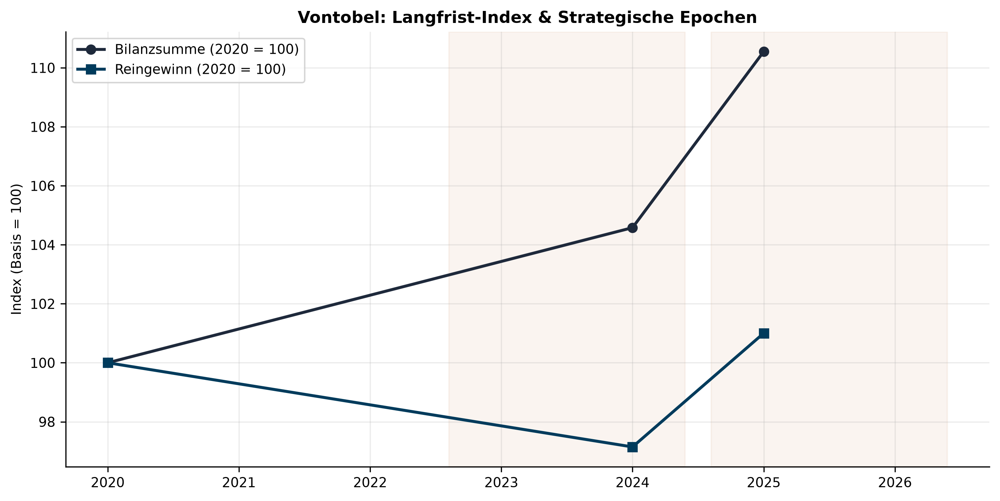
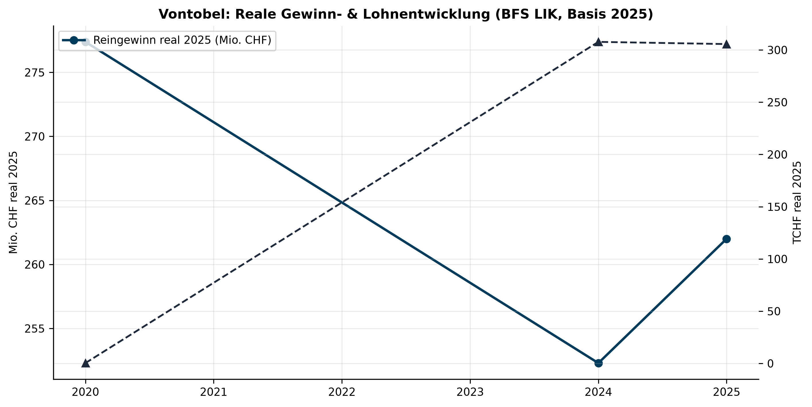

# 07 · Strategische Epochen, Governance, reale Vergütung & Vorsorge (2020–2025): Vontobel Holding AG

> **Preisbasis:** Sämtliche Realgrössen sind mit dem offiziellen **BFS Landesindex der Konsumentenpreise (LIK, Dez. 1982 = 100)** deterministisch auf **reale CHF 2025** deflationiert.

## 1. Management Summary & Strategische Epochen
- **Epoche 1 (2023–2024):** Wealth & Asset Management Konsolidierung
- **Epoche 2 (2025–2026):** Basel III final & Globale Expansion

## 2. Reale Gewinn-, Lohn- & Vergütungsentwicklung (real 2025 CHF)
| Jahr | Gewinn nom. | Gewinn real 2025 | Lohn/FTE real (TCHF) | VR real (TCHF) | CEO real (TCHF) | GL real (TCHF) |
| --- | --- | --- | --- | --- | --- | --- |
| 2020 | 259,4 | 277,4 | 0,3 | – | – | – |
| 2024 | 252,0 | 252,3 | 307,7 | – | – | – |
| 2025 | 262,0 | 262,0 | 305,6 | – | – | – |

## 3. Arbeitgeber-Attraktivität & Vorsorgeeinrichtung (Pensionskasse)
- **Vorsorgeeinrichtung:** Vontobel Pensionskasse (IAS 19) (*Beitragsprimat (IAS 19: Defined Benefit)*, Basis: `IFRS / IAS 19`)
- **Versichertenstruktur:** Aktive **–**, Rentner **–** (Verhältnis Aktive/Rentner: **–**)
- **Deckungsgrad (BVG) / Reserven:** Deckungsgrad **– %**, Arbeitgeberbeitragsreserve **– Mio. CHF**, Sondereinlagen **0,0 Mio. CHF**
- **CEO-zu-Mitarbeitenden-Pay-Ratio (2025):** **–×** (CEO real 2025: – TCHF vs. Ø Personalaufwand/FTE: 305,6 TCHF)
- **Quelle:** `vontobel/.md/vontobel-geschaeftsbericht-2025.md (Note 5 & Note 33)` — Bilanzierter Defined-Benefit-Aktivüberschuss (IAS 19) per 31.12.2025 CHF 218,3 Mio. (2024: CHF 54,5 Mio.); Vorsorgeaufwand 2025: CHF 55,3 Mio. (2024: CHF 48,3 Mio.).

## 4. Treiberanalyse, Strukturbrüche & Ausblick
- **2025:** Inkrafttreten Basel III final per 01.01.2025
- Die gemeinsame Inflationsbereinigung auf `real 2025 CHF` ermöglicht den unverzerrten Vergleich von Produktivität, Reallöhnen, Pay Ratio und Pensionskassen-Resilienz im Branchenvergleich (`comparison/reports/07_mitarbeiter_und_vorsorge_branchenvergleich.md`).
