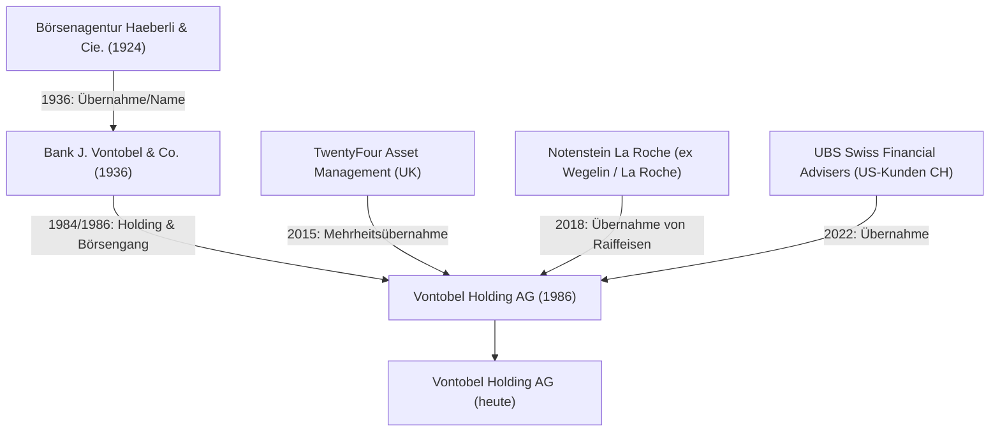

# 10 · Fusionsbaum & Institutsgeschichte seit 1900: Vontobel Holding AG

> **Gründung / Ursprung:** 1924 (Börsenagentur Haeberli & Cie. → 1936 Bank J. Vontobel & Co.) | **Aktuelle Rechtsform:** `listed_ag` | **FINMA-Kategorie:** 3

## 1. Überblick der Institutslinie (1900–2026)
Vontobel entstand 1924 durch den Einstieg von Jakob Vontobel in die Zürcher Börsenagentur Haeberli & Cie. (1936 Umfirmierung in Bank J. Vontobel & Co., 1984 Holdinggründung, 1986 Börsengang). Wichtige Zukäufe seit 2000 waren TwentyFour Asset Management (2015), die Übernahme von Notenstein La Roche von Raiffeisen (2018) sowie das US-Private-Wealth-Portfolio von UBS Swiss Financial Advisers (2022).

## 2. Fusionsbaum (Mermaid-Diagramm seit 1900)

## 3. Chronologische Meilensteine (Fusionen, Übernahmen & Rechtsformwechsel)
| Jahr / Zeitraum | Institut / Ereignis | Typ | Bedeutung & Auswirkung |
| --- | --- | --- | --- |
| 1924 / 1936 | Haeberli & Cie. → Bank J. Vontobel & Co. | Gründung | Jakob Vontobel übernimmt Börsenagentur und gründet 1936 das Bankhaus |
| 1984 / 1986 | Gründung Vontobel Holding AG & IPO | Börsengang | Familienmehrheit bleibt über Pool- und Stiftungsstruktur gesichert |
| 2015 | Mehrheitsübernahme TwentyFour Asset Management (London) | Akquisition | Ausbau des Fixed-Income- und institutionellen Asset Managements |
| 2018 | Übernahme Notenstein La Roche Privatbank AG (von Raiffeisen) | Akquisition | Stärkung des Schweizer Wealth Management um ~16 Mrd. CHF AuM |
| 2022 | Übernahme UBS Swiss Financial Advisers AG (SFA) | Akquisition | Ausbau des Geschäfts mit US-domizilierten Wealth-Management-Kunden in der Schweiz |

- **Quellenbasis:** `Vontobel 100-Jahr-Chronik 1924–2024 (vontobel.com); Geschäftsberichte`
