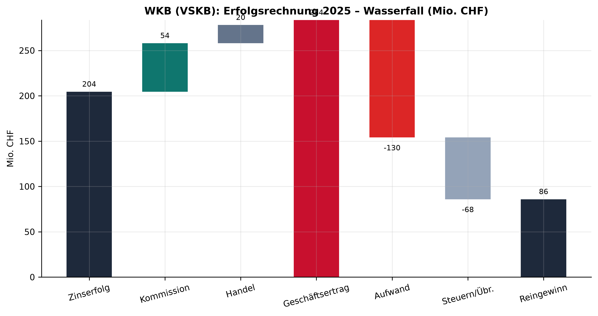
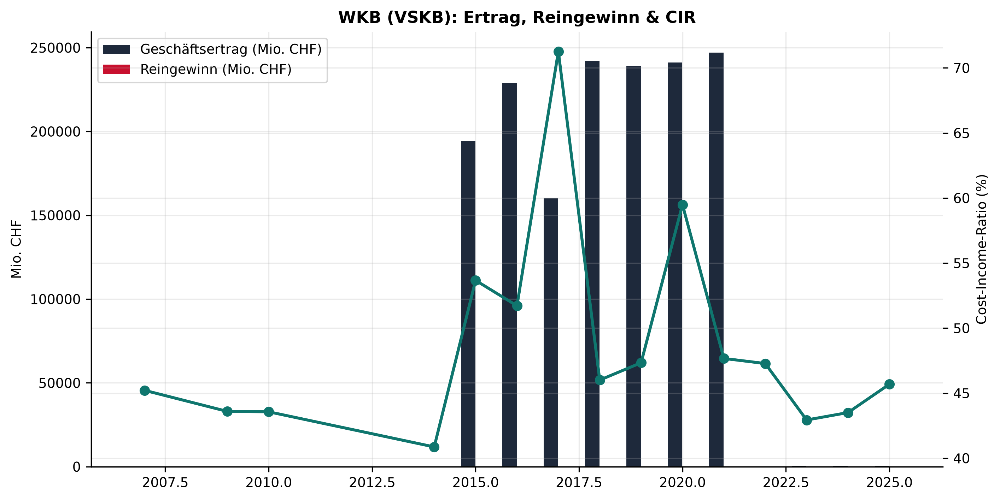

# 01 · Zinszyklen & Ertragsarchitektur (2007–2025): Walliser Kantonalbank (BCVs)

> **Scope:** `standalone` | **Standard:** `ARB_RVB` | **Währung:** Mio. CHF (harmonisierte Zeitreihe)

## 1. Management Summary
- Im Zeitraum **2007–2025** entwickelte sich der Geschäftsertrag von **190,1 Mio. CHF** auf **283,6 Mio. CHF** (CAGR **2,25 % p. a.**).
- Der Reingewinn erreichte im jüngsten Geschäftsjahr 2025 **85,9 Mio. CHF** (nach 41,1 Mio. CHF im Jahr 2007).
- Der Netto-Zinserfolg trägt aktuell **72,1 %** zum Gesamtertrag bei, das Kommissionsgeschäft **18,9 %** und das Handelsgeschäft **7,1 %**.

## 2. Quantitative Entwicklung
| Jahr | Zinserfolg (Mio.) | Kommission (Mio.) | Handel (Mio.) | Geschäftsertrag | Geschäftserfolg | Reingewinn | Zinsanteil |
| --- | --- | --- | --- | --- | --- | --- | --- |
| 2007 | – | – | – | 190,1 | 104,1 | 41,1 | – % |
| 2009 | – | – | – | 206,2 | 116,3 | 48,5 | – % |
| 2010 | – | – | – | 214,0 | 120,8 | 51,7 | – % |
| 2014 | – | – | – | 233,2 | 137,9 | 56,3 | – % |
| 2015 | 158'591,4 | 35'838,5 | – | 194'438,5 | 110,4 | 56,8 | 81,6 % |
| 2016 | 165'447,6 | 34'662,7 | 23'772,4 | 228'942,3 | 100'278,1 | 57,5 | 72,3 % |
| 2017 | 160'307,4 | 39,4 | 28,7 | 160'384,3 | 112,6 | 64,0 | 100,0 % |
| 2018 | 165'782,0 | 39'999,0 | 26'875,5 | 242'238,6 | 116'011,1 | 67,1 | 68,4 % |
| 2019 | 163'710,6 | 41'707,0 | 27'370,7 | 239'128,6 | 118'407,9 | 67,3 | 68,5 % |
| 2020 | 169'002,0 | 41'542,9 | 24'782,7 | 241'165,0 | 87'138,1 | 67,4 | 70,1 % |
| 2021 | 172'740,0 | 43'834,5 | 24'565,8 | 247'128,7 | 117'224,9 | 68,5 | 69,9 % |
| 2022 | 183,5 | 44,9 | 24,9 | 256,5 | 124,4 | 72,9 | 71,5 % |
| 2023 | 235,5 | 46,3 | 9,9 | 296,8 | 156,6 | 90,4 | 79,4 % |
| 2024 | 225,6 | 48,5 | 16,9 | 294,8 | 154,1 | 90,5 | 76,5 % |
| 2025 | 204,5 | 53,5 | 20,1 | 283,6 | 142,1 | 85,9 | 72,1 % |

## 3. Treiberanalyse & Wendepunkte
- **2015:** Umstellung auf FINMA-RVB
- **2025:** Inkrafttreten Basel III final per 01.01.2025

## 4. Fazit & Ausblick
- Die Ertragsarchitektur von WKB (VSKB) spiegelt die Zinszyklen (Negativzinsphase 2015–2022, Zinswende 2022–2024, Zinssenkungen ab 2025) unmittelbar wider.
