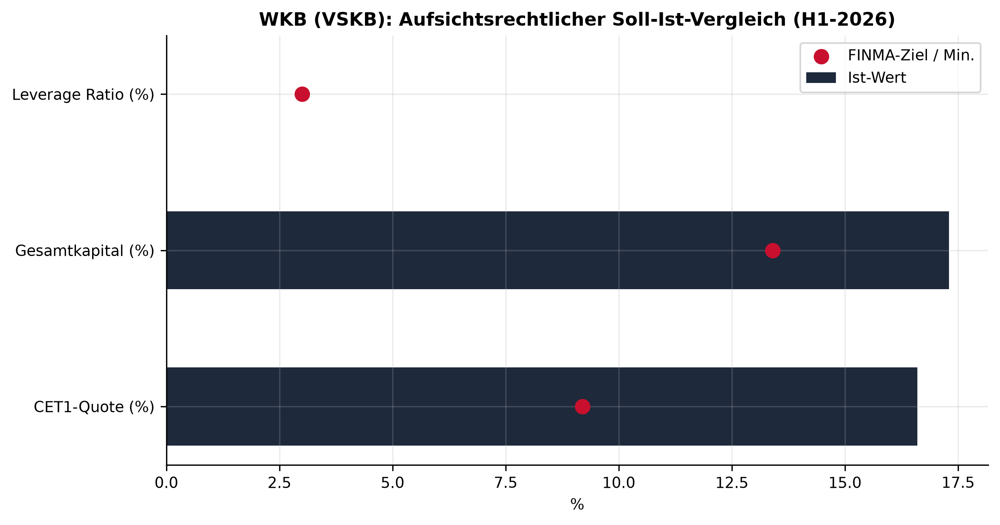
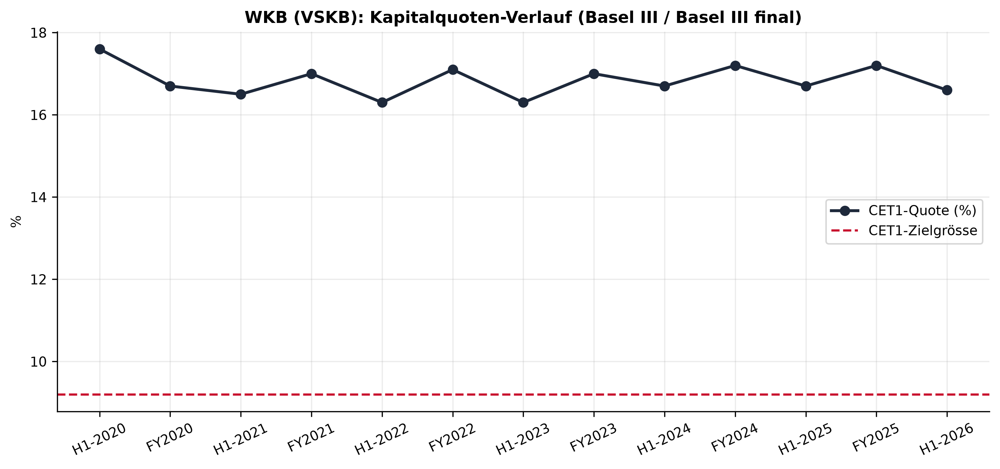

# 03 · Aufsichtsrechtliche Resilienz & Basel III: Walliser Kantonalbank (BCVs)

> **FINMA-Kategorie:** Kategorie 3 | **CET1-Zielgrösse:** 9,20 % | **Gesamtkapital-Ziel:** 13,40 %

## 1. Management Summary
- Am jüngsten Offenlegungsstichtag (**H1-2026**, Regime: *Basel III final*) beträgt die **CET1-Quote 16,60 %** (Puffer über Ziel: **7,40 Prozentpunkte**).
- Die Gesamtkapitalquote liegt bei **17,30 %**, die Leverage Ratio bei **– %**.
- Liquiditätsquoten: LCR **180,8 %**, NSFR **125,1 %** (Mindestanforderung je 100 %).

## 2. Quantitative Entwicklung (13 Stichtage)
| Periode | Regime | RWA (Mio.) | CET1 (Mio.) | CET1 % | Gesamtkap. % | Leverage % | LCR % | NSFR % |
| --- | --- | --- | --- | --- | --- | --- | --- | --- |
| H1-2020 | Basel III | 7'776,1 | 1'365,9 | 17,60 % | 17,60 % | – % | – % | – % |
| FY2020 | Basel III | 7'994,3 | – | 16,70 % | 17,50 % | – % | – % | – % |
| H1-2021 | Basel III | 8'069,2 | 1'333,2 | 16,50 % | 17,30 % | – % | – % | – % |
| FY2021 | Basel III | 8'110,1 | 1'379,4 | 17,00 % | 17,80 % | – % | – % | 128,0 % |
| H1-2022 | Basel III | 8'449,2 | 1'380,2 | 16,30 % | 17,10 % | – % | 163,3 % | 125,0 % |
| FY2022 | Basel III | 8'353,7 | 1'430,3 | 17,10 % | 17,80 % | – % | – % | 125,1 % |
| H1-2023 | Basel III | 8'787,4 | 1'431,4 | 16,30 % | 17,00 % | – % | 139,3 % | 126,5 % |
| FY2023 | Basel III | 8'845,8 | 1'507,7 | 17,00 % | 17,80 % | – % | – % | 123,9 % |
| H1-2024 | Basel III | 9'041,7 | 1'508,5 | 16,70 % | 17,40 % | – % | – % | 129,2 % |
| FY2024 | Basel III | 9'195,7 | 1'581,0 | 17,20 % | 17,90 % | – % | – % | 128,8 % |
| H1-2025 | Basel III final | 9'471,0 | 1'584,5 | 16,70 % | 17,40 % | – % | 171,0 % | 124,7 % |
| FY2025 | Basel III final | 9'575,4 | 1'646,7 | 17,20 % | 17,90 % | – % | – % | – % |
| H1-2026 | Basel III final | 9'910,3 | 1'649,5 | 16,60 % | 17,30 % | – % | 180,8 % | 125,1 % |

## 3. Treiberanalyse & Wendepunkte
- Mit Inkrafttreten von **Basel III final** ab 01.01.2025 verändern sich risikogewichtete Aktiven (RWA) und RWA-Dichte durch angepasste Standard- bzw. Output-Floor-Vorgaben.

## 4. Fazit & Ausblick
- Die Eigenmittel- und Liquiditätspuffer übertreffen die regulatorischen Mindestanforderungen für FINMA-Kategorie 3 deutlich.
