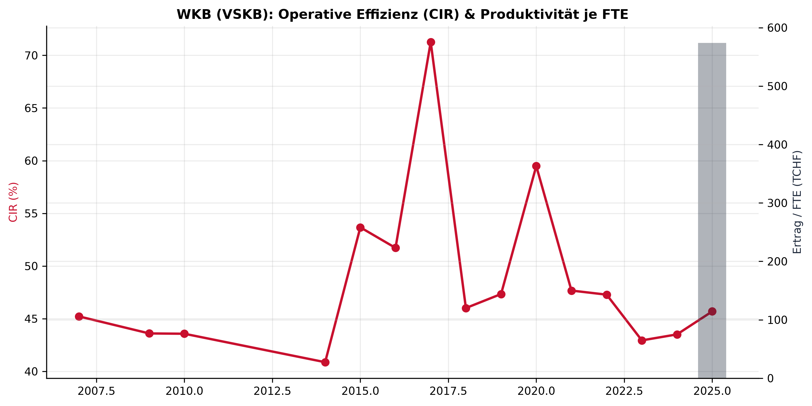

# 04 · Operative Effizienz & Transformation (2007–2025): Walliser Kantonalbank (BCVs)

## 1. Management Summary
- Die Cost-Income-Ratio (CIR) liegt im Jahr 2025 bei **47,22 %** (vs. 47,77 % im Jahr 2007), die Eigenkapitalrendite (ROE) bei **5,07 %**.
- Der Personalbestand umfasst 2025 **494,0 FTE** bei einem Ertrag pro Vollzeitstelle von **555,4 TCHF** und einem **Lohnkosten-/Produktivitätsverhältnis von 30,7 %** (bzw. **3,26×** Ertrag je CHF Personalaufwand).
- **Personalfluktuation:** Jüngster offengelegter Wert liegt im Jahr **2025** bei **8,0 %** (*Netto-Fluktuationsrate (exkl. Pensionierungen & Mutterschaft, 2016–2024) bzw. GRI 401-1 Taux de rotation du personnel (inkl. Brutto-Ausweis 2021–2025)*).

## 2. Quantitative Entwicklung
| Jahr | CIR % | ROE % | FTE | Fluktuation % | Ertrag/FTE (TCHF) | Lohn/FTE (TCHF) | Lohn/Ertrag % | Ertrag/Lohn | Bilanz/FTE (Mio.) |
| --- | --- | --- | --- | --- | --- | --- | --- | --- | --- |
| 2007 | 47,77 % | – % | – | 4,0 % | – | – | – % | –× | – |
| 2009 | 45,69 % | – % | – | 5,6 % | – | – | – % | –× | – |
| 2010 | 45,04 % | – % | – | 2,9 % | – | – | – % | –× | – |
| 2014 | 42,97 % | – % | – | 6,8 % | – | – | – % | –× | – |
| 2015 | 46,88 % | 4,98 % | – | 5,5 % | – | – | – % | –× | – |
| 2016 | 52,64 % | 4,56 % | – | 3,1 % | – | – | – % | –× | – |
| 2017 | 48,18 % | 4,84 % | – | 2,3 % | – | – | – % | –× | – |
| 2018 | 46,97 % | 4,90 % | – | 3,9 % | – | – | – % | –× | – |
| 2019 | 47,53 % | 4,75 % | – | – | – | – | – % | –× | – |
| 2020 | 60,52 % | 4,86 % | – | – | – | – | – % | –× | – |
| 2021 | 48,57 % | 4,78 % | – | 6,5 % | – | – | – % | –× | – |
| 2022 | 47,43 % | – % | – | 7,0 % | – | – | – % | –× | – |
| 2023 | 42,06 % | – % | – | 6,6 % | – | – | – % | –× | – |
| 2024 | 43,95 % | – % | – | 3,6 % | – | – | – % | –× | – |
| 2025 | 47,22 % | 5,07 % | 494,0 | 8,0 % | 555,4 | 170,6 | 30,7 % | 3,26× | 44,62 |

## 3. Treiberanalyse & Wendepunkte
- **2015:** Umstellung auf FINMA-RVB
- **2025:** Inkrafttreten Basel III final per 01.01.2025

## 4. Fazit & Ausblick
- Digitalisierung und Skalierung steigern Bilanzsumme und Geschäftsvolumen pro Vollzeitstelle langfristig.
