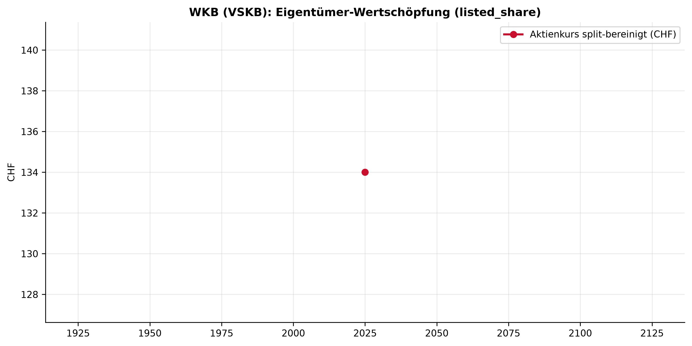

# 05 · Aktie, Dividenden & Investoren-Wertschöpfung (2007–2025): Walliser Kantonalbank (BCVs)

> **Eigentümer-Modus:** `listed_share` | **Staatsgarantie:** Ja | **Ticker:** `WKB`

## 1. Management Summary
- Im Geschäftsjahr 2025 erwirtschaftete WKB (VSKB) einen Gewinn von **85,9 Mio. CHF** bei einem Eigenkapital von **1'693,0 Mio. CHF**.
- **Aktuelle Ausschüttung (2025):** Kurs **134.00 CHF**, Dividende **4.00 CHF** (Rendite **2,99 %**).

## 2. Quantitative Entwicklung
| Jahr | Reingewinn (Mio.) | Eigenkapital (Mio.) | Aktienkurs (split-ber.) | Dividende/Aktie | Div.-Rendite | Öff. Ablieferung (Mio.) |
| --- | --- | --- | --- | --- | --- | --- |
| 2007 | 41,1 | – | – | – | – % | – |
| 2009 | 48,5 | – | – | – | – % | – |
| 2010 | 51,7 | – | – | – | – % | – |
| 2014 | 56,3 | – | – | – | – % | – |
| 2015 | 56,8 | – | – | – | – % | – |
| 2016 | 57,5 | – | – | – | – % | – |
| 2017 | 64,0 | – | – | – | – % | – |
| 2018 | 67,1 | – | – | – | – % | – |
| 2019 | 67,3 | – | – | – | – % | – |
| 2020 | 67,4 | – | – | – | – % | – |
| 2021 | 68,5 | – | – | – | – % | – |
| 2022 | 72,9 | – | – | – | – % | – |
| 2023 | 90,4 | – | – | – | – % | – |
| 2024 | 90,5 | – | – | – | – % | – |
| 2025 | 85,9 | 1'693,0 | 134.00 | 4.00 | 2,99 % | – |

## 3. Treiberanalyse & Wendepunkte (Investoren-Perspektive)
- Bei kotierten Instituten mit Aktiensplits (z. B. BCV 1:10 im Jahr 2020) sind sämtliche historischen Kurs- und Dividendenreihen deterministisch split-bereinigt.
- Im Branchenvergleich (siehe `comparison/reports/06_investoren_branchenvergleich.md`) werden P/B, P/E, Dividendenrendite und Eigentümer-Ablieferungen über alle 8 Institute eingeordnet.

## 4. Fazit, Führungsleistung & Ausblick
- Stabile Ertragskraft sichert langfristig Dividendenkontinuität bzw. verlässliche Ablieferungen an Kanton, Post oder Genossenschafter.
- Die detaillierte Leistungsbilanz von CEO und Verwaltungsratspräsidium aus Investoren- und Eigentümersicht findet sich im [CEO & Chairman of the Board Achievement Report](./08_ceo_und_vrp_leistungsbericht.md).
