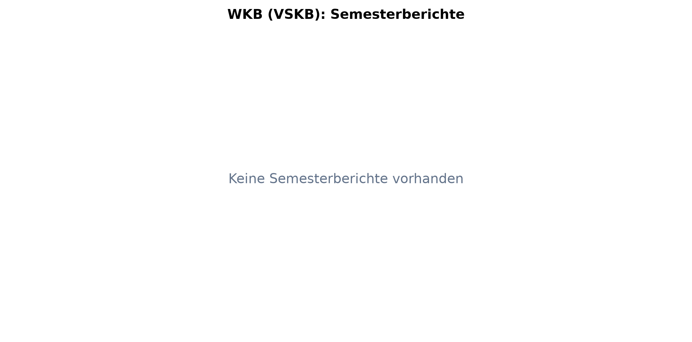

# 06 · Unterjährige Dynamik (Semesterberichte): Walliser Kantonalbank (BCVs)

## 1. Management Summary
- Vorliegen von **12 Halbjahresabschlüssen**; jüngster Stichtag ist **H1-2026** mit einem Geschäftsertrag von **147,1 Mio. CHF** und einem Halbjahresgewinn von **– Mio. CHF**.

## 2. Quantitative Entwicklung
| Periode | Bilanzsumme | Zinserfolg H1 | Geschäftsertrag H1 | Geschäftserfolg H1 | Reingewinn H1 |
| --- | --- | --- | --- | --- | --- |
| H1-2015 | – | – | – | – | – |
| H1-2016 | – | – | – | – | – |
| H1-2017 | 15'348'118,9 | 78'998,6 | – | 57'434,1 | – |
| H1-2018 | 15'979'527,5 | 79'562,6 | – | 59'012,1 | – |
| H1-2019 | 16'694'106,1 | 84'121,3 | – | 60'045,0 | – |
| H1-2020 | 17'840'942'885,5 | 86'181,5 | – | 60'295,5 | – |
| H1-2021 | 18'226'206,3 | 88,7 | 126,1 | 60,5 | – |
| H1-2022 | 19'235,8 | 89,2 | – | 61,2 | – |
| H1-2023 | 19'699,5 | 113,7 | – | 74,1 | – |
| H1-2024 | 20'526,5 | 114,2 | 147,4 | 75,2 | – |
| H1-2025 | 21'874,6 | 103,7 | – | 70,5 | – |
| H1-2026 | 22'798,3 | – | 147,1 | 72,5 | – |

## 3. Treiberanalyse & Wendepunkte
- Der Vergleich von H1-Werten gegen die jeweiligen Gesamtjahresergebnisse (FY) zeigt die saisonale Ertragsverteilung und Reservebildung im zweiten Halbjahr.

## 4. Fazit & Ausblick
- Die Halbjahresberichte ermöglichen ein zeitnahes Monitoring der Zinsmargen- und Kreditvolumen-Dynamik bis H1-2026.
