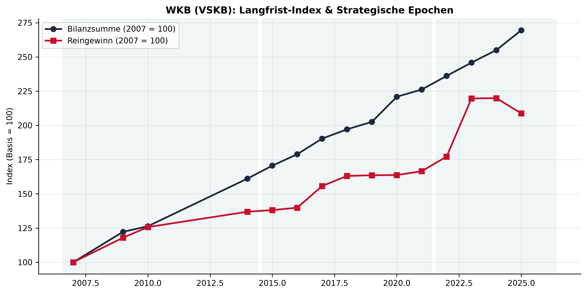
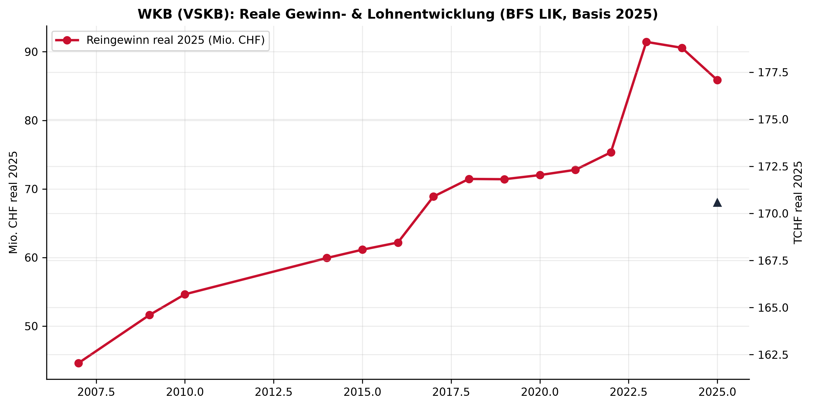

# 07 · Strategische Epochen, Governance, reale Vergütung & Vorsorge (2007–2025): Walliser Kantonalbank (BCVs)

> **Preisbasis:** Sämtliche Realgrössen sind mit dem offiziellen **BFS Landesindex der Konsumentenpreise (LIK, Dez. 1982 = 100)** deterministisch auf **reale CHF 2025** deflationiert.

## 1. Management Summary & Strategische Epochen
- **Epoche 1 (2007–2014):** Regionales Wachstum & Finanzkrise
- **Epoche 2 (2015–2021):** SNB-Negativzinsen & Kapitalstärkung
- **Epoche 3 (2022–2026):** Zinswende & Basel III final

## 2. Reale Gewinn-, Lohn- & Vergütungsentwicklung (real 2025 CHF)
| Jahr | Gewinn nom. | Gewinn real 2025 | Lohn/FTE real (TCHF) | Fluktuation % | VR real (TCHF) | CEO real (TCHF) | GL real (TCHF) |
| --- | --- | --- | --- | --- | --- | --- | --- |
| 2007 | 41,1 | 44,6 | – | 4,0 % | – | – | – |
| 2009 | 48,5 | 51,6 | – | 5,6 % | – | – | – |
| 2010 | 51,7 | 54,6 | – | 2,9 % | – | – | – |
| 2014 | 56,3 | 59,9 | – | 6,8 % | – | – | – |
| 2015 | 56,8 | 61,1 | – | 5,5 % | – | – | – |
| 2016 | 57,5 | 62,2 | – | 3,1 % | – | – | – |
| 2017 | 64,0 | 68,9 | – | 2,3 % | – | – | – |
| 2018 | 67,1 | 71,5 | – | 3,9 % | – | – | – |
| 2019 | 67,3 | 71,4 | – | – | – | – | – |
| 2020 | 67,4 | 72,0 | – | – | – | – | – |
| 2021 | 68,5 | 72,8 | – | 6,5 % | – | – | – |
| 2022 | 72,9 | 75,3 | – | 7,0 % | – | – | – |
| 2023 | 90,4 | 91,4 | – | 6,6 % | – | – | – |
| 2024 | 90,5 | 90,6 | – | 3,6 % | – | – | – |
| 2025 | 85,9 | 85,9 | 170,6 | 8,0 % | 1'150,0 | 790,0 | 3'250,0 |

## 3. Arbeitgeber-Attraktivität, Personalfluktuation & Vorsorgeeinrichtung (Pensionskasse)
- **Vorsorgeeinrichtung:** Pensions- und Vorsorgekasse für das Personal der Walliser Kantonalbank (*Beitragsprimat (umhüllend)*, Basis: `Swiss GAAP FER 16 / ARB`)
- **Versichertenstruktur:** Aktive **–**, Rentner **–** (Verhältnis Aktive/Rentner: **–**)
- **Deckungsgrad (BVG) / Reserven:** Deckungsgrad **– %**, Arbeitgeberbeitragsreserve **0,0 Mio. CHF**, Sondereinlagen **29,0 Mio. CHF**
- **CEO-zu-Mitarbeitenden-Pay-Ratio (2025):** **4,6×** (CEO real 2025: 790,0 TCHF vs. Ø Personalaufwand/FTE: 170,6 TCHF)
- **Quelle Vorsorge:** `vskb/.md/vskb-geschaeftsbericht-2025.md (Anhang 8.13, S. 78)` — Überdeckung per 31.12.2025: 119,273 Mio. CHF; bezahlte Arbeitgeberbeiträge 2025: 11,810 Mio. CHF (Vorsorgeaufwand 11,764 Mio. CHF); 2020 Sondereinlage 29,0 Mio. CHF.
- **Personalfluktuation (18 Berichtsjahre, 2003–2025):** **2003:** 5,4 %, **2004:** 4,4 %, **2005:** 4,9 %, **2006:** 3,8 %, **2007:** 4,0 %, **2008:** 3,3 %, **2009:** 5,6 %, **2010:** 2,9 %, **2014:** 6,8 %, **2015:** 5,5 %, **2016:** 3,1 % (Netto 3,1 % / Brutto 6,8 %), **2017:** 2,3 % (Netto 2,3 % / Brutto 5,2 %), **2018:** 3,9 % (Netto 3,9 % / Brutto 5,9 %), **2021:** 6,5 % (Netto 6,5 % / Brutto 10,8 %), **2022:** 7,0 % (Netto 7,0 % / Brutto 11,3 %), **2023:** 6,6 % (Netto 6,6 % / Brutto 11,5 %), **2024:** 3,6 % (Netto 3,6 % / Brutto 8,1 %), **2025:** 8,0 %
- **Methodik & Quelle Fluktuation:** Netto-Fluktuationsrate (exkl. Pensionierungen & Mutterschaft, 2016–2024) bzw. GRI 401-1 Taux de rotation du personnel (inkl. Brutto-Ausweis 2021–2025) (`vskb/.md/vskb-geschaeftsbericht-2007..2024.md & BCVS Rapports RSE / CSR Reports 2023 (p. 63), 2024 (p. 38) & 2025 (p. 24) – GRI 401-1`)

## 4. Treiberanalyse, Strukturbrüche & Ausblick
- **2015:** Umstellung auf FINMA-RVB
- **2025:** Inkrafttreten Basel III final per 01.01.2025
- Die gemeinsame Inflationsbereinigung auf `real 2025 CHF` ermöglicht den unverzerrten Vergleich von Produktivität, Reallöhnen, Personalfluktuation, Pay Ratio und Pensionskassen-Resilienz im Branchenvergleich (`comparison/reports/07_mitarbeiter_und_vorsorge_branchenvergleich.md`).
