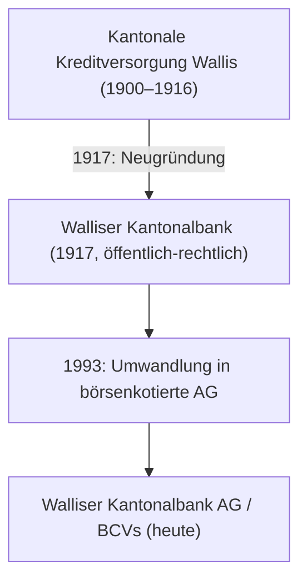

# 10 · Fusionsbaum & Institutsgeschichte seit 1900: Walliser Kantonalbank (BCVs)

> **Gründung / Ursprung:** 1917 (Walliser Kantonalbank / Banque Cantonale du Valais) | **Aktuelle Rechtsform:** `listed_ag` | **FINMA-Kategorie:** 3

## 1. Überblick der Institutslinie (1900–2026)
Die Walliser Kantonalbank (WKB | BCVs) wurde 1917 als öffentlich-rechtliche Staatsbank des Kantons Wallis gegründet (nachdem die frühere Banque Cantonale du Valais von 1858–1871 liquidiert worden war). Seit 1900 blieb das Institut nach seiner Neugründung 1917 frei von Grossfusionen und wurde 1993 in eine börsenkotierte spezialgesetzliche Aktiengesellschaft umgewandelt.

## 2. Fusionsbaum (Mermaid-Diagramm seit 1900)

## 3. Chronologische Meilensteine (Fusionen, Übernahmen & Rechtsformwechsel)
| Jahr / Zeitraum | Institut / Ereignis | Typ | Bedeutung & Auswirkung |
| --- | --- | --- | --- |
| 1900–1916 | Übergangsphase nach Liquidation der ersten WKB (1871) | Vorgeschichte | Kantonale Kreditversorgung über Sparkassen und Hypothekarkasse vor Neugründung |
| 1917 | Gründung der Walliser Kantonalbank (WKB / BCVs) | Gründung | Öffentlich-rechtliche Anstalt mit voller Staatsgarantie des Kantons Wallis |
| 1993 | Umwandlung in eine Aktiengesellschaft (SIX-kotiert) | Rechtsformwechsel | Öffnung des Aktienkapitals für private und institutionelle Investoren |
| 2017–2026 | 100-Jahr-Jubiläum & digitales Universalbank-Ausbau | Organisches Wachstum | 22 Filialen in Ober-, Mittel- und Unterwallis; keine Grossfusionen |

- **Quellenbasis:** `WKB / BCVs Geschäftsberichte; Historisches Lexikon der Schweiz`
