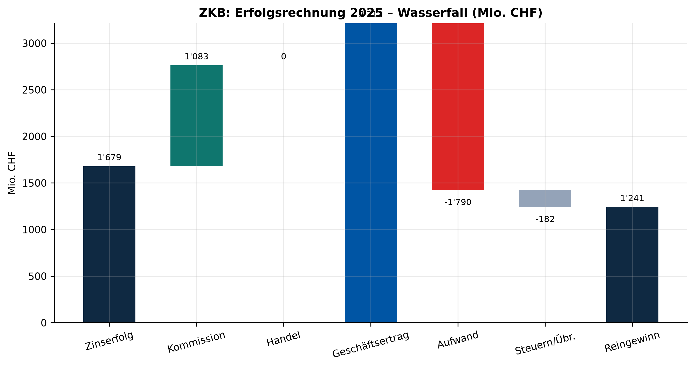
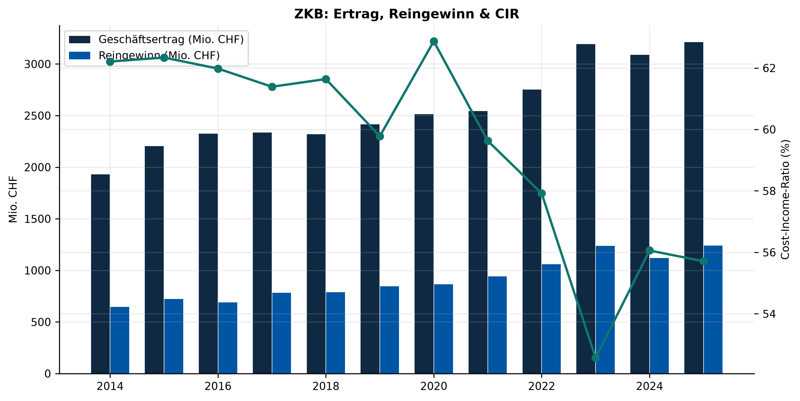

# 01 · Zinszyklen & Ertragsarchitektur (2014–2025): Zürcher Kantonalbank

> **Scope:** `consolidated` | **Standard:** `ARB_RVB` | **Währung:** Mio. CHF (harmonisierte Zeitreihe)

## 1. Management Summary
- Im Zeitraum **2014–2025** entwickelte sich der Geschäftsertrag von **1'929,0 Mio. CHF** auf **3'213,0 Mio. CHF** (CAGR **4,75 % p. a.**).
- Der Reingewinn erreichte im jüngsten Geschäftsjahr 2025 **1'241,0 Mio. CHF** (nach 647,0 Mio. CHF im Jahr 2014).
- Der Netto-Zinserfolg trägt aktuell **52,3 %** zum Gesamtertrag bei, das Kommissionsgeschäft **33,7 %** und das Handelsgeschäft **– %**.

## 2. Quantitative Entwicklung
| Jahr | Zinserfolg (Mio.) | Kommission (Mio.) | Handel (Mio.) | Geschäftsertrag | Geschäftserfolg | Reingewinn | Zinsanteil |
| --- | --- | --- | --- | --- | --- | --- | --- |
| 2014 | 1'070,0 | 531,0 | 287,0 | 1'929,0 | 735,0 | 647,0 | 55,5 % |
| 2015 | 1'162,0 | 663,0 | 328,0 | 2'204,0 | 664,0 | 722,0 | 52,7 % |
| 2016 | 1'187,0 | 728,0 | 379,0 | 2'325,0 | 752,0 | 691,0 | 51,0 % |
| 2017 | – | – | – | 2'336,0 | 784,0 | 782,0 | – % |
| 2018 | – | – | – | 2'320,0 | 892,0 | 788,0 | – % |
| 2019 | – | – | – | 2'414,0 | 846,0 | 845,0 | – % |
| 2020 | – | – | – | 2'513,0 | 801,0 | 865,0 | – % |
| 2021 | – | – | – | 2'544,0 | 951,0 | 942,0 | – % |
| 2022 | – | – | – | 2'752,0 | 1'059,0 | 1'059,0 | – % |
| 2023 | 1'821,0 | 940,0 | – | 3'194,0 | 1'469,0 | 1'238,0 | 57,0 % |
| 2024 | 1'680,0 | 1'024,0 | – | 3'088,0 | 1'277,0 | 1'120,0 | 54,4 % |
| 2025 | 1'679,0 | 1'083,0 | – | 3'213,0 | 1'354,0 | 1'241,0 | 52,3 % |

## 3. Treiberanalyse & Wendepunkte
- **2015:** Übernahme Swisscanto & FINMA-RVB
- **2024:** AuM-Umklassierung Custody Services (-55 Mrd. CHF) & OECD-Mindeststeuer
- **2025:** Inkrafttreten Basel III final per 01.01.2025

## 4. Fazit & Ausblick
- Die Ertragsarchitektur von ZKB spiegelt die Zinszyklen (Negativzinsphase 2015–2022, Zinswende 2022–2024, Zinssenkungen ab 2025) unmittelbar wider.
