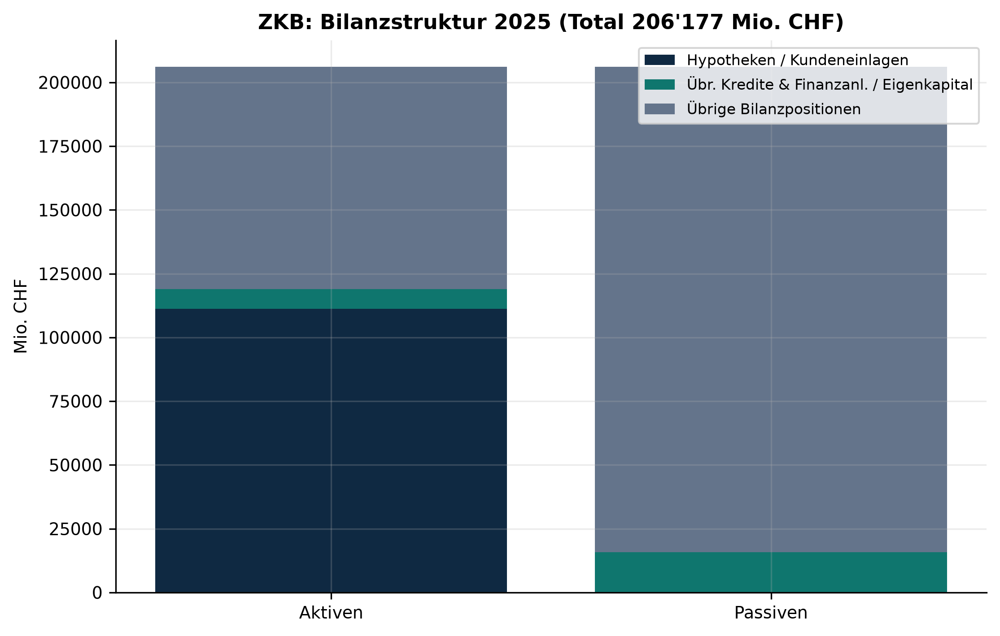
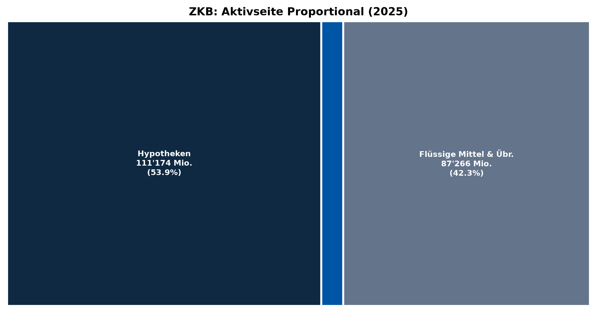
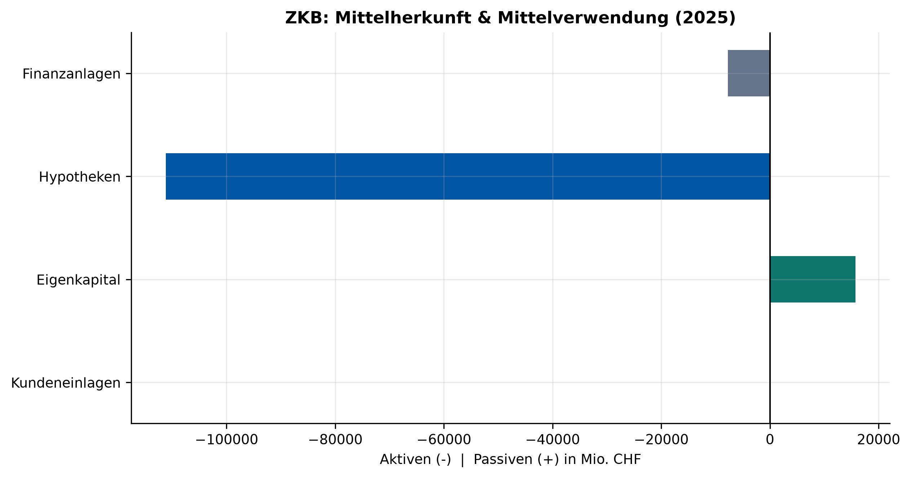
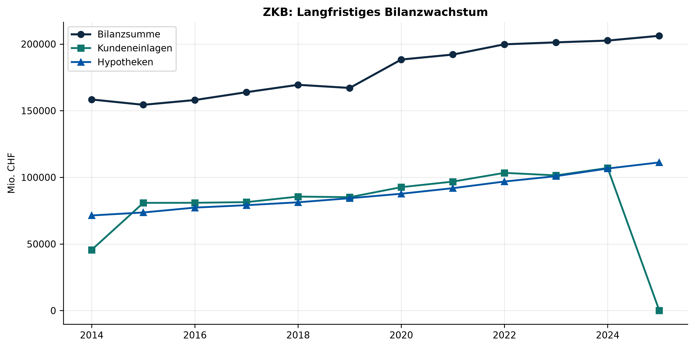

# 02 · Bilanzwachstum, Hypotheken & Refinanzierung (2014–2025): Zürcher Kantonalbank

## 1. Management Summary
- Die Bilanzsumme wuchs von **158'392,0 Mio. CHF** (2014) auf **206'177,0 Mio. CHF** (2025, CAGR **2,43 %**).
- Die Hypothekarforderungen machen im Jahr 2025 **53,9 %** der Bilanzsumme aus.
- Die Kundeneinlagen belaufen sich 2025 auf **114,3 Mio. CHF**, das Eigenkapital auf **15'727,0 Mio. CHF** (Eigenkapitalquote **7,63 %**).

## 2. Quantitative Entwicklung
| Jahr | Bilanzsumme | Hypotheken | Finanzanlagen | Kundeneinlagen | Eigenkapital | Deckungsgrad |
| --- | --- | --- | --- | --- | --- | --- |
| 2014 | 158'392,0 | 71'389,0 | 4'027,0 | 45'624,0 | – | 52,8 % |
| 2015 | 154'410,0 | 73'623,0 | 4'320,0 | 80'820,0 | – | 99,4 % |
| 2016 | 157'985,0 | 77'275,0 | 4'156,0 | 80'890,0 | – | 95,4 % |
| 2017 | 163'881,0 | 79'087,0 | 4'740,0 | 81'381,0 | – | 102,9 % |
| 2018 | 169'408,0 | 81'256,0 | 4'705,0 | 85'537,0 | – | 105,3 % |
| 2019 | 167'054,0 | 84'311,0 | 4'422,0 | 85'089,0 | – | 100,9 % |
| 2020 | 188'364,0 | 87'679,0 | 5'035,0 | 92'609,0 | – | 105,6 % |
| 2021 | 192'105,0 | 91'847,0 | 4'759,0 | 96'777,0 | – | 105,4 % |
| 2022 | 199'791,0 | 96'838,0 | 7'490,0 | 103'351,0 | – | 106,7 % |
| 2023 | 201'259,0 | 100'874,0 | 5'577,0 | 101'452,0 | 14'268,0 | 100,6 % |
| 2024 | 202'594,0 | 106'600,0 | 5'206,0 | 106'980,0 | 14'862,0 | 100,4 % |
| 2025 | 206'177,0 | 111'174,0 | 7'737,0 | 114,3 | 15'727,0 | 0,1 % |

## 3. Treiberanalyse & Wendepunkte
- **2015:** Übernahme Swisscanto & FINMA-RVB
- **2024:** AuM-Umklassierung Custody Services (-55 Mrd. CHF) & OECD-Mindeststeuer
- **2025:** Inkrafttreten Basel III final per 01.01.2025

## 4. Fazit & Ausblick
- Refinanzierungsbasis und Bilanzstruktur bleiben eng an Kundeneinlagen und die jeweilige Geschäftsmodell-Spezialisierung gekoppelt.
