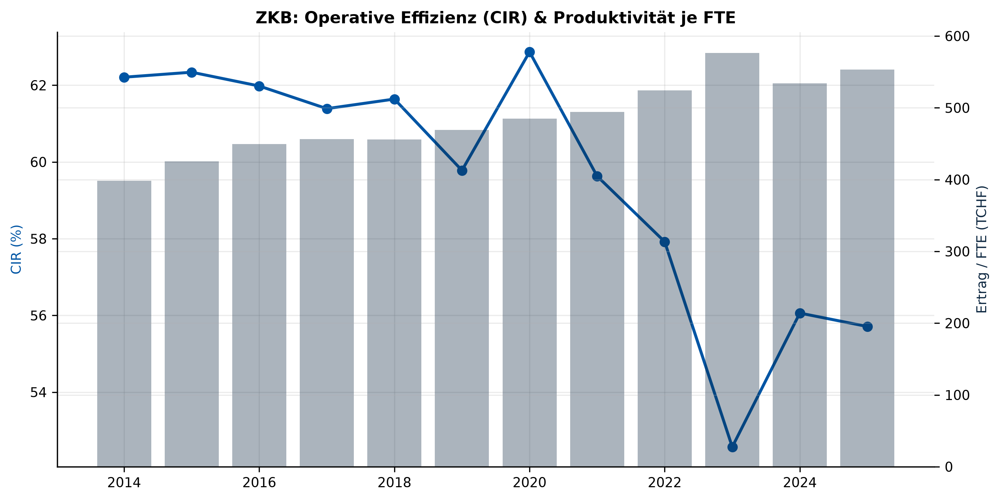

# 04 · Operative Effizienz & Transformation (2014–2025): Zürcher Kantonalbank

## 1. Management Summary
- Die Cost-Income-Ratio (CIR) liegt im Jahr 2025 bei **55,71 %** (vs. 62,21 % im Jahr 2014), die Eigenkapitalrendite (ROE) bei **7,89 %**.
- Der Personalbestand umfasst 2025 **5'809,0 FTE** bei einem Ertrag pro Vollzeitstelle von **553,1 TCHF** und einem **Lohnkosten-/Produktivitätsverhältnis von 38,9 %** (bzw. **2,57×** Ertrag je CHF Personalaufwand).

## 2. Quantitative Entwicklung
| Jahr | CIR % | ROE % | FTE | Ertrag/FTE (TCHF) | Lohn/FTE (TCHF) | Lohn/Ertrag % | Ertrag/Lohn | Bilanz/FTE (Mio.) |
| --- | --- | --- | --- | --- | --- | --- | --- | --- |
| 2014 | 62,21 % | – % | 4'844,0 | 398,2 | 168,5 | 42,3 % | 2,36× | 32,70 |
| 2015 | 62,34 % | – % | 5'179,0 | 425,6 | – | – % | –× | 29,81 |
| 2016 | 61,98 % | – % | 5'173,0 | 449,4 | – | – % | –× | 30,54 |
| 2017 | 61,39 % | – % | 5'117,0 | 456,5 | – | – % | –× | 32,03 |
| 2018 | 61,64 % | – % | 5'087,0 | 456,1 | – | – % | –× | 33,30 |
| 2019 | 59,78 % | – % | 5'145,0 | 469,2 | – | – % | –× | 32,47 |
| 2020 | 62,87 % | – % | 5'180,0 | 485,1 | – | – % | –× | 36,36 |
| 2021 | 59,63 % | – % | 5'145,0 | 494,5 | – | – % | –× | 37,34 |
| 2022 | 57,92 % | – % | 5'249,0 | 524,3 | – | – % | –× | 38,06 |
| 2023 | 52,57 % | 8,68 % | 5'539,0 | 576,6 | – | – % | –× | 36,33 |
| 2024 | 56,06 % | 7,54 % | 5'779,0 | 534,3 | 211,6 | 39,6 % | 2,52× | 35,06 |
| 2025 | 55,71 % | 7,89 % | 5'809,0 | 553,1 | 215,0 | 38,9 % | 2,57× | 35,49 |

## 3. Treiberanalyse & Wendepunkte
- **2015:** Übernahme Swisscanto & FINMA-RVB
- **2024:** AuM-Umklassierung Custody Services (-55 Mrd. CHF) & OECD-Mindeststeuer
- **2025:** Inkrafttreten Basel III final per 01.01.2025

## 4. Fazit & Ausblick
- Digitalisierung und Skalierung steigern Bilanzsumme und Geschäftsvolumen pro Vollzeitstelle langfristig.
