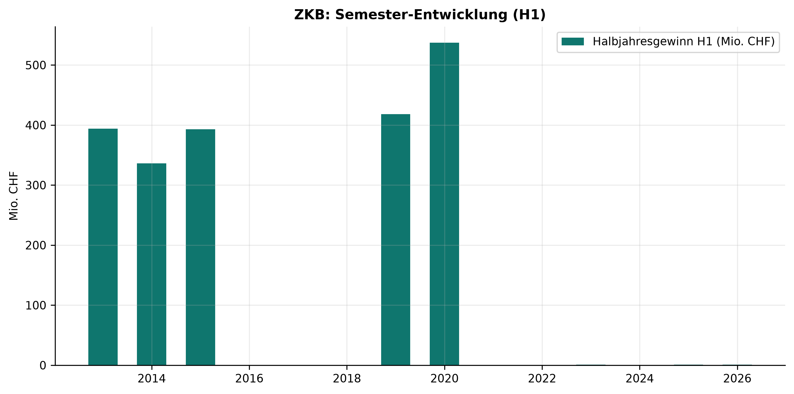

# 06 · Unterjährige Dynamik (Semesterberichte): Zürcher Kantonalbank

## 1. Management Summary
- Vorliegen von **14 Halbjahresabschlüssen**; jüngster Stichtag ist **H1-2026** mit einem Geschäftsertrag von **1,7 Mio. CHF** und einem Halbjahresgewinn von **0,7 Mio. CHF**.

## 2. Quantitative Entwicklung
| Periode | Bilanzsumme | Zinserfolg H1 | Geschäftsertrag H1 | Geschäftserfolg H1 | Reingewinn H1 |
| --- | --- | --- | --- | --- | --- |
| H1-2013 | 149,8 | 0,6 | 1,1 | 0,5 | 394,0 |
| H1-2014 | 154,8 | 0,5 | 1,0 | 0,4 | 336,0 |
| H1-2015 | 161,8 | 0,5 | 1,1 | 0,4 | 393,0 |
| H1-2016 | 151,6 | 0,6 | 1,1 | 0,4 | – |
| H1-2017 | 158,4 | 0,6 | 1,2 | 0,4 | – |
| H1-2018 | -0,1 | 4,5 | 2,2 | 4,5 | – |
| H1-2019 | 170,6 | 0,6 | 1,2 | 0,4 | 418,0 |
| H1-2020 | 179'521,0 | 619,0 | 1'310,0 | 469,0 | 537,0 |
| H1-2021 | 190,9 | 0,6 | 1,3 | 0,5 | 0,5 |
| H1-2022 | 198,0 | 0,7 | 1,3 | 0,5 | 0,5 |
| H1-2023 | 202,9 | 0,9 | 1,7 | 0,8 | 0,7 |
| H1-2024 | 202,6 | – | 1,6 | 0,7 | 0,6 |
| H1-2025 | 199,8 | – | 1,6 | 0,7 | 0,7 |
| H1-2026 | 210,8 | 837,0 | 1,7 | 0,8 | 0,7 |

## 3. Treiberanalyse & Wendepunkte
- Der Vergleich von H1-Werten gegen die jeweiligen Gesamtjahresergebnisse (FY) zeigt die saisonale Ertragsverteilung und Reservebildung im zweiten Halbjahr.

## 4. Fazit & Ausblick
- Die Halbjahresberichte ermöglichen ein zeitnahes Monitoring der Zinsmargen- und Kreditvolumen-Dynamik bis H1-2026.
