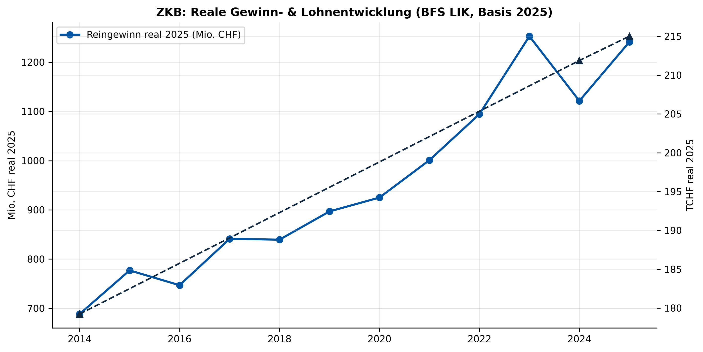

# 07 · Strategische Epochen, Governance, reale Vergütung & Vorsorge (2014–2025): Zürcher Kantonalbank

> **Preisbasis:** Sämtliche Realgrössen sind mit dem offiziellen **BFS Landesindex der Konsumentenpreise (LIK, Dez. 1982 = 100)** deterministisch auf **reale CHF 2025** deflationiert.

## 1. Management Summary & Strategische Epochen
- **Epoche 1 (2014–2019):** Swisscanto-Integration & D-SIB-Aufbau
- **Epoche 2 (2020–2022):** Pandemie-Bilanzausweitung & Negativzinsende
- **Epoche 3 (2023–2026):** Zinswende, Custody-Umklassierung & OECD-Steuer

## 2. Reale Gewinn-, Lohn- & Vergütungsentwicklung (real 2025 CHF)
| Jahr | Gewinn nom. | Gewinn real 2025 | Lohn/FTE real (TCHF) | Fluktuation % | VR real (TCHF) | CEO real (TCHF) | GL real (TCHF) |
| --- | --- | --- | --- | --- | --- | --- | --- |
| 2014 | 647,0 | 688,4 | 179,2 | 7,7 % | – | – | – |
| 2015 | 722,0 | 776,9 | – | 6,8 % | – | – | – |
| 2016 | 691,0 | 746,9 | – | 5,9 % | – | – | – |
| 2017 | 782,0 | 841,0 | – | 5,7 % | – | – | – |
| 2018 | 788,0 | 839,4 | – | 6,3 % | – | – | – |
| 2019 | 845,0 | 896,8 | – | 5,8 % | – | – | – |
| 2020 | 865,0 | 925,0 | – | 4,5 % | – | – | – |
| 2021 | 942,0 | 1'001,0 | – | 5,9 % | – | – | – |
| 2022 | 1'059,0 | 1'094,5 | – | 6,4 % | – | – | – |
| 2023 | 1'238,0 | 1'252,8 | – | 6,1 % | – | – | – |
| 2024 | 1'120,0 | 1'121,3 | 211,9 | 5,5 % | – | – | – |
| 2025 | 1'241,0 | 1'241,0 | 215,0 | 5,0 % | 2'480,0 | 2'826,2 | 16'500,0 |

## 3. Arbeitgeber-Attraktivität, Personalfluktuation & Vorsorgeeinrichtung (Pensionskasse)
- **Vorsorgeeinrichtung:** Pensionskasse der Zürcher Kantonalbank (*Beitragsprimat (umhüllend)*, Basis: `Swiss GAAP FER 16 / ARB`)
- **Versichertenstruktur:** Aktive **6'179**, Rentner **2'308** (Verhältnis Aktive/Rentner: **2,68**)
- **Deckungsgrad (BVG) / Reserven:** Deckungsgrad **117,6 %**, Arbeitgeberbeitragsreserve **0,0 Mio. CHF**, Sondereinlagen **0,0 Mio. CHF**
- **CEO-zu-Mitarbeitenden-Pay-Ratio (2025):** **13,1×** (CEO real 2025: 2'826,2 TCHF vs. Ø Personalaufwand/FTE: 215,0 TCHF)
- **Quelle Vorsorge:** `zkb/.md/zkb-geschaeftsbericht-2025.md (Personalbericht & Anhang 13, S. 147–148)` — 2025: 6'179 Aktive / 2'308 Rentner; PK-Vermögen ~6,0 Mrd. CHF; Deckungsgrad 117,6 % (gerundet 118 %; Marienburg-Kaderstiftung 110 %); bezahlte Beiträge 2025: 122 Mio. CHF.
- **Personalfluktuation (16 Berichtsjahre, 2010–2025):** **2010:** 6,4 %, **2011:** 6,5 %, **2012:** 6,5 %, **2013:** 7,7 %, **2014:** 7,7 %, **2015:** 6,8 %, **2016:** 5,9 %, **2017:** 5,7 %, **2018:** 6,3 %, **2019:** 5,8 %, **2020:** 4,5 %, **2021:** 5,9 %, **2022:** 6,4 %, **2023:** 6,1 %, **2024:** 5,5 %, **2025:** 5,0 %
- **Methodik & Quelle Fluktuation:** Fluktuationsrate Stammhaus in % (Personalbericht / Kennzahlen Beschäftigung) (`zkb/.md/zkb-geschaeftsbericht-2014..2025.md (Kapitel «Mitarbeitende / Unternehmensprofil»)`)

## 4. Treiberanalyse, Strukturbrüche & Ausblick
- **2015:** Übernahme Swisscanto & FINMA-RVB
- **2024:** AuM-Umklassierung Custody Services (-55 Mrd. CHF) & OECD-Mindeststeuer
- **2025:** Inkrafttreten Basel III final per 01.01.2025
- Die gemeinsame Inflationsbereinigung auf `real 2025 CHF` ermöglicht den unverzerrten Vergleich von Produktivität, Reallöhnen, Personalfluktuation, Pay Ratio und Pensionskassen-Resilienz im Branchenvergleich (`comparison/reports/07_mitarbeiter_und_vorsorge_branchenvergleich.md`).
