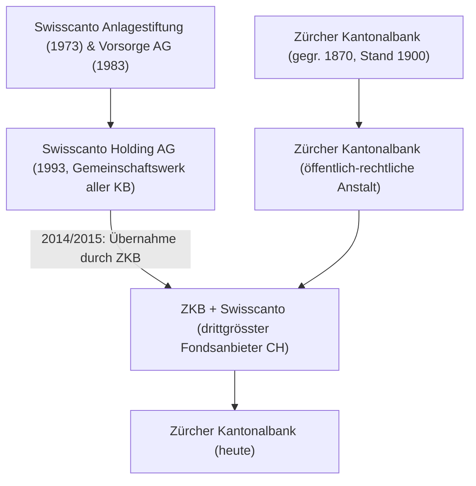

# 10 · Fusionsbaum & Institutsgeschichte seit 1900: Zürcher Kantonalbank

> **Gründung / Ursprung:** 1870 (Zürcher Kantonalbank) | **Aktuelle Rechtsform:** `cantonal_institution` | **FINMA-Kategorie:** 2

## 1. Überblick der Institutslinie (1900–2026)
Die Zürcher Kantonalbank (ZKB) wurde 1870 gegründet und operiert seit 1900 ununterbrochen als selbstständige öffentlich-rechtliche Anstalt des Kantons Zürich. Der bedeutendste anorganische Wachstumsschritt seit 1900 war die Übernahme der Swisscanto Holding AG (2014/2015) von den übrigen Kantonalbanken.

## 2. Fusionsbaum (Mermaid-Diagramm seit 1900)

## 3. Chronologische Meilensteine (Fusionen, Übernahmen & Rechtsformwechsel)
| Jahr / Zeitraum | Institut / Ereignis | Typ | Bedeutung & Auswirkung |
| --- | --- | --- | --- |
| 1870 / 1900 | Zürcher Kantonalbank | Ausgangslage 1900 | Selbstständige öffentlich-rechtliche Anstalt mit unbeschränkter Staatsgarantie |
| 1973 / 1983 / 1993 | Gründung Swisscanto-Gruppe (Anlagestiftung, Vorsorge AG, Holding AG) | Gemeinschaftsplattform | Gemeinsame Fonds- und Vorsorgeplattform der Schweizer Kantonalbanken |
| 2014–2015 | Übernahme der Swisscanto Holding AG | Akquisition | Vollständige Integration von Swisscanto in die ZKB (rückwirkend per 01.07.2014) |
| 2022–2026 | Swisscanto-Markenvereinheitlichung & Asset Management | Integration | Ausbau zur Top-3-Fondsanbieterin der Schweiz (~500 Mrd. CHF AuM) |

- **Quellenbasis:** `ZKB Geschäftsberichte; Swisscanto Chronik (swisscanto.com)`
