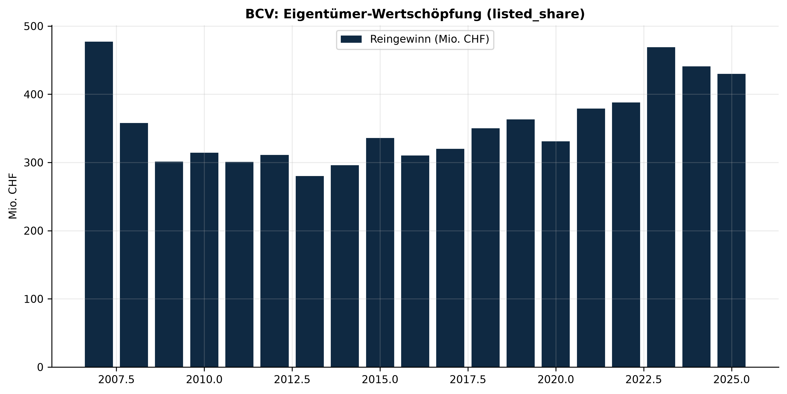

# 05 · Aktie, Dividenden & Wertschöpfung (2007–2025): Banque Cantonale Vaudoise

> **Eigentümer-Modus:** `listed_share` | **Staatsgarantie:** Keine | **Ticker:** `BCVN`

## 1. Management Summary
- Im Geschäftsjahr 2025 erwirtschaftete BCV einen Gewinn von **430,0 Mio. CHF** bei einem Eigenkapital von **– Mio. CHF**.
- Die Ausschüttungs- und Kapitalstruktur folgt dem spezifischen Governance-Modell (`listed_share`).

## 2. Quantitative Entwicklung
| Jahr | Reingewinn (Mio.) | Eigenkapital (Mio.) | Aktienkurs (split-ber.) | Dividende/Aktie | Div.-Rendite | Öff. Ablieferung (Mio.) |
| --- | --- | --- | --- | --- | --- | --- |
| 2007 | 477,3 | 3'225,1 | – | – | – % | – |
| 2008 | 357,7 | 3'176,9 | – | – | – % | – |
| 2009 | 301,4 | 3'221,8 | – | – | – % | – |
| 2010 | 314,1 | 3'270,8 | – | – | – % | – |
| 2011 | 301,0 | 3'301,0 | – | 2.20 | – % | – |
| 2012 | 311,0 | 3'315,0 | – | 2.20 | – % | – |
| 2013 | 280,0 | 3'322,0 | – | 2.20 | – % | – |
| 2014 | 296,0 | 3'341,0 | – | 2.20 | – % | – |
| 2015 | 336,0 | – | – | 2.30 | – % | – |
| 2016 | 310,0 | – | – | 2.30 | – % | – |
| 2017 | 320,0 | 3'457,0 | – | 2.30 | – % | – |
| 2018 | 350,0 | 3'522,0 | – | 3.50 | – % | – |
| 2019 | 363,0 | 3'586,0 | – | 3.60 | – % | – |
| 2020 | 331,0 | 3'574,0 | – | 23.00 | – % | – |
| 2021 | 379,0 | 3'644,0 | – | – | – % | – |
| 2022 | 388,0 | 3'713,0 | – | – | – % | – |
| 2023 | 469,0 | – | – | – | – % | – |
| 2024 | 441,0 | – | – | – | – % | – |
| 2025 | 430,0 | – | – | 4'403.00 | – % | – |

## 3. Treiberanalyse & Wendepunkte
- Bei kotierten Instituten mit Aktiensplits (z. B. BCV 1:10 im Jahr 2020) sind sämtliche historischen Kurs- und Dividendenreihen deterministisch split-bereinigt.

## 4. Fazit & Ausblick
- Stabile Ertragskraft sichert langfristig Dividendenkontinuität bzw. verlässliche Ablieferungen an Kanton, Post oder Genossenschafter.
