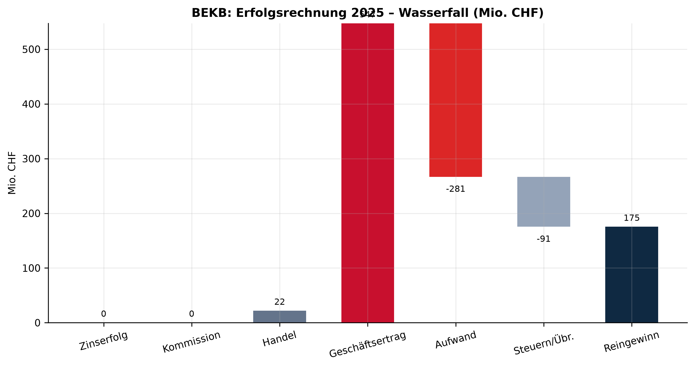
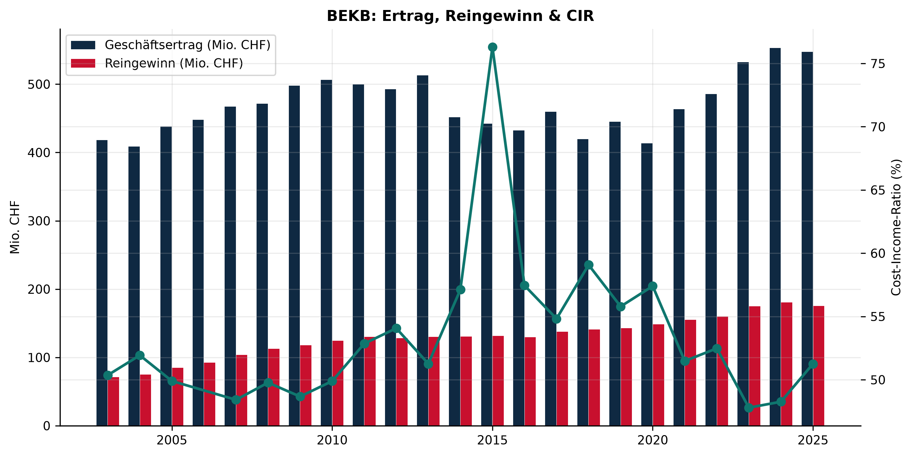

# 01 · Zinszyklen & Ertragsarchitektur (2003–2025): Berner Kantonalbank AG

> **Scope:** `standalone` | **Standard:** `ARB_RVB` | **Währung:** Mio. CHF (harmonisierte Zeitreihe)

## 1. Management Summary
- Im Zeitraum **2003–2025** entwickelte sich der Geschäftsertrag von **418,1 Mio. CHF** auf **547,3 Mio. CHF** (CAGR **1,23 % p. a.**).
- Der Reingewinn erreichte im jüngsten Geschäftsjahr 2025 **175,4 Mio. CHF** (nach 71,1 Mio. CHF im Jahr 2003).
- Der Netto-Zinserfolg trägt aktuell **– %** zum Gesamtertrag bei, das Kommissionsgeschäft **– %** und das Handelsgeschäft **4,0 %**.

## 2. Quantitative Entwicklung
| Jahr | Zinserfolg (Mio.) | Kommission (Mio.) | Handel (Mio.) | Geschäftsertrag | Geschäftserfolg | Reingewinn | Zinsanteil |
| --- | --- | --- | --- | --- | --- | --- | --- |
| 2003 | – | – | – | 418,1 | 207,5 | 71,1 | – % |
| 2004 | 268,7 | 78,0 | 19,8 | 408,7 | 196,5 | 74,7 | 65,7 % |
| 2005 | 273,2 | 85,7 | 22,6 | 437,9 | 219,4 | 85,0 | 62,4 % |
| 2006 | – | – | – | 447,9 | – | 92,2 | – % |
| 2007 | – | – | 27,6 | 467,2 | 241,0 | 103,8 | – % |
| 2008 | – | – | 37,8 | 471,3 | 236,7 | 112,7 | – % |
| 2009 | – | – | 25,4 | 497,8 | 255,5 | 118,0 | – % |
| 2010 | – | – | 22,7 | 506,4 | 253,7 | 124,4 | – % |
| 2011 | – | – | 27,2 | 499,5 | 235,5 | 130,1 | – % |
| 2012 | – | – | 21,9 | 492,6 | 226,2 | 128,1 | – % |
| 2013 | – | – | 21,2 | 512,7 | 234,6 | 130,1 | – % |
| 2014 | – | – | 21,9 | 451,4 | 193,6 | 130,4 | – % |
| 2015 | – | – | 21,3 | 442,2 | 61,3 | 131,3 | – % |
| 2016 | – | – | 19,3 | 432,2 | 146,0 | 129,4 | – % |
| 2017 | – | – | 21,8 | 459,6 | 145,8 | 137,4 | – % |
| 2018 | – | – | 20,8 | 419,5 | 137,5 | 140,8 | – % |
| 2019 | – | – | 24,0 | 445,0 | 160,2 | 142,9 | – % |
| 2020 | – | – | 20,9 | 413,2 | 112,7 | 148,4 | – % |
| 2021 | – | – | 24,9 | 463,5 | 178,6 | 154,9 | – % |
| 2022 | – | – | 37,5 | 485,7 | 170,4 | 159,6 | – % |
| 2023 | – | – | 24,3 | 532,3 | 238,9 | 174,9 | – % |
| 2024 | – | – | 25,0 | 553,1 | 247,9 | 180,7 | – % |
| 2025 | – | – | 21,9 | 547,3 | 220,7 | 175,4 | – % |

## 3. Treiberanalyse & Wendepunkte
- **2015:** Umstellung auf FINMA-RVB sowie einmalige PK-Sanierungseinlage (83,8 Mio. CHF)
- **2025:** Inkrafttreten Basel III final per 01.01.2025

## 4. Fazit & Ausblick
- Die Ertragsarchitektur von BEKB spiegelt die Zinszyklen (Negativzinsphase 2015–2022, Zinswende 2022–2024, Zinssenkungen ab 2025) unmittelbar wider.
