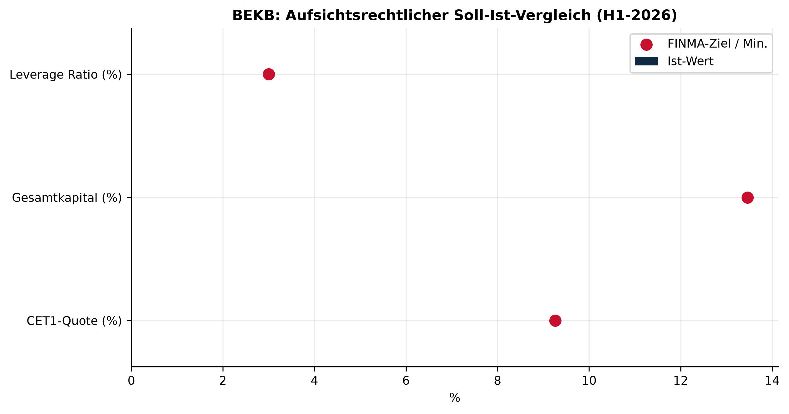
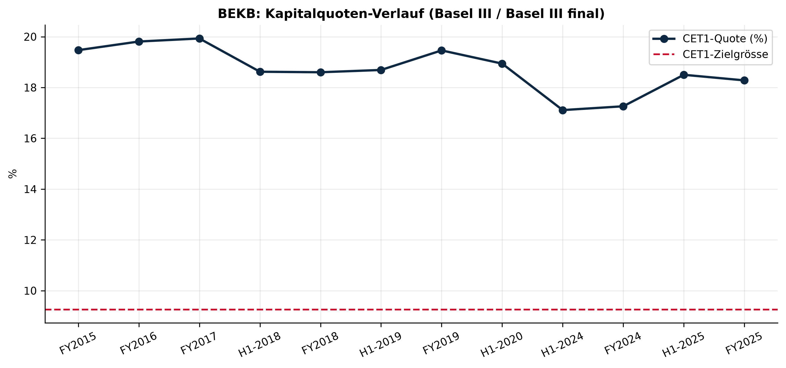

# 03 · Aufsichtsrechtliche Resilienz & Basel III: Berner Kantonalbank AG

> **FINMA-Kategorie:** Kategorie 3 | **CET1-Zielgrösse:** 9,26 % | **Gesamtkapital-Ziel:** 13,46 %

## 1. Management Summary
- Am jüngsten Offenlegungsstichtag (**H1-2026**, Regime: *Basel III final*) beträgt die **CET1-Quote – %** (Puffer über Ziel: **– Prozentpunkte**).
- Die Gesamtkapitalquote liegt bei **– %**, die Leverage Ratio bei **– %**.
- Liquiditätsquoten: LCR **– %**, NSFR **– %** (Mindestanforderung je 100 %).

## 2. Quantitative Entwicklung (20 Stichtage)
| Periode | Regime | RWA (Mio.) | CET1 (Mio.) | CET1 % | Gesamtkap. % | Leverage % | LCR % | NSFR % |
| --- | --- | --- | --- | --- | --- | --- | --- | --- |
| FY2015 | Basel III | – | – | 19,47 % | – % | 29'183'982,00 % | – % | – % |
| FY2016 | Basel III | – | – | 19,81 % | – % | 29'572'913,00 % | – % | – % |
| FY2017 | Basel III | – | – | 19,93 % | – % | – % | – % | – % |
| H1-2018 | Basel III | – | – | 18,62 % | – % | – % | – % | – % |
| FY2018 | Basel III | – | 2'489,0 | 18,60 % | 18,60 % | 7,82 % | – % | – % |
| H1-2019 | Basel III | – | 2'497,8 | 18,69 % | 18,69 % | 7,48 % | – % | – % |
| FY2019 | Basel III | – | 2'540,5 | 19,46 % | 19,46 % | 7,48 % | – % | – % |
| H1-2020 | Basel III | – | 2'540,0 | 18,94 % | 18,94 % | 7,95 % | – % | – % |
| FY2020 | Basel III | – | – | – % | – % | – % | – % | – % |
| H1-2021 | Basel III | – | – | – % | – % | – % | – % | – % |
| FY2021 | Basel III | – | – | – % | – % | – % | – % | – % |
| H1-2022 | Basel III | – | – | – % | – % | – % | – % | – % |
| FY2022 | Basel III | – | – | – % | – % | – % | – % | – % |
| H1-2023 | Basel III | – | – | – % | – % | – % | – % | – % |
| FY2023 | Basel III | – | – | – % | – % | – % | – % | – % |
| H1-2024 | Basel III | – | 2'793,6 | 17,11 % | 19,33 % | 6,81 % | – % | 152,9 % |
| FY2024 | Basel III | – | 2'875,3 | 17,26 % | 19,40 % | 6,90 % | – % | 148,8 % |
| H1-2025 | Basel III final | – | 2'896,8 | 18,50 % | 20,69 % | 6,69 % | 144,4 % | 143,0 % |
| FY2025 | Basel III final | – | 2'954,5 | 18,28 % | 20,39 % | – % | 141,9 % | 143,3 % |
| H1-2026 | Basel III final | – | – | – % | – % | – % | – % | – % |

## 3. Treiberanalyse & Wendepunkte
- Mit Inkrafttreten von **Basel III final** ab 01.01.2025 verändern sich risikogewichtete Aktiven (RWA) und RWA-Dichte durch angepasste Standard- bzw. Output-Floor-Vorgaben.

## 4. Fazit & Ausblick
- Die Eigenmittel- und Liquiditätspuffer übertreffen die regulatorischen Mindestanforderungen für FINMA-Kategorie 3 deutlich.
