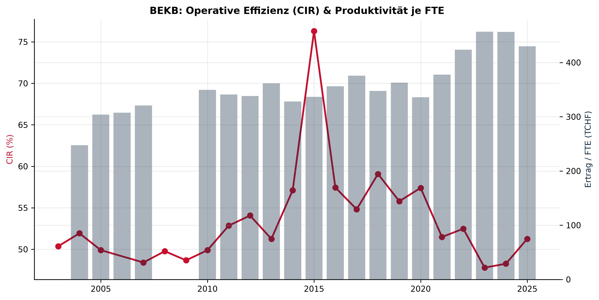

# 04 · Operative Effizienz & Transformation (2003–2025): Berner Kantonalbank AG

## 1. Management Summary
- Die Cost-Income-Ratio (CIR) liegt im Jahr 2025 bei **51,26 %** (vs. 50,36 % im Jahr 2003), die Eigenkapitalrendite (ROE) bei **– %**.
- Der Personalbestand umfasst 2025 **1'273,0 FTE** bei einem Ertrag pro Vollzeitstelle von **429,9 TCHF**.

## 2. Quantitative Entwicklung
| Jahr | CIR % | ROE % | FTE | Ertrag/FTE (TCHF) | Bilanz/FTE (Mio.) | Filialen |
| --- | --- | --- | --- | --- | --- | --- |
| 2003 | 50,36 % | – % | – | – | – | – |
| 2004 | 51,93 % | – % | 1'653,0 | 247,3 | 12,27 | – |
| 2005 | 49,90 % | – % | 1'441,0 | 303,9 | 14,38 | – |
| 2006 | – % | – % | 1'456,0 | 307,6 | 14,48 | – |
| 2007 | 48,41 % | – % | 1'457,0 | 320,7 | 14,66 | – |
| 2008 | 49,77 % | – % | – | – | – | – |
| 2009 | 48,67 % | – % | – | – | – | – |
| 2010 | 49,89 % | – % | 1'448,0 | 349,7 | 16,81 | – |
| 2011 | 52,85 % | – % | 1'465,0 | 341,0 | 17,21 | – |
| 2012 | 54,07 % | – % | 1'456,0 | 338,3 | 18,11 | – |
| 2013 | 51,26 % | – % | 1'418,0 | 361,6 | 18,80 | – |
| 2014 | 57,12 % | – % | 1'375,0 | 328,3 | 19,68 | – |
| 2015 | 76,30 % | – % | 1'313,0 | 336,8 | 21,35 | – |
| 2016 | 57,45 % | – % | 1'214,0 | 356,0 | 23,40 | – |
| 2017 | 54,82 % | – % | 1'224,0 | 375,5 | 23,94 | – |
| 2018 | 59,08 % | – % | 1'206,0 | 347,8 | 25,36 | – |
| 2019 | 55,79 % | – % | 1'226,0 | 363,0 | 26,86 | – |
| 2020 | 57,40 % | – % | 1'230,0 | 335,9 | 29,61 | – |
| 2021 | 51,48 % | – % | 1'228,0 | 377,5 | 31,75 | – |
| 2022 | 52,48 % | – % | 1'146,0 | 423,8 | 34,69 | – |
| 2023 | 47,79 % | – % | 1'165,0 | 456,9 | 34,38 | – |
| 2024 | 48,26 % | – % | 1'212,0 | 456,4 | 33,42 | – |
| 2025 | 51,26 % | – % | 1'273,0 | 429,9 | 33,76 | – |

## 3. Treiberanalyse & Wendepunkte
- **2015:** Umstellung auf FINMA-RVB sowie einmalige PK-Sanierungseinlage (83,8 Mio. CHF)
- **2025:** Inkrafttreten Basel III final per 01.01.2025

## 4. Fazit & Ausblick
- Digitalisierung und Skalierung steigern Bilanzsumme und Geschäftsvolumen pro Vollzeitstelle langfristig.
